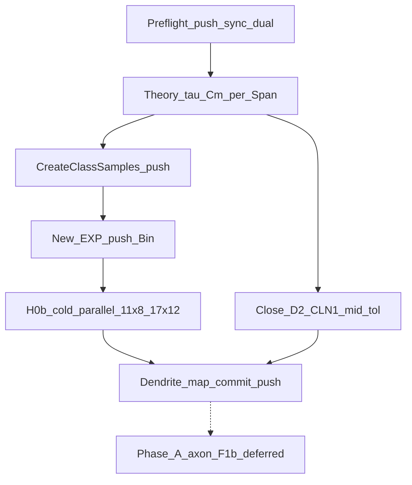

# План экспериментов фазы D (дендрит) до аксонного тренера

Канон коммита **f739d9bcc**: стратегия [STRATEGY_TAU_PER_SPAN_THEN_AXON_2026-10-23.ru.md](Docs/Audit/TimeLearner-2026-09-26-review/evidence/STRATEGY_TAU_PER_SPAN_THEN_AXON_2026-10-23.ru.md), карточка [H0_tau_cm_per_span.md](Docs/Audit/TimeLearner-2026-09-26-review/plans/AGENT_PLAN_2026-10-20/cards/H0_tau_cm_per_span.md), аудит §23.10 / этап 5a в [TIMELEARNER_AUDIT_AND_PLAN_2026-10-20.ru.md](Docs/Audit/TimeLearner-2026-09-26-review/TIMELEARNER_AUDIT_AND_PLAN_2026-10-20.ru.md). Группировка: [RESULT_GROUPING_HIERARCHY.ru.md](Docs/Audit/TimeLearner-2026-09-26-review/evidence/RESULT_GROUPING_HIERARCHY.ru.md).

**Цель фазы D:** карта возможностей и потолков чисто дендритного обучения (Classic/Branch × N0/N1) на рабочей τ через Cm по классу Span, с mods; дендритный Controller SPEC FINAL (mid / tol / CL-N1@480) без обязательного F1b.

**Вне scope до ворот D:** F1b Console/cold, новый аксонный тренер, G1 full RERUN ради stall, новый F5 cold без гипотезы.

**Неизменность исторических конфигов (обязательно):** старые стратегии, признанные неудачными, и их Train/Test **не удалять и не перезатирать**. Они остаются эталонами для демонстрации проблем подходов (единая τ, C25e12 на коротком спане, A15-повреждённые снимки до порта, и т.п.). Новые профили обучения/теста для H0 порождать **только под отдельными именами** (новые каталоги EXP / новые case_id / новые NeuronModel id), с явной ссылкой «derived from …» в манифесте или evidence — без in-place edit канонических HIST/W13/W37/W01 шаблонов.

**Dual-host + git (обязательно на всём плане):**

| Хост | Роль | Лимит Console |
|------|------|---------------|
| Локальная машина (`.11` / текущий agent host) | cold, docs, сборка | **≤ 8** процессов |
| `.17` | cold параллельно | **≤ 12** процессов |

- Исследования cold по возможности **параллелить** между `.11` и `.17` (разные Span / Trainer×Mode / Mod-полосы), не превышать лимиты.
- Синхронизация исходников **только через `origin`**: после каждого substantive шага — `commit` → `push` (PulseLib / Bin / root в нужном порядке gitlink) → на обоих хостах `git fetch` + `pull` / submodule update до одного tip SHA перед следующим cold.
- Не оставлять «только локальные» коммиты перед длинными сериями: иначе расходятся Console/конфиги между хостами.
- Evidence и DENDRITE_MAP тоже commit+push в root, чтобы оба хоста читали одну карту.

---

## 0. Preflight

- Зафиксировать tip SHA (root / Bin / PulseLib / Console); якорь `tl-baseline-20261020`.
- A15: FAIL Test 0 на tip Bin — **обязательно commit+push** Bin (`1fa1aa7c`/`7292522e` или актуальный tip) и root gitlink на `origin`; на `.17` pull до того же SHA. Починенные Test — tip; **не** стирать evidence «до ремонта».
- R8 smoke: по возможности парно на `.11` и `.17` (или один хост smoke + второй sync-check Console sha256).
- Инструменты: cable_model/C2, E1.4, E0 `--train-param`; **жёсткие** лимиты Console `.11`≤8 / `.17`≤12.
- Входы: F1a/C2, E1.0–E1.5, SPEC DRAFT, долги D2 / CL-N1 / F5 / CTRL / H0.
- Политика имён H0 (§1): HIST не переписывать; место под новые EXP свободно на обоих хостах после pull.

---

## 1. H0a — τ из теор. оценок + классы в UStorage (без правок тренеров)

### 1.1 Сразу зафиксировать τ/Cm по уже имеющимся оценкам разделимости

Не начинать со слепого sweep: взять канон аудита (таблица «Нужна FWHM / τ мембраны при идеальной задержке», F1a/C2 ideal_delay margins) и назначить **рабочую** пару (τ, Cm) на каждый Span. Rm AsymRm Pack A оставить (Exc 1e7 / Inh 1e8), менять **MembraneCapacity**, чтобы не ломать отношение синапс/мембрана.

Стартовая привязка (из аудита; уточнить Cm = τ/Rm при Rm=1e7 Exc):

| Span | Целевая FWHM | τ (теория) | Ожид. запас (ideal) | Cm при Rm=1e7 (ориентир) | Комментарий |
|------|--------------|------------|---------------------|--------------------------|-------------|
| 25 мс | ≤ 2 мс | 0.25–0.5 мс | 7–12% | 2.5e-11 … 5e-11 | Уже близко к `…C25e12` / рядом |
| 50 мс | ≤ 3 мс | ≤ 1 мс | 12–20% | ~1e-10 | Новый класс при необходимости |
| 100 мс | ≤ 6.5 мс | ≤ 2.5 мс | 11–24% | ~2.5e-10 | Близко к `…C25e11` |
| 200 мс | по кривой FWHM/span | ~5 мс | → к 25% | ~5e-10 | Новый или FastCell-сетка |
| 480 мс | по кривой | ~10 мс | ~25% | ~1e-9 | Уже `…C1e9` (legacy W10) — **не** переименовывать; для H0 либо ссылка на существующий класс, либо новый alias только если нужен отдельный tag |

Проверка H0a (короткая): cable_model/C2 на выбранных (Span,τ) — FWHM/span, feasible@MaxL, margin; отклонение от теории → одна итерация Cm, не сетка «всех Cm».

Выход: таблица `Span → τ → Cm → StorageClassName → FWHM/span → margin → feasible` + legacy-негативы read-only (C25e12 на чужом спане и т.п.).

### 1.2 Как устроены отдельные модели нейрона сейчас

Механизм уже есть в PulseLib — **не менять алгоритм тренеров**:

1. В [`NPulseLibrary::CreateClassSamples`](Libraries/Nmsdk-PulseLib/Core/NPulseLibrary.cpp) регистрируются готовые образцы через `UploadClass(name, n)` в UStorage.
2. Паттерн AsymRm / FastResponse (фрагменты ~1135–1275): `TakeObject("NPNeuron")` → `MembraneClassName` / LTZone → `Build()` → `UseElementDefaults=true` → задать `MembraneCapacity`, `SynapseDissociationTC`, Exc/Inh Rm/Rsyn → `ApplyElementDefaults()` → `UploadClass("NSPNeuronGenAsymRmD001C…", n)`.
3. В конфигах Train/Test поле **`NeuronClassName`** (и узел `<Neuron Class="…">`) указывает имя класса из хранилища, напр. `NSPNeuronGenAsymRmD001C1e9` в SelectivityAsymRm EXP — тренер Classic/Branch берёт класс как есть.

Документация паттерна: [MembraneParamsHistory.md](Libraries/Nmsdk-PulseLib/Docs/Analysis/MembraneParamsHistory.md) §CreateClassSamples.

### 1.3 Что сделать в коде/конфигах (H0 deliverable)

**A. PulseLib — новые UploadClass (отдельные имена, старые не трогать)**

- Добавить в `CreateClassSamples` семейство H0, напр. `NSPNeuronGenAsymRmTauCm_S25`, `_S50`, `_S100`, `_S200`, `_S480` (или явные `…D001C<cap>` с суффиксом `TauH0`), с Cm/τ из §1.1.
- Существующие `NSPNeuronGenAsymRmD001C25e12` / `C25e11` / `C1e9` / FastCell / Preinh* **не изменять и не удалять** — legacy + демо неудачных подходов.
- При необходимости preinh/nextseg: клоны по образцу `NSPNeuronGenPreinh2_5AsymRmD001C…` с **новыми** именами, без правки старых.
- После регистрации — **commit+push PulseLib** на `origin` → rebuild Console на `.11` и `.17` с одного tip; R8 smoke dual-host.

**B. Bin — новые EXP Train/Test (отдельные деревья)**

- Копировать шаблон SelectivityAsymRm / Branch EXP в `SelectivityTauCm/<StorageClassName>_{gen|preinh|nextseg}/{Train,Test}` (или эквивалент).
- В XML выставить `NeuronClassName` / `Class=` на **новый** Storage-класс; топологию/паттерны/TrainerClassName оставить как в шаблоне.
- HIST / W13 / W37 / канонические W01 inputs **не** патчить. Matrix: новые case_id при включении в очередь; attempt-local только для PostTune/train-param.
- **Commit+push Bin** на `origin` → bump root gitlink → push root → pull на `.11` и `.17` перед cold.

**C. Тренеры**

- **Ноль** изменений Classic/Branch ради H0: другой класс нейрона задаётся только конфигом из UStorage.

Ворота H0a: теор. таблица → StorageClassName map задокументирована; новые классы в CreateClassSamples **на origin**; новые EXP на origin; legacy на месте; progress `DEBT-H0-tau-cm` закоммичен.

---

## 2. H0b — cold dual-host (E1.8)

На каждом (Span, **новый** StorageClassName / EXP):

- Trainer×Mode: Classic×N0, Classic×N1, Branch×N0, Branch×N1
- Mod ядро: gen, preinh, nextseg (через NeuronClassName / MembraneClassName preinh-клоны из UStorage, не правкой тренера)
- Mod доп.: PSI on/off только Classic×N1 после ядра
- PostTune ON/OFF attempt-local (не патчить matrix.json)
- ≥1 cold на ячейку; PASS-кандидаты — PASS×3 на том же SHA

**Параллель хостов (обязательно использовать оба):**

- `.11`: до **8** одновременных NeuroModelerConsole; типично полосы Classic×N0/N1 или короткие Span.
- `.17`: до **12** Console; типично Branch×N0/N1 или длинные Span / PASS×3.
- Перед стартом серии: оба хоста на одном tip (root+Bin+PulseLib+Console sha256 зафиксировать в RUN evidence).
- Не гонять одну и ту же case_id на двух хостах без нужды (дубли); реплики PASS×3 — разные RUN_ID, один SHA.
- После пачки результатов: сводка в evidence → **commit+push root** → оба хоста pull перед следующей волной.

Отчёт по иерархии Trainer×Mode → Span → NeuronModel(StorageClass) → Mod; колонки PostTune; Host; ссылки Train и Test; Need / fires / Acc / Цель / sep_margin / exit-класс H2.

Порядок Span: от лучшего теор. запаса (100–200), затем 50, 25, затем 480 (480 можно отдать `.17` при занятости `.11`).

Ворота H0b: ядро mods без дыр на **обоих** хостах учтено в сводке; расхождения с E1.4 разобраны; R8 не молча сломан; evidence на origin.

---

## 3. Параллельно: дендритные долги (к воротам D)

### 3.1 Silent-Test (DEBT-D2)

Need=0 + silent Test = `quality_fail` (SPEC DRAFT §4). Выбрать production mid A–D (§6.1). Не KeepDone cold как sole-fix.

### 3.2 Classic×N1 @480 (DEBT-CL-N1)

Stall 480-specific (H1 Span100). В FINAL принять `bounded_stall_rmax` / `maxl_hold`; W3 diagnostic opt-in. На H0b@480: согласованная τ(Cm) → если не Done при MaxL — потолок карты, не mid-flight axon.

### 3.3 Controller SPEC FINAL (DEBT-CTRL-V2-DRAFT)

Блокеры дендритного FINAL: mid A–D; числовые tol (E1.5: остров ~1–2%, не съедать margin, survive L±1/TipR±25%); CL-N1@480 policy. Артефакт `CONTROLLER_V2_SPEC_FINAL_*.ru.md`. C++ v2 — после FINAL с R8 A/B.

### 3.4 F* только если мешает H0

F5: без нового cold; в карте «A7 midband noop». F2/F4/F7 с agent PulseLib — портировать лишь если H0a/H0b нельзя честно читать без них; иначе после FINAL. EstDelayPerSeg привязать к τ(Cm) профиля при фиксации NeuronModel.

---

## 4. Ворота D — карта дендрита

Артефакт: `Docs/Audit/TimeLearner-2026-09-26-review/evidence/DENDRITE_MAP_TAU_CM_<date>.ru.md` (+ TSV).

Содержание: таблица H0a; сводная H0b; раздел «потолок дендрита» (где MaxL/FWHM/silent/stall без смены носителя задержки); раздел **legacy vs H0** (старые неудачные конфиги read-only + новые имена); R8/baseline; статус DEBT-H0 и SPEC FINAL; явная отсылка что потолки — вход в фазу A.

Критерий закрытия исследования дендрита: карта **закоммичена и запушена на origin**; оба хоста могут `pull` одну версию; senior подтверждает, что дальше на недоступных Span нужен новый носитель задержки, а не ещё одна единая τ. Legacy-конфиги на месте для демонстрации.

---

## 5. Отложенная фаза A (не исполнять здесь)

Сохранить связь, cold не стартовать до ворот D:

- [STRATEGY §3](Docs/Audit/TimeLearner-2026-09-26-review/evidence/STRATEGY_TAU_PER_SPAN_THEN_AXON_2026-10-23.ru.md) — норматив аксонного тренера
- [F1_fast_epsp_pilot.md](Docs/Audit/TimeLearner-2026-09-26-review/plans/AGENT_PLAN_2026-10-20/cards/F1_fast_epsp_pilot.md) — F1b checklist
- [F1B_EXPLAINER_AND_STATUS_2026-10-23.ru.md](Docs/Audit/TimeLearner-2026-09-26-review/evidence/F1B_EXPLAINER_AND_STATUS_2026-10-23.ru.md) — N0/N1 vs рост аксонов источников
- аудит E1.6 / этап 6; `DEBT-F1b` OPEN

Будущий шаг: отдельный тренер; обучение ростом сегментов аксонов нейронов-источников; пилот verify-first (L=1, быстрый τ, NAxoneDelay), затем train-loop; не merge в Classic/Branch без fork.

---

## 6. Порядок

1. Commit+push A15/docs → sync `.11`+`.17` → preflight R8
2. τ/Cm из теор. таблицы (§1.1)
3. UploadClass в CreateClassSamples → commit+push PulseLib → rebuild оба хоста (§1.3A)
4. Новые EXP → commit+push Bin+root gitlink → pull оба (§1.3B)
5. H0b cold **параллельно** `.11`≤8 и `.17`≤12; промежуточные evidence commit+push
6. mid/tol/CL-N1 → SPEC FINAL → commit+push
7. DENDRITE_MAP + ворота D → commit+push
8. Только после D — фаза A (вне плана)

Запреты: F1b вместо H0; единый NeuronClass на все Span; патч/удаление/overwrite существующих UploadClass и HIST/неудачных EXP; правки Classic/Branch ради H0; патч канонических inputs ради PostTune; cold на рассинхроне tip между хостами; превышение 8/12 Console; долгоживущие unpushed коммиты перед серией; G1 full RERUN / multifactor Span100 ради train-stall.
