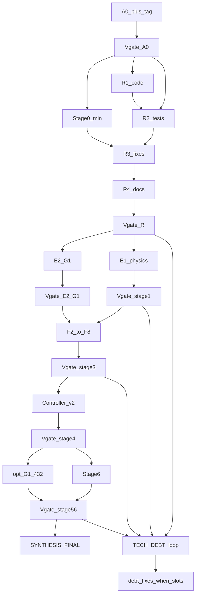

> **Архив в git (2026-10-23).** Verbatim-копия Cursor-плана `~/.cursor/plans/timelearner_agent_plan_1d9a3d4d.plan.md`. Индекс связей с аудитом: [`CURSOR_PLAN_INDEX.ru.md`](CURSOR_PLAN_INDEX.ru.md). Исходный аудит: [`../TIMELEARNER_AUDIT_AND_PLAN_2026-10-20.ru.md`](../TIMELEARNER_AUDIT_AND_PLAN_2026-10-20.ru.md). Пакет карточек: [`AGENT_PLAN_2026-10-20/`](AGENT_PLAN_2026-10-20/). Стратегия 23.10 (τ per Span → аксоны F1b): [`../evidence/STRATEGY_TAU_PER_SPAN_THEN_AXON_2026-10-23.ru.md`](../evidence/STRATEGY_TAU_PER_SPAN_THEN_AXON_2026-10-23.ru.md). Ниже — исходный текст плана без сокращений тела.

# План реализации TimeLearner (перепроверен 20.10.2026)

Using **writing-plans** + **structtrain-experiments**. Источники: [TIMELEARNER_AUDIT_AND_PLAN_2026-10-20.ru.md](Docs/Audit/TimeLearner-2026-09-26-review/TIMELEARNER_AUDIT_AND_PLAN_2026-10-20.ru.md), [AGENT_PLAN_2026-10-20](Docs/Audit/TimeLearner-2026-09-26-review/plans/AGENT_PLAN_2026-10-20/), коммит `c0d19a90` (+ follow-up `ce6fd020` «Add full review»).

## Что было упущено (сверка → внесено)

Перепроверка аудита + всех карточек A0–G1 + Sources показала пробелы в прежней редакции плана. **Внесено ниже:**

| Пробел | Куда в плане |
|---|---|
| Тег `tl-baseline-20261020` | A0 |
| Done: measured delay residue, amp/target, exact vs BE; verify в recognition-config | Этап 0 |
| Mid на calib foil ≠ Test; второй Test ±2% jitter; margin `(tgt−max foil)/tgt` в каждом отчёте | Этап 0 |
| Wiring preflight на **каждый** запуск; R8 на **каждый** trainer-commit | Этап 0 / R3 gate |
| D1 без **EXP04 PSI k=2.5**; без явных `AutoScaleIterationGap` / PostTune=0 / Norm=1 | R2 |
| Абляции midband-off, Rmin=20 (не из Rm), Reset every pack | R2 D2-ext |
| E1.0–E1.5 полностью (не только C1); F1b acceptance | Физика |
| F2–F8 со спекой и воротами (не одной строкой); Done_BE | fixes-f2-f8 |
| A9 (Branch train mute vs recognize), A11 (CanonRmin / mid на Test) | R1 + OPEN/fix |
| Controller v2: 5 шагов + ворота ≥90% | controller-stage6 |
| Этап 6: foil curve, axons≥200, margin-train, jitter ±1/2/5% | controller-stage6 |
| G1: канон **24–32** (карточка B), опц. расширение к **432** (аудит A) | e2-g1 |
| R4 неполный список docs из Sources + M0/M1/HISTORICAL/PHASE7/CAMPAIGN | R4 |
| Открытые вопросы аудита (Reset 10%, δ/γ@480, N0>50, 8-pat vs margin curve) | checklist в физике / SYNTHESIS |

**Осознанные overrides карточек AGENT_PLAN** (по решению кампании): нет human-gate на G1; при DEVIATION — ветки, не STOP всего; A1 fail → `BASELINE_DEGRADED` + продолжение помеченных рукавов. В отчётах: `human_gate_bypassed: true`. Инфра-STOP (диск/build/fingerprint) сохраняются.

**Напряжение порядка:** аудит «сначала физика, потом фиксы» vs приоритет «сначала регрессии». Компромисс: **R** чинит только CONFIRMED regressions/contaminations; параллельно поднимается **минимальный этап 0** (margin+residues+R8) для честных verify; полная E1.1–E1.5 — **до** Controller и полной G1-432.

Baseline: root `03c8cb9`, Bin `e7509263`, PulseLib `d52dc1c`, Rdk `b3b2472`; `.11`≤8 / `.17`≤12.

## Граф

---

## Верификация этапа (V-gate) — обязательно после каждого этапа

После завершения работ этапа **до** старта зависимого следующего шага оркестратор автоматически пишет:

`$REPORTS/Vgates/V_<stage_id>_<UTC>.md` + строку в `$REPORTS/Vgates/STAGE_COMPLIANCE.tsv`.

### Источники сверки (все три)

1. **Аудит** — чеклист соответствующего этапа 0–6 и таблица дефектов A1–A16 в [TIMELEARNER_AUDIT_AND_PLAN_2026-10-20.ru.md](Docs/Audit/TimeLearner-2026-09-26-review/TIMELEARNER_AUDIT_AND_PLAN_2026-10-20.ru.md).
2. **Карточки AGENT_PLAN** — «Ожидаемо» / «Готово, когда» / STOP-условия из [cards/](Docs/Audit/TimeLearner-2026-09-26-review/plans/AGENT_PLAN_2026-10-20/cards/) + [00_RULES](Docs/Audit/TimeLearner-2026-09-26-review/plans/AGENT_PLAN_2026-10-20/00_RULES.md) / [README](Docs/Audit/TimeLearner-2026-09-26-review/plans/AGENT_PLAN_2026-10-20/README.md) (с учётом override human-gate).
3. **Сопроводительные docs** этапа — STATUS, ledger, evidence-файлы, на которые ссылается этап; для R4 — полный список Sources.

### Формат STAGE_COMPLIANCE.tsv (колонки)

`stage_id | audit_item | card_id | companion_doc | status | evidence_path | debt_id`

`status`: `DONE` | `PARTIAL` | `SKIP_OVERRIDE` | `BLOCKED` | `DEFERRED_DEBT`.

### Правила автопродолжения после V-gate

- Все **критичные** пункты этапа `DONE` (или `SKIP_OVERRIDE` с записью) → сразу следующий этап.
- Есть `PARTIAL`/`BLOCKED` по критичному пункту → завести/обновить **TECH_DEBT**, пометить `DEFERRED_DEBT` или запустить **параллельный рукав доработки**; **не** останавливать независимые этапы.
- Критичность: ворота аудита этапа (R8×3, pred≥5/6, PASS×3, Classic N1 Done, Controller 90%) и CONFIRMED regressions без фикса = P0.

### Карта stage_id → источники

| stage_id | Аудит | Карточки | Сопр. (минимум) |
|---|---|---|---|
| `A0` | baseline SHA | A0 | provenance |
| `R` | A15/CL-N1/… confirm+fix | A2,A3,B1,B2,D1,D2,E0,E1,E2 | LEDGER черновик |
| `S0` | этап 0 checklist | tools summarize/wiring | DETECTION_GATE поля отчёта |
| `S1` | E1.0–E1.5 ворота | C1,C2,F1 | cable_model, margin_model |
| `S2` | бисекция/абляции | D1,D2,D2b | — |
| `S3` | F1–F8 ворота | E1 flags + R8 | PulseLib Components при API change |
| `E2G1` | R8 + карта границ (24–32) | E2,G1 | RESULT_GROUPING, C2 sweep |
| `S4` | Controller v2 | — | ALGORITHM_UNDERSTANDING |
| `S5` | опц. 432 | G1 expand | CLASSIC/M1 maps |
| `S6` | этап 6 пункты | F1b follow-on | — |
| `FINAL` | весь чеклист 0–6 + A1–A16 | все cards | полный Sources + LEDGER |

---

## Техдолг — ведение и доработки

**Канон:** `Docs/Audit/TimeLearner-2026-09-26-review/evidence/TECH_DEBT_TIMELEARNER_2026-10-20.ru.md`
(+ машинный `$REPORTS/TECH_DEBT.tsv` для оркестратора).

Заводится в конце **R4** (или раньше при первом `PARTIAL`). Обновляется **при каждом V-gate**.

### Поля записи долга

`debt_id | opened_utc | stage_id | source (audit|card|companion) | item_ref | priority (P0/P1/P2) | blocker_for | status (open|in_progress|done|wontfix) | owner_arm | notes | closed_utc | fix_run_id`

### Политика доработок (без human-gate)

1. После V-gate: все **P0**, не блокирующие чужой критический путь, стартуют **сразу** отдельным рукавом (`DEBT-<id>-…`), если есть слоты Console/CPU.
2. **P1** — в очередь после текущего этапа или в параллель на свободном хосте.
3. **P2** — копятся до SYNTHESIS_FINAL; закрываются, если остаётся машинное время.
4. Невозможность (нет слотов / нужен redesign) → `status=open`, `blocker_for=<stage>`, продолжить план; в FINAL — явный список остатка.
5. Закрытие долга: evidence + повторный мини-V-gate только по `item_ref` + строка в LEDGER при влиянии на исторические метрики.

Примеры кандидатов в долг из уже известных gaps: EXP04 не в D1 до R2-ext; G1-432 vs 24–32; F1b_BLOCKED; A9/A11 OPEN; midband ablation недоступна без патча; human_gate_bypassed items требующие senior-design.
---

## A0

Как [01_A0_ENV_SETUP.md](Docs/Audit/TimeLearner-2026-09-26-review/plans/AGENT_PLAN_2026-10-20/01_A0_ENV_SETUP.md) шаги 1–8 + **`git tag tl-baseline-20261020`** на трёх SHA (локально; push тега — человек). Auto → R1∥R2∥Stage0-min.

---

## Фаза R — регрессии

### R1 код-confirm → `$REPORTS/R1_*/CODE_CONFIRM.md`

| ID | Вердикты |
|---|---|
| CL-N1, A15, H-A15b, EstDelay, A16 | CONFIRMED / NOT / CONTAMINATES |
| A1,A2,A3,A5,A6,A7,A8,A10,A14 | то же |
| **A4, A9, A11, A12, A13** | обязательно в R1 (раньше упускались); A9/A11 — high |
| ok_audit_v2 | `ruler_change`, не regression |

### R2 тесты

- Unit: B1 hygiene 6/6 + негатив 3 FAIL; E0 overlay; E1 gtest×3; A2_MATCH 45.
- **D1** на `.11`: W02_CL480_N1 + W01_CL50_N1 + **EXP04 PSI k=2.5** (cold/config из аудита); флаги `AutoScaleIterationGap`, `EnablePostTrainTuning=0`, `NormalizationMode=1`, одинаковый `-t`.
- **D2 + D2-ext:** EstDelay=0.01, gamma fixed, **и** (a) Rmin=20 МОм без Rm/q, (b) midband walk off, (e) Reset before each pack; D2b: RminLengthTolFactor=1, UseSignedDelay, FreezeBase, EstDelayPerSegInit.
- A3 + E2 S0↔S1; A1 PASS×3 ctrl на `.17`.
- Вердикт: `R2_REGRESSION_VERDICT.json`.

### R3 фиксы только CONFIRMED

Таблица B1/B2/CL-N1/EstDelay/A16 как раньше + при confirm A9/A11 — отдельные коммиты. После каждого trainer-commit: **R8 ×3** (ворота merge). Auto → R4.

### R4 документация + ledger

Новый: `evidence/REGRESSION_AND_CONTAMINATION_LEDGER_2026-10-20.ru.md`.

**Обязательный sweep (полный список Sources + смежные):**

- STATUS, TIMELEARNER_AUDIT_AND_PLAN_2026-10-20, TIMELEARNER_EXPERIMENT_RUNBOOK, RESULT_GROUPING_HIERARCHY
- ALGORITHM_UNDERSTANDING_AND_NEXT_PLAN_2026-10-18, INVESTIGATION_HISTORY_AND_MODE_COMPARISON_2026-10-14
- POST_P0_SYNTHESIS_AND_NEXT_CYCLE_2026-10-19, POST_P0_MATRIX_EXPAND_AND_NEXT_PLAN_2026-10-18
- INTERIM_ANALYSIS_AND_NEXT_RESEARCH_PLAN_2026-10-17, DETECTION_GATE_HISTORICAL_AUDIT_2026-10-17, RS_DROP_AND_MIN_RATIO_INVESTIGATION_2026-10-13
- RE_AUDIT_CURRENT_STATE_2026-10-17, HISTORICAL_CONVERGENCE_INVESTIGATION_2026-10-11/12, HISTORICAL_CONFIG_COVERAGE_2026-10-10
- evidence: POSTTUNE_FIX_COLD_SUMMARY, POSTTUNE_ALGORITHM_AUDIT, CLASSIC_BOUNDARY_MAP, M0A/M0B/M0C, M1_BOUNDARY_MAP, DUALHOST_ASSIGNMENT_POSTTUNE_FIX, EXPERIMENT_AXIS_COVERAGE_GAPS
- Bin: CAMPAIGN_REPORT_2026-08_09, PHASE7_BRANCH_QUALITY, EXPERIMENTS.md / SUCCESSFUL_EXPERIMENTS.md (строки contamination)
- При изменении API тренера: PulseLib `Docs/Components/NNeuronTimeLearner*.md`

Правила invalidate/reinterpret/ruler_change — как в прежней R4. Finding README #5 (τ=0.25 W13/W37 infeasible) → ledger.

Далее: **V-gate `R`** → создать/обновить `TECH_DEBT_TIMELEARNER_2026-10-20.ru.md` → auto этап 0 / физика / E2.

---

## Этап 0 (min параллельно R; full до физики/G1-432)

1. Поля отчёта: residue delay, amp/target, sync/amp exit code exact|BE, **margin**.
2. Verify-проход recognition (все входы; по одному mute).
3. Calib foil set ≠ Test; второй Test jitter ±2% span.
4. Preflight `check_model_wiring` перед queue case.
5. EstDelay↔τ + cable_model прогноз sync рядом с выбранными L в summary.
6. Ворота: R8 baseline ×3 стабилен + отчёт с residual/margin.
7. **V-gate `S0`** по чеклисту этапа 0 аудита → долг при PARTIAL.

---

## Физика (после V-gate R; `.11`)

| ID | Содержание |
|---|---|
| E1.0 / C1 | Console vs cable; tol: пик/FWHM ≤10%, t_peak ≤5% (карточка C1); для E1.0 L∈{1,4,10,25,50} дополнительно зафиксировать |
| E1.1 | Библиотека ядер: модели × L=1…100 × Rs 8-log × N∈{1…128}, Reset, ±NextSegInh/PSI |
| E1.2 | 20 Reset / 20 no-Reset → 3σ |
| E1.3 | Релаксация (открытый вопрос 10%) |
| E1.4 | Предсказатель на **измеренных** ядрах; 3 PASS + 3 FAIL; ворота ≥5/6 |
| E1.5 | Fragility EXP_br480_tiprmin + br25_nextseg: L±1, TipR×0.8/1.25 |
| F1a | Offline ideal_delay (после C2) |
| F1b | Console L=1+NAxoneDelay span 25/50; margin≥0.08/0.15; fires `10000000` ×3; при блокере → `F1b_BLOCKED` ветка |

Открытые вопросы аудита закрывать артефактами E1.3 / cable@480 / N0>50 / критерий 8-pat vs margin-curve (решение в SYNTHESIS, без паузы исполнения).

**V-gate `S1`** (pred≥5/6 + карта Span×Model); незакрытое → TECH_DEBT P0/P1 + параллельный DEBT-рукав при слотах.

---

## F2–F8 (после min Stage0 + R; полный acceptance)

Каждый — коммит+флаг+R8 A/B. Порядок risk↑:

- **F1/F7/F8** — уже E1 switches; включить семантику F7→Done_BE only.
- **F2** (A1/A10): measured delay; Done vs Done_BE.
- **F3** (A5): Reset every pack (или never+E1.3 pause).
- **F4** (A4): относительные eps/band/gap.
- **F5** (A7): γ corrected / from E1.1.
- **F6** (A6/A8): no midband→Rmin; Rmin=max(XML, floor).

Ворота этапа 3 аудита: PASS×3 удержан; margin R8 не хуже >2 п.п.; Classic N1 `converged_*` или честный Done_BE/infeasible.

A9/A11: fix в этой фазе если CONFIRMED, иначе OPEN с критерием до Controller mid-without-CanonRmin.

---

## Кампания E2 / G1 / Controller / этап 6

- **E2** R8 S0/S1/S2 ×3; DIFFERENT → параллельные рукава D2b/G1 (не STOP).
- **G1 канон = 24–32** cases (`select_cases.py`, PSI-off, exclude dirty unless repaired), ×3, dual-host, auto после машинных предикатов; сравнить с C2 `m_oracle`.
- **Опционально после Controller:** матрица аудита 432 (Trainer×Mode×Span{25,50,100,**200**}×Model×Mod ×3 × v1/v2).
- **ControllerVersion=2:** (1) bracket L* (2) log-Rs / N → общая A* (3) fine delay (4) verify (5) mid на calib без CanonRmin; ворота ≥90% exact Done в feasible zone.
- **Этап 6:** foil 2/3-coincidence curve; regenerative axons span≥200; train-on-margin; jitter ±1/2/5%.
- Между подэтапами — V-gate `S1`/`E2G1`/`S3`/`S4`/`S5`/`S6`; **SYNTHESIS_FINAL** = V-gate `FINAL` + снимок TECH_DEBT (open/done) + ledger retest.

---

## Dual-host

- `.11`: D1, C1/E1.*, Stage0 builds, доля G1/D2, **DEBT-фикс рукава** (≤8).
- `.17`: A1, B2, E2, D2b, доля G1, **DEBT-фикс рукава** (≤12).
- `BRANCH_MATRIX.tsv` + `ASSIGNMENTS.tsv` + `STAGE_COMPLIANCE.tsv` + `TECH_DEBT.tsv`; templates REPORT/result.schema.

## Источники

Аудит этапы 0–6 + A1–A16; пакет `c0d19a90`; runbook; скилл structtrain-experiments; канон долга — [`evidence/TECH_DEBT_TIMELEARNER_2026-10-20.ru.md`](Docs/Audit/TimeLearner-2026-09-26-review/evidence/TECH_DEBT_TIMELEARNER_2026-10-20.ru.md) (создаётся в R4).
