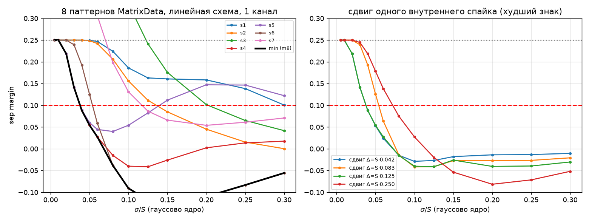
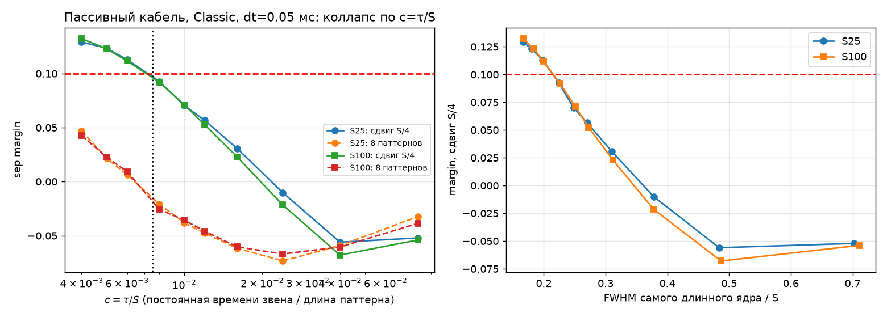
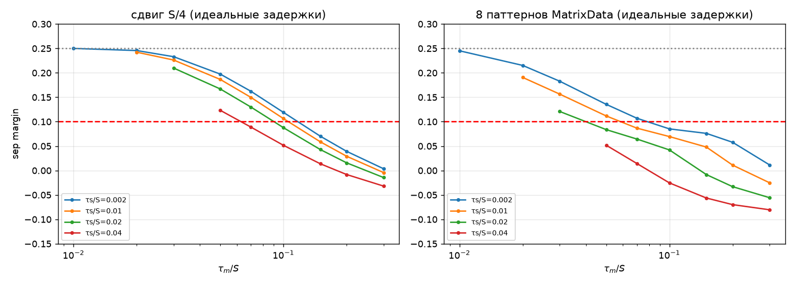
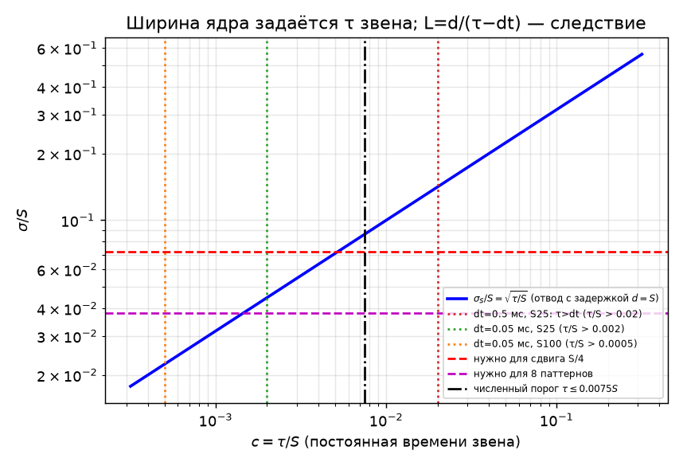
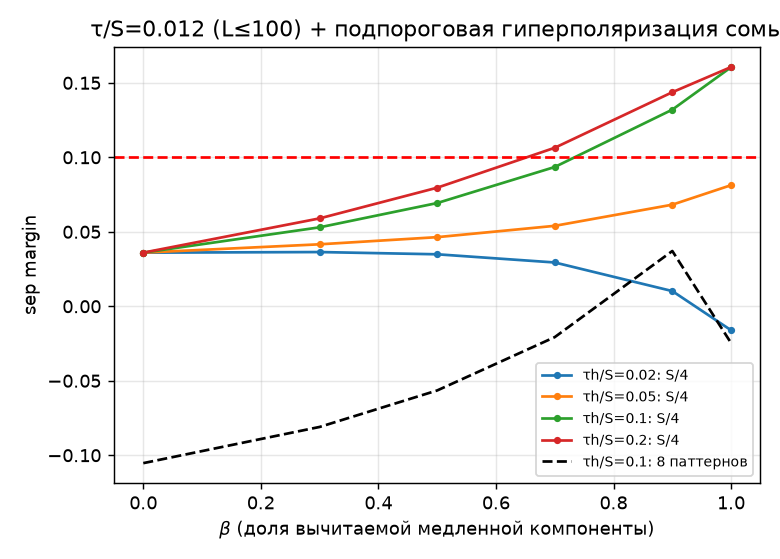
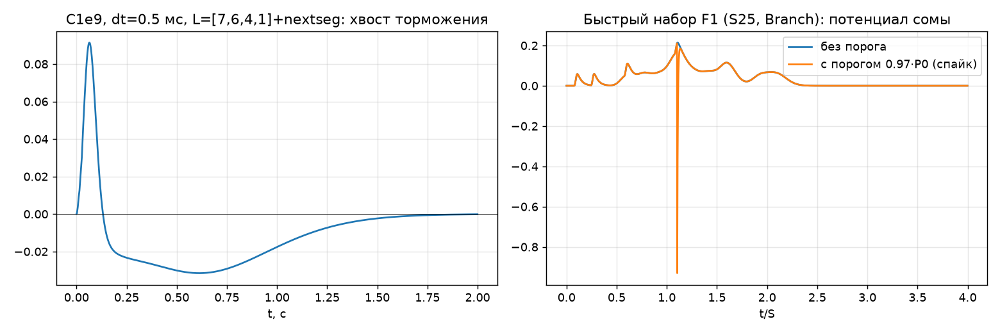

# Форма сигнала сегментного нейрона для распознавания внутри одного предъявления (одноканальная постановка)

Дата: 24.10.2026 (МСК, UTC+3). Модели и прогоны выполнены вне стендов, NMSDK на .11 и .17 не запускался.
Код лежит в `sim/` (segsim.c, model.py, evalset.py, klib.py, theory1.py, theory2.py, run_*.py, figs.py), данные — в `data/*.json` и `data/*.npy`. Рисунки строит `sim/figs.py`.

## 0. Исправления по замечаниям Тима (24.10.2026)
1. **Шаг интегрирования, а не «частота».** В первой версии величина $f$ ошибочно называлась частотой («2000/20000 Гц»). На самом деле это число шагов в секунду, параметр `DefaultTimeStep`. Теперь везде используется шаг интегрирования $dt=1/\text{DefaultTimeStep}$:
   * Console считает с $dt=0.5$ мс (DefaultTimeStep = 2000);
   * в `library.py` заложено $dt=0.05$ мс;
   * для S25 необходимо $dt\lesssim0.19$ мс, рекомендуется $0.05$ мс (DefaultTimeStep 20000).

   С частотой генерации импульсов (длительность импульса около 1 мс, частота до 500 Гц) это не связано. Причина ограничения в том, что каждый шаг дискретной схемы вносит численное размытие порядка $dt$ в каждое звено задержки (§3), отсюда нижняя граница $\sigma/S\ge\sqrt{dt/S}$.
2. **Первична постоянная времени звена $\tau$, число сегментов $L$ — следствие.** Цепочка должна дать задержку $d\sim S$, при этом $d=L(\tau-dt)\approx L\tau$ и $\sigma^2=d\,\tau$. При заданной задержке ширина $\sigma=\sqrt{d\tau}$ зависит только от $\tau$.
   * Условие формулируется так: $\tau\lesssim0.0075\,S$ (≈0.19 мс для S25) и $dt\ll\tau$.
   * Число звеньев $L=d/(\tau-dt)\approx145$–$200$ — лишь следствие, то есть требование к `MaxDendriteLength`.
   * Длинная цепь сама по себе не размывает: размывает большая задержка, набранная медленными звеньями.
   * Сейчас звенья медленные: $\tau=RC=10$ мс, поэтому L=[13,11,7,1] даёт задержки ~120/60 мс вместо 25/12.5 мс, отсюда и размытие.

   Числа и выводы первой версии от этого не меняются: изменились формулировки, оси и подписи рисунков (fig2, fig4, fig5, fig6), имена файлов данных (`dt…ms` вместо `f…`).

Постановка. Все дендриты получают один и тот же входной канал. Паттерн состоит из $N=4$ спайков с ISI из MatrixData, длина $S\in\{25,50,100\}$ мс, плюс 7 ложных паттернов.
Критерий: цель детектируется, $m=\min_f (P_0-P_f)/P_0\ge 0.1$ для ложных паттернов, у которых внутренний спайк сдвинут на $\ge S/4$.
Пометки: **[строго]** — выведено аналитически; **[числ.]** — получено численно в упрощённой модели; **[гипотеза]** — требует проверки в NMSDK.

## 1. Упрощённая модель (сверена с NMSDK)
Звено канала (Гаусс–Зейдель, от дистального конца к проксимальному), где $dt$ — шаг интегрирования, $\tau=RC$:
$$V_i \mathrel{+}= \frac{dt}{\tau}\big(V_{i+1}+I_i - V_i(1+G_iR)\big).$$
Синапс: $p\mathrel{+}=(1-p)\,dt/t_s$ во время импульса, иначе $p\mathrel{-}=p\,dt/t_d$, $G=p/R_s$. Сома: $P=V_e+V_i$, при $P\ge\theta$ включается обратная связь $\times 2$ с $R\to$FBR.
Импульсная характеристика одного звена: $h[m]=a(1-a)^m$, $a=dt/\tau$ (требуется $dt<\tau$). Отсюда
$$\delta\equiv\mu_1=\tau-dt,\qquad \sigma_1^2=\tau(\tau-dt).$$
Верификация: при $dt=0.5$ мс, C1e9, $R_s=8.6\cdot10^7$, $L=1$ пик равен 0.0157814, это ровно `InitialSomaPotential` W04. Значит, **Console считает с $dt=0.5$ мс**. В `library.py` заложено $dt=0.05$ мс, что не соответствует Console.
Хвост торможения модели (C1e9, InhRm=1e8, nextseg, L=[7,6,4,1]): −0.030 при 0.5 с и −0.0023 при 1.5 с, в Console −0.039 и −0.003. Пик цели 0.091–0.097, в Console около 0.10.

## 2. Линейный потолок [строго]
При неотрицательных ядрах и одном канале отклик равен $y_p(t)=\sum_k w_k\sum_j h_k(t-t_j)$. Каждый отвод видит все спайки. Ложный паттерн, полученный удалением одного спайка цели, даёт
$$m\le \min_k c_k/y\le 1/N=25\%.$$
Ложные s1, s2, s4–s6 совпадают с целью по 3 из 4 спайков, поэтому для них $m\lesssim0.25$ при любых ядрах. Знакопеременные ядра этот предел для удалённых спайков не обходят, но на сдвиговых ложных паттернах могут дать больше 0.25 (§5).

## 3. Дисперсионная граница: первична постоянная времени звена [строго]
Отвод должен дать задержку $d$ (самый длинный $d\approx S$). Цепь из $L$ звеньев даёт $d=L\delta=L(\tau-dt)$, а дисперсии звеньев складываются:
$$\sigma_d^2=L\,\tau(\tau-dt)=d\,\tau\quad\Longrightarrow\quad \left(\frac{\sigma_S}{S}\right)^2=\frac{\tau}{S}\equiv c .$$
**При заданной задержке ширина ядра зависит только от $\tau$.** Первичный безразмерный параметр — $c=\tau/S$. Второй — $s=\sigma_{syn}/S$ (ширина синаптического импульса), выгодно $s\lesssim0.02$.

Роль шага $dt$. В терминах фактической задержки звена $\delta=\tau-dt$ имеем $\sigma^2=d(\delta+dt)$: слагаемое $d\cdot dt$ — численное размытие схемы, порядка $dt$ на каждое звено. Эквивалентная форма: $\tau>dt$, поэтому
$$c=\frac{\delta}{S}+\frac{dt}{S}\ \ \Rightarrow\ \ \frac{\sigma_S}{S}\ge\sqrt{\frac{dt}{S}} .$$
Число звеньев — следствие: $L=d/(\tau-dt)=S/(\tau-dt)$, то есть $\tau/S=1/L+dt/S$. Это та же формула, что в первой версии ($c=dt/S+1/L$), но прочитанная в правильную сторону.
Требование к `MaxDendriteLength`: $L_{\max}\ge S/(\tau-dt)$. Это **не** источник размытия.

Гауссова теория (theory1, fig1) [числ.]: $m\ge0.1$ требует $\sigma/S\le0.072$ для сдвига $S/4$ и $\sigma/S\le0.038$ для набора из 8 (критичны ложные с почти совпадениями $S/12$ и $S/24$). Реальное ядро каскада асимметрично (гамма-форма), поэтому численный порог чуть мягче: $c\le0.0075$, то есть $\sigma/S\le0.087$ (§4).

Следствия [строго + числ.] (fig4):
* **Требование к звену: $\tau\lesssim0.0075\,S$** (S25: ≈0.19 мс; S50: 0.375 мс; S100: 0.75 мс) **и $dt\ll\tau$**. Строго необходимо $dt<\tau$, отсюда для S25 $dt<0.19$ мс. При $dt\to\tau$ задержка звена $\delta\to0$ и $L\to\infty$, поэтому практически нужно $dt\lesssim\tau/3$, то есть рекомендуется $dt=0.05$ мс (DefaultTimeStep 20000).
* Console с $dt=0.5$ мс для S25 даёт $\sigma/S\ge\sqrt{0.02}=0.14$ при **любой** $\tau$ и любой длине, то есть критерий недостижим. Для S100 граница $\sqrt{0.005}=0.071$ лежит на самом пределе.
* Если ограничить длину $L\le100$ при $d=S$, то это вынуждает $\tau\ge S/100+dt$, то есть $c\ge0.01+dt/S$ и $\sigma/S\ge0.1$. Медленные звенья, а не длина, делают критерий S/4 недостижимым.
* Набор из 8 пассивно недостижим: нужно $c\lesssim0.0015$ (S25: $\tau\approx0.04$ мс, что требует $dt\ll0.04$ мс и $L\sim10^3$) и $s\le0.025$.
* **Текущее состояние.** $\tau=RC=10^7\cdot10^{-9}=10$ мс, то есть $c=0.4$ для S25. Задержка звена $\delta=9.5$ мс, поэтому обученные L=[13,11,7,1] и [7,6,4,1] дают задержки около 120 и 60 мс вместо нужных 25/20.8/12.5 мс. Даже при правильной задержке $d=S$ было бы $\sigma=\sqrt{25\cdot10}\approx16$ мс $=0.63S$; при $d=120$ мс $\sigma\approx35$ мс. Все 8 откликов совпадают в пределах ±2%, $m_8\approx-0.03$ (data/run_base.json). Это согласуется с выводом об артефакте порядка nextseg.

## 4. Порог по $c=\tau/S$, коллапс S25/S100 [числ.] (fig2, data/run_collapse.json, data/run_fast.json)
Classic (отдельные дендриты от одного генератора), $dt=0.05$ мс, синхронизированные L, амплитуды выровнены через $R_s$:

| $c=\tau/S$ | 0.004 | 0.005 | 0.006 | 0.008 | 0.010 | 0.012 | 0.016 | 0.024 |
|---|---|---|---|---|---|---|---|---|
| S25: m(S/4) | 0.129 | 0.123 | 0.113 | 0.093 | 0.070 | 0.057 | 0.031 | −0.010 |
| S100: m(S/4) | 0.132 | 0.123 | 0.112 | 0.092 | 0.071 | 0.052 | 0.023 | −0.022 |
| S25: m8 | 0.047 | 0.022 | 0.007 | −0.021 | −0.038 | −0.048 | −0.062 | −0.073 |
| следствие: L (S25 / S100) | 492/281 | 328/219 | 247/180 | 165/132 | 124/105 | 100/87 | 72/65 | 46/43 |

При одинаковой $c$ кривые для S25 и S100 совпадают в пределах 0.01, хотя $L$ разное. Это прямо подтверждает, что **определяет результат $\tau/S$, а не L**.
Условие: $m(S/4)\ge0.1\iff \tau\lesssim0.0075\,S$. Следствие для длины: $L=S/(\tau-dt)$, при $dt=0.05$ мс это ≈182 для S25 и ≈143 для S100 на пороге. FWHM самого длинного ядра при этом ≈0.21S. Прежнее правило «FWHM ≤ S/8, τ_m ≤ 0.1S» верно только для задержек без дисперсии (§5).
Branch (одна цепь) хуже Classic на 2–2.5 п.п. (0.080–0.084 против 0.103–0.107 при $c=0.007$). Причина — shunting: волна, проходящая через активный синапс, ослабляется в $1/(1+GR)$ раз [строго, для механизма].
Торможение на $L+d$ той же цепью (EI, $\tau_i=\tau_e$) почти не помогает: лучший $m_8=-0.094$.

## 5. Форма PSP при задержках без дисперсии и роль гиперполяризации [числ.] (fig3, data/theory2_psp.json)
Ядро — биэкспонента $(\tau_s,\tau_m)$. Для сдвига S/4 нужно $\tau_m\le0.1S$ при $\tau_s\le0.01S$ (0.106) или $\tau_m\le0.07S$ при $\tau_s=0.02S$. Для набора из 8 нужно $\tau_m\le0.07S$ при $\tau_s\le0.002S$.
Недолёт (гиперполяризационный хвост глубиной $\beta$ и длительностью $\tau_h$) при $\tau_s=0.01S$, $\tau_m=0.1S$:

| β, τ_h/S | 0 | 0.2, 0.1 | 0.4, 0.1 | 0.6, 0.1 | 0.6, 0.3 |
|---|---|---|---|---|---|
| m(S/4) | 0.106 | 0.162 | 0.210 | 0.285 | 0.262 |
| m8 | 0.069 | 0.084 | 0.105 | **0.137** | −0.024 |

Нужная форма: **быстрый подъём, спад $\tau_m\le0.1S$, затем короткая гиперполяризация глубиной 0.4–0.6 от пика и длительностью $\tau_h\approx0.1S$**. Длинный хвост ($\tau_h=0.3S$) ухудшает m8, потому что гасит следующий спайк собственного паттерна.

**На каскаде с $\tau/S=0.012$ (L≤100)** ту же роль играет подпороговый соматический high-pass $y-\beta\,(y*e^{-t/\tau_h})$ (data/run_hp.json, fig5): при $\beta=0.9$, $\tau_h=0.1S$ получается $m(S/4)=0.132$ (без него 0.036), при $\beta=1$, $\tau_h=0.2S$ — 0.161. m8 остаётся ≤0.04. В NMSDK обратная связь сомы есть только от спайка LTZ, поэтому это **требует нового элемента** [гипотеза о реализуемости].

## 6. Минимальное нелинейное свойство [гипотеза + абстрактная модель] (data/theory2_gate.json)
Сегментный порог / регенерация (coincidence gate, AND по цепи): сайт $k$ генерирует стандартное событие, если волна от сайта $k-1$ совпала с локальным спайком, $\theta_{seg}\in(\max_t[k(t)+k(t-\Delta)],\,2A]$. Для экспоненциального PSP с $\theta=1.6A$ это даёт
$$\tau_m<\Delta/\ln\frac1{\theta/A-1}\approx2\Delta .$$
В абстрактной модели цель проходит все 4 стадии, ложные из набора — не больше 2, сдвиги S/4 и S/8 — тоже не больше 2 при $\tau_m\le0.15S$. Для сдвигов S/24 условие $\tau_m\le0.04S$.
Дисперсия набирается только на одном межспайковом перегоне ($\le S/2$), то есть $\sigma^2\le(S/2)\tau$. Потолок $1/N$ снимается. В текущем NMSDK таких каналов нет.

## 7. Восстановление и межпробный перенос [строго + числ.] (fig6, data/run_iti_fast.json, data/run_base.json)
Внутри предъявления $m$ определяется подпороговыми пиками до первого спайка, поэтому рефрактерность и сброс на sep не влияют [строго]. Они важны только для паузы между пробами.
Минимальный период пробы:
$$T\ \ge\ S+\mu_{\max}+5\sigma_{\max}+\tau_{tail}\ln\frac{A}{\varepsilon\theta},\qquad\mu_{\max}\approx S .$$
* Быстрый набор ($\tau_i=\tau_e$): остаток $9\cdot10^{-5}$ (0.04% от $P_0=0.214$) при периоде $2.5S$ и $10^{-14}$ при $3.5S$. Достаточно **периода ≥ 2.5S**, спайк гаснет за 1–2 шага.
* C1e9 + nextseg (InhRm=1e8, $\tau_i=100$ мс, 8 звеньев): пауза 0.5 с даёт стартовый сдвиг −0.023 и потерю 20% пика; 1.5 с — $-2.6\cdot10^{-4}$; 6 с — 0. Нужна **пауза ≥ 1.5 с** (хвост имеет гамма-форму $\propto(t/\tau_i)^{L-1}e^{-t/\tau_i}$).

## 8. Кандидатные параметры NMSDK (масштаб $k=S/25$)
* **F1 (пассивный, Classic, проходит S/4 на грани).**
  * Первичное — $\tau=RC=0.007\,S$: Rm=1e7 (Exc и Inh), $C=0.007S/10^7$ (S25: 1.75e-11, S50: 3.5e-11, S100: 7e-11).
  * $dt=0.05$ мс (DefaultTimeStep 20000); FBR=1e7; td=0.04S, ts=tp=0.02S; Rmin 2e7.
  * Следствие: L=S/(τ−dt). S25: [197,164,98,1], $R_s$=[24.1,26.0,32.0,86] МОм; S50: [165,137,82,1]; S100: [152,127,76,1]. Поэтому MaxDendriteLength ≥ 200.
  * Ожидается m(S/4)=0.103–0.107, m8<0. При $\tau=0.005S$ запас 0.12, но для S25 нужно L≈330.
* **F2 (L≤100 без нового кода).** Это вынуждает $\tau=0.012S$, m(S/4) ≈ 0.05–0.06, **критерий не проходит**.
* **F3 (новый элемент).** F2 плюс подпороговая гиперполяризация сомы $\beta\approx0.9$, $\tau_h\approx0.1S$: m(S/4) ≈ 0.13. Либо сегментный порог (§6), для набора из 8 это единственный путь.

## 9. Что проверить точечно
1. Шаг Console: при L=1 пик должен быть 0.0157814 при $dt=0.5$ мс.
2. F1 S25 в Console (Classic, $dt=0.05$ мс, L≈200): m(S/4) ≈ 0.10, Branch ≈ 0.08.
3. F1 с $\tau=0.005S$: запас около 0.12.
4. Остаток на старте при периоде 2.5S для F1 и при паузе 1.5 с для C1e9 + nextseg.

## 10. Строгое и гипотезы
Строго: потолок $1/N$ для неотрицательных ядер; $\sigma_d^2=d\tau$ (ширина при заданной задержке зависит только от $\tau$); $\tau>dt\Rightarrow\sigma/S\ge\sqrt{dt/S}$; недостижимость при $dt=0.5$ мс для S25; независимость sep от постспайковой динамики.
Численно в упрощённой модели: порог $\tau\le0.0075S$ ($\sigma/S\le0.087$; гауссова оценка 0.072); коллапс по $\tau/S$; штраф Branch 2–2.5 п.п.; эффект гиперполяризации.
Гипотезы: реализуемость high-pass и сегментного порога в NMSDK; перенос чисел на Console (насыщение синапса на близких ISI зависит от $R_s$: kernel-lib даёт m8 −0.105, segsim −0.048).

Рисунки:

