# Структурное обучение и распознавание в NeuroModeler

Руководство для Windows-сборки Release ветки `autoPreset`. `NNeuronTrainer` и `NNeuronLearner` обучают импульсный нейрон реагировать на заданный временной рисунок входных спайков. После обучения тот же нейрон можно запустить в режиме распознавания, то есть предъявлять ему входы и регистрировать выходные импульсы.

## 1 Открытие или создание конфигурации

### 1.1 Открытие готового проекта

1. Найдите папку `Bin/Configs/StructTrainClassic/Prepared`. Скопируйте целиком `trainer` для `NNeuronTrainer` или `learner` для `NNeuronLearner` в отдельную папку. Работайте с копией проекта, включая его XML-файлы.
2. В NeuroModeler нажмите **Load Config** и откройте `project.ini` из этой копии. Так же открывается уже обученная конфигурация, если сохранена вся её папка.
3. Щёлкните блок **Subject** на схеме. Слева откроются свойства. В заголовке блока указан его экземпляр, а под ним — класс `NNeuronLearner` или `NNeuronTrainer`. Выберите вкладку **Parameters** для полного списка. Расположение кнопок и блока показано на рисунке 1.

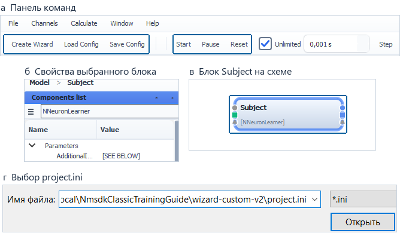

### 1.2 Создание проекта с нуля

1. Нажмите **Create Wizard**. На странице **Name** выберите отдельную папку проекта в **Project directory**, заполните **Project name** и нажмите **Next**. Мастер сохранит в этой папке `project.ini` (рисунок 2).
2. На странице **Model**, в **Channels configuration**, укажите **Channels Number = 1**. Выберите **From component**, затем класс `NNeuronTrainer` или `NNeuronLearner` из PulseLibrary (рисунок 3). В **Model type** выберите **Modeling**.
3. Проверьте, что в полях **T (Global) = 1./** и **T (Default) = 1./** стоит `2000`. Это 2000 тактов в секунду, по 0,5 мс на такт. Нажмите **Next**. На странице **Additionals** можно снять **Autosave**, чтобы сохранять опыт вручную. Нажмите **Finish** (рисунок 3).
4. В проекте, созданном через **From component**, тренер сам является корневым компонентом **Model**. Щёлкните **Model** над схемой и откройте **Parameters**. В готовых проектах из раздела 1.1 эти параметры находятся у **Subject**. Дальше выбирайте тренер по расположению в своём проекте (рисунки 1 и 4).

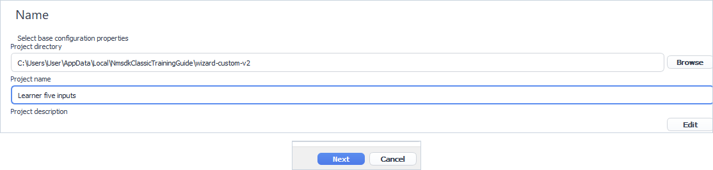

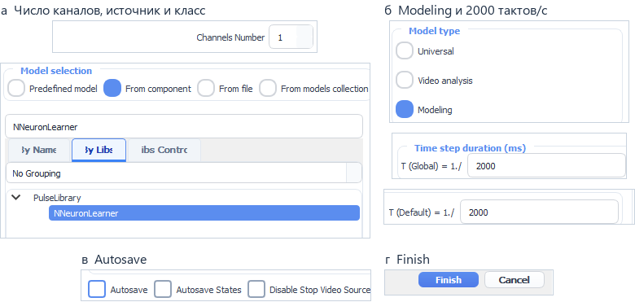

## 2 Задание собственного паттерна

### 2.1 Как составить паттерн

Паттерн — список задержек входных импульсов в секундах. Порядок строк определяет каналы. Первая строка задаёт задержку генератора `Source1`, вторая — `Source2` и так далее. Число строк равно `NumInputDendrite`. Например, для пяти входов можно задать следующий паттерн, составленный вручную.

```text
0.015
0.030
0.048
0.067
0.090
```

К каждому значению добавляется общее свойство `Delay`. При `Delay = 0.100` с времена первых пяти импульсов составят примерно 115, 130, 148, 167 и 190 мс от начала предъявления. При `SpikesFrequency = 1.5` Гц следующий цикл начинается через 0,667 с. Для первого опыта выбирайте задержки так, чтобы `Delay` плюс самая большая задержка укладывались в один период. Для другого числа каналов измените `NumInputDendrite` и длину вектора вместе. Используйте неотрицательные задержки и десятичную точку в редакторе паттерна и входном файле.

### 2.2 Ввод значений в NeuroModeler

1. Поставьте расчёт на паузу кнопкой **Pause**, если он идёт. Выберите тренер и откройте **Parameters**. В новом проекте задайте настройки из таблицы 1. Если `InputPattern` ещё показывает одно число после изменения `NumInputDendrite`, нажмите **Reset → Step** в главном окне и **Reload** в панели параметров. После сборки пяти входов редактор покажет пять строк. При инференсе сохраняйте число входов уже обученной модели.
2. Найдите строку **InputPattern**. Дважды щёлкните **[SEE BELOW]** в столбце **Value**. В окне **Edit value** замените весь текст пятью задержками, по одной на строку, и нажмите **OK**. На рисунке 4 показаны свойство и заполненный редактор.
3. Для проверки другого входа можно изменить только третью строку, например с `0.048` на `0.118`. При `Delay = 0.100` с третий импульс ожидается около 0,218 с вместо 0,148 с. Остальные четыре задержки остаются прежними. Это удобный контроль правильности ввода.

Таблица 1 — Начальные параметры учебной конфигурации

| Свойство | Значение | Назначение |
| --- | --- | --- |
| `NumInputDendrite` | `5` | Число входных каналов |
| `Delay`, `SpikesFrequency` | `0.100` с, `1.5` Гц | Общая задержка и частота предъявления |
| `NeuronClassName` | `NSPNeuronGen` | Класс обучаемого нейрона |
| `PulseGeneratorClassName` | `NPulseGeneratorTransit` | Класс входных генераторов |
| `SynapseClassName` | `NPSynapseBio` | Класс синапсов |
| `StructureBuildMode` | `1` | Сборка структуры тренера |
| `CalculateMode` | `6` для Trainer, `0` для Learner | Штатный режим обучения |
| `IsNeedToTrain` | `true` перед первым обучением | Включение обучения |
| `ExperimentMode` | `false` у Learner | Ручная подача входа |

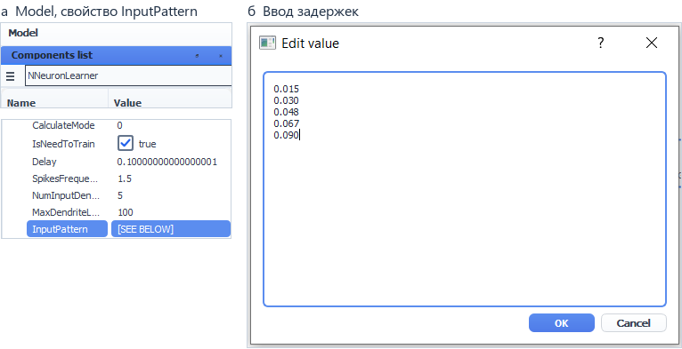

Для воспроизведения контрольного запуска из отчёта используйте папку `Prepared` и оставьте её пороги, частоты и остальные параметры. Пример выше задаёт произвольный временной паттерн. Его распознавание следует измерять на нейроне, обученном этому паттерну.

## 3 Настройка Watch

### 3.1 Создание графика и добавление рядов

1. В главном окне откройте **Window → Watches**. В окне **Watch window** нажмите **Create tab**, затем **Layout → Grid → 2×1 → OK**. Получатся два графика друг над другом. Щёлкните верхний график правой кнопкой и выберите **Add series** (рисунок 5).
2. В мастере оставьте **Manual**, **Time series** и **Single cell / scalar**. Нажмите **Next**. Слева разверните **Model**, затем **Subject**, если он есть. Выберите **Source1**, а справа — **Outputs → Output**. Для матрицы проверьте ячейку `(0, 0)` в нижней части окна. Нажмите **Next**, задайте цвет и нажмите **Finish**. Повторите для остальных входов. Для контроля изменения третьей задержки добавьте `Source3.Output(0, 0)`, как на рисунке 6.
3. На нижнем графике тем же способом добавьте `Output(0, 0)` у **Neuron → LTZone** (рисунок 6). Это ряд выходных спайков. В готовых проектах можно также выбрать `Subject.Output(0, 0)`, если ряд уже сохранён в настройках проекта. В проекте из мастера выбирайте дочерние компоненты, например **LTZone**, поскольку свойства корневого **Model** в этой сборке не привязываются к ряду.
4. Для наблюдения за обучением добавьте отдельный график потенциала. В готовом проекте выберите у **Subject** свойство `SomaNeuronAmplitude`, ячейку `(0, 0)` для суммы по сомам или `(1, 0)` для первой сомы. В новом корневом проекте выбирайте **Neuron → Soma1 → SumPotential(0, 0)** для первой сомы. Для третьего графика в **Layout** выберите **Custom** и задайте три строки и один столбец.

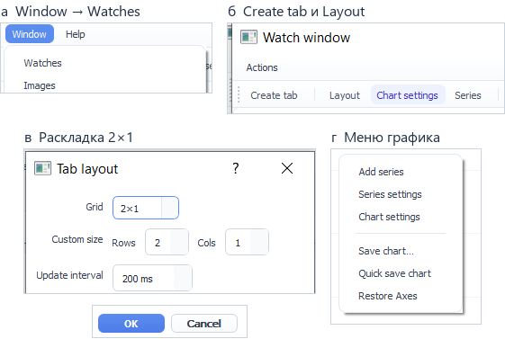

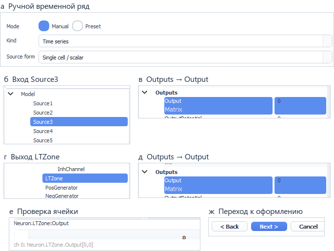

### 3.2 Выбор масштаба

1. Выберите график и откройте **Chart settings**. В разделе **Axes** задайте **X axis** «Модельное время, с» и название сигнала в **Y axis**. Входы и выход с амплитудой `1` удобно смотреть с подписью «Уровень импульса» и границами **Y min = -0.1**, **Y max = 1.1**. Для потенциала подпишите «Потенциал, В». Для первой сомы начните с диапазона от −0,02 до 0,04 В и расширьте его, если сигнал выходит за пределы. Для суммы по нескольким сомам подберите границы заново (рисунок 7).
2. Для обзора предъявлений задайте **X range = 5** с и включите **Track latest**. Чтобы рассмотреть первый цикл при 1,5 Гц, используйте **X range ≈ 0,667** с. Для увеличения отдельного спайка поставьте модель на **Pause** в главном окне. В Watch отключите **Track**, включите **Box zoom** и протяните мышью прямоугольник вокруг нужного участка. **Pan** сдвигает вид, **Reset** в Watch восстанавливает исходный масштаб осей (рисунок 8).
3. Для сопоставления сигналов увеличьте входной и выходной графики до одного интервала X. В длинном окне импульс длительностью 1 мс может теряться при отрисовке. Перед выводом об ответе `0` проверьте короткое окно и правильность источника. **Save chart** сохраняет видимый график. **Save Config** запоминает настройку рядов проекта. После открытия график снова заполняется по ходу расчёта.

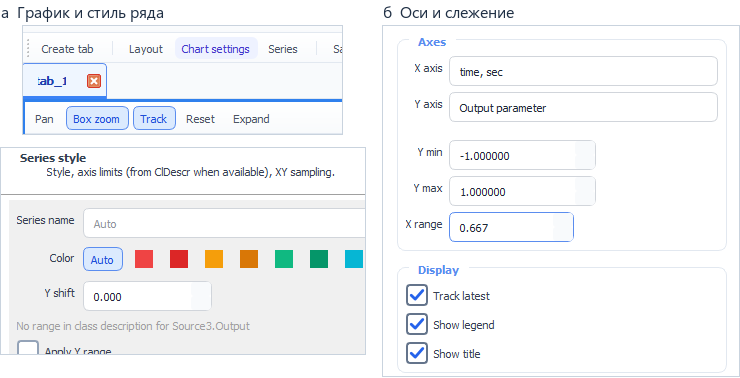

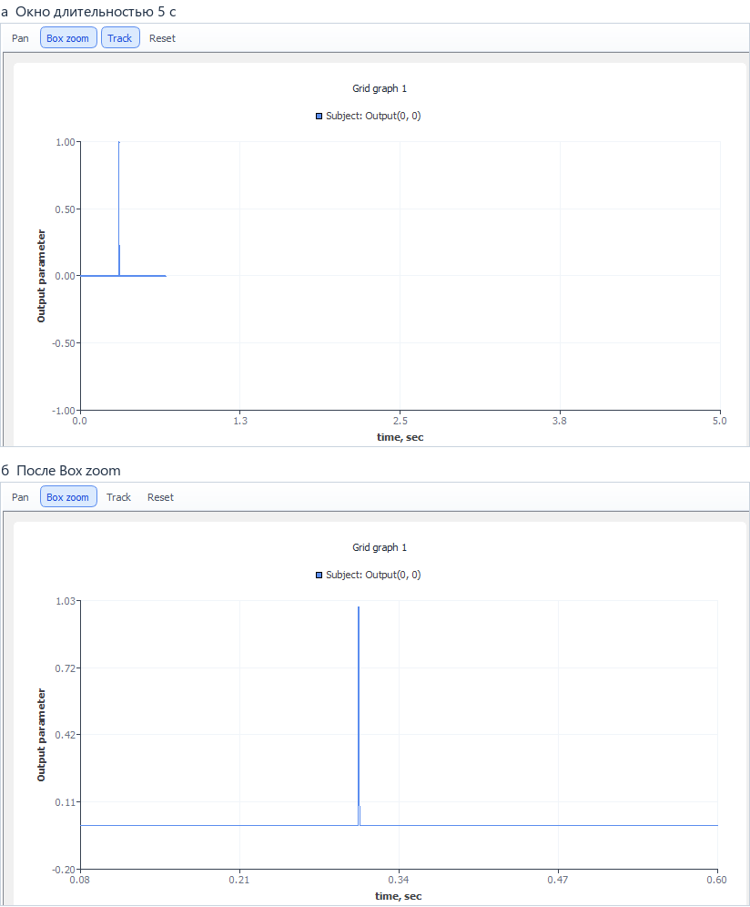

## 4 Запуск и проверка результата

### 4.1 Обучение

1. Убедитесь, что задан обучающий паттерн, `IsNeedToTrain = true` и подготовлены графики из раздела 3. Включите **Unlimited** и нажмите **Start**. Следите за модельным временем **MT** внизу главного окна и за потенциалом сомы. Чтобы сопоставить два этапа обучения, запишите **MT** и пики потенциала в двух одинаковых по длительности окнах (рисунки 1, 7 и 9).
2. Нажмите **Pause** и **Reload** в панели свойств. Пока `IsNeedToTrain = true`, обучение ещё продолжается. Нажмите **Start** для продолжения. При штатном завершении свойство станет `false` после обновления панели. В `NNeuronLearner` строки **DendriteLength** и **NumSynapse** показывают длину и число синапсов для каждого входа, в порядке каналов. Их можно прочитать прямо в **Parameters** на паузе.
3. Нажмите **Save Config**. Чтобы проверить ответ после обучения, выполните шаги раздела 4.2 с тем же паттерном. На рисунке 9 показано, где проверить состояние обучения в GUI.

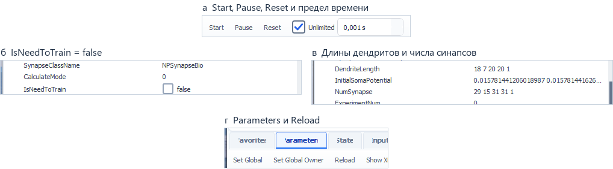

Для пяти задержек из раздела 2 новый `NNeuronLearner` завершил обучение. После сохранения и открытия длины дендритов были `[61, 1, 1, 1, 1]`, а числа синапсов — `[62, 1, 1, 1, 1]`. Это пример того, что следует сверить после загрузки. Отдельно проверьте, получился ли выходной спайк на том же входе.

На рисунке 10 приведён контрольный запуск двух тренеров на объекте № 22 из Iris. Верхний график показывает максимум потенциала среди участков сомы за итерацию `NNeuronLearner`. Нижний показывает, как меняются суммарные числа сегментов и синапсов. Чтобы проследить структуру `NNeuronLearner`, на каждой паузе запишите **MT**, **DendriteLength** и **NumSynapse** в порядке входных каналов.

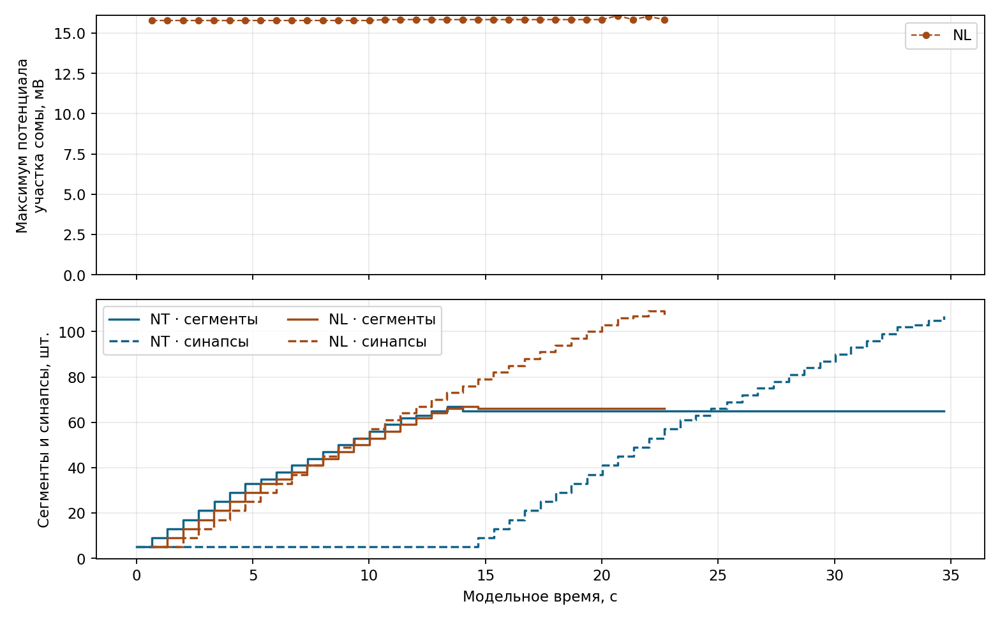

### 4.2 Ручной инференс на обученной модели

1. Откройте сохранённую конфигурацию через **Load Config** (рисунок 1). На паузе проверьте `IsNeedToTrain = false`, а у `NNeuronLearner` ещё и `ExperimentMode = false`. Проверьте, что ряды Watch указывают на входные генераторы и выход нужного нейрона (рисунки 5 и 6).
2. Введите паттерн по разделу 2.2 (рисунок 4). Для повторяемой проверки нового входа начинайте из одной и той же сохранённой конфигурации. Для серии без сброса меняйте входы на паузе и записывайте порядок. Состояние от предыдущего входа тогда участвует в следующем расчёте.
3. Если **MT = 0**, снимите **Unlimited**, в поле справа введите **0,667 с** и нажмите **Start**. Сверьте после остановки, что **MT** дошло примерно до 0,667 с. При 2000 Гц и 1,5 Гц это один цикл, около 1334 шагов. Для дальнейшего предъявления без сброса задайте новый предел как текущее **MT** плюс 0,667 с. Используйте разделитель дробной части, который показывает числовое поле. При возврате к обучению снова включите **Unlimited** (рисунок 11).
4. Сверьте вход и результат на одной шкале времени. Запишите **MT** непосредственно перед запуском как начало окна. В новом проекте после загрузки это 0 с. На входных рядах найдите импульсы всех каналов. Например, для изменённого третьего канала в разделе 2 импульс должен сдвинуться примерно с 0,148 до 0,218 с от начала первого предъявления. На выходном графике ищите спайк внутри этого же окна. Спайк в окне означает ответ `1`. Ответ `0` фиксируйте после полного окна при наличии ожидаемых входных импульсов. Если входной импульс пропущен на графике, увеличьте вид и проверьте привязку ряда к нужному `Source`.

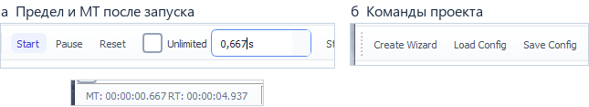

На рисунке 12 показан контрольный проход по задержкам из раздела 2 после открытия обученного проекта. Синий импульс третьего канала виден около 0,148 с. Жёлтый ряд выхода остаётся на нуле в течение 0,667 с. При снятом флаге обучения счётчик спайков **PulseCounter** у LTZone равен нулю, а список **OutputPulseTimes** пуст. Для оценки распознавания проверьте длительность окна и все ожидаемые входы.

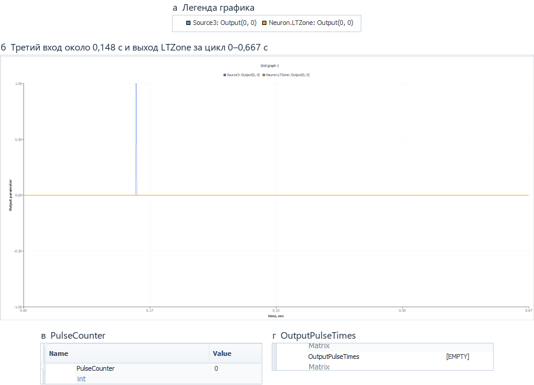

Рисунок 13 показывает измеренный цикл сохранённой модели NL22, обученной на объекте № 22 набора Iris. Вверху пять штрихов обозначают входные импульсы. Внизу спайк на 302,5 мс даёт ответ `1`. Для своего паттерна используйте его задержки, а время ответа считайте по своему графику.

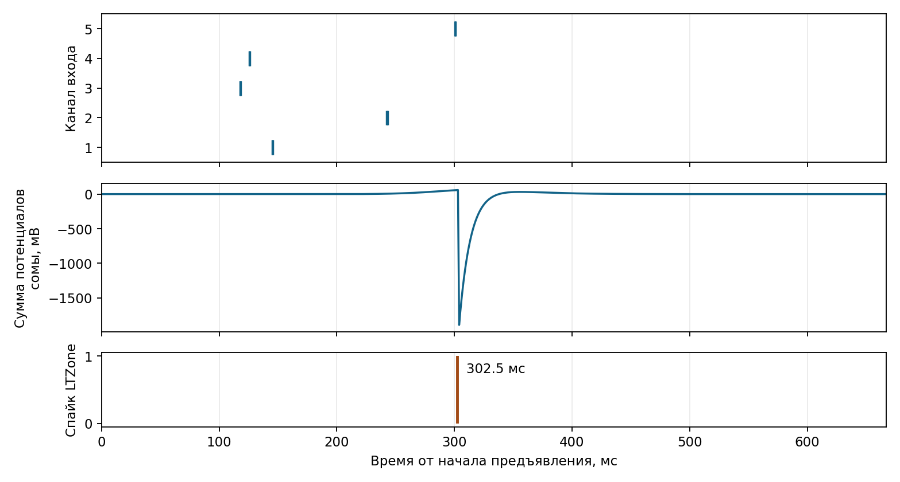

### 4.3 Инференс на последовательности из файла

1. В папке рабочей копии, где лежит `project.ini`, создайте обычный текстовый файл `input_data.txt`. Одна строка — один паттерн. В каждой строке пять задержек с десятичной точкой, разделённых пробелами. Например, следующий файл предъявит три произвольных паттерна. Имена и номера строк в файл не вставляйте.

```text
0.015 0.030 0.048 0.067 0.090
0.015 0.030 0.118 0.067 0.090
0.090 0.067 0.048 0.030 0.015
```

2. В проекте с `NNeuronLearner` на паузе откройте **Parameters**, проверьте `IsNeedToTrain = false` и включите `ExperimentMode`. Нажмите **Reload** и проверьте `ExperimentNum = 1`. Это режим распознавания из файла (рисунок 14). Включите **Unlimited** и нажмите **Start**. После серии откройте `output_data1.txt`. После **Reload** завершённый режим показывает `ExperimentMode = false`. Перед следующим запуском скопируйте результаты под другим именем, поскольку новый запуск снова пишет в `output_data1.txt`.
3. После строки «Результаты распознавания» сопоставьте число двоичных строк с числом входных паттернов. В проверке NL22 программа записала четыре ответа для трёх входов, с завершающим переводом строки и без него. Если числа расходятся, сохраните оба файла и предъявите каждый вход вручную по разделу 4.2. Привязку ответов к паттернам устанавливайте по самостоятельным окнам предъявления.
4. Если проект содержит оболочку `NSpikeClassifier`, данные подаются через `InputPattern` оболочки, а штатный файловый флаг оболочки называется `DataFromFile`. Она пишет `output_data.txt`. Для отдельного `NNeuronTrainer` используйте ручной ввод. Файловый путь оболочки проверяйте отдельно на своём проекте.

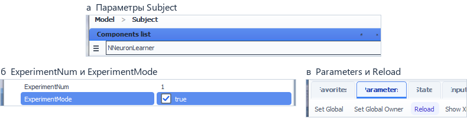

## 5 Повторное обучение и возвращение к опыту

### 5.1 Повтор с исходной структуры или обучение новому входу

1. Для повторения с исходных условий откройте копию проекта, сделанную до обучения. При необходимости измените `InputPattern` по рисунку 4. Запустите обучение по разделу 4.1. Так можно повторить и `NNeuronTrainer`, и `NNeuronLearner`.
2. Чтобы `NNeuronLearner` обучился другому входу с текущей структуры, поставьте завершённый опыт на паузу. Сохраните его и оставьте отдельную копию. В открытом рабочем проекте измените `InputPattern`, включите `IsNeedToTrain` и запустите расчёт. Сверьте **DendriteLength** и **NumSynapse** до запуска и после завершения. Затем отдельно предъявите прежний и новый паттерны в режиме распознавания (рисунки 4 и 9).
3. У `NNeuronTrainer` повторное включение `IsNeedToTrain` удаляет дочерние компоненты тренера. Для него задокументирован сценарий нового обучения из исходной копии.

### 5.2 Продолжение прерванного обучения

1. **Окно проекта открыто.** Нажмите **Pause**, затем **Start**. Модельное время и состояние очередного такта сохраняются в текущем процессе. Кнопка **Reset** в главном окне относится к сбросу модели, а **Reset** в Watch — к масштабу графика (рисунки 1 и 8).
2. **Проект уже закрыт.** Для `NNeuronLearner` сохраните незавершённый проект через **Save Config** на паузе. После **Load Config** проверьте вход, **DendriteLength**, **NumSynapse** и `IsNeedToTrain`. Если сохранён флаг `true`, нажмите **Start** без повторной установки флага. Если флаг сброшен, включение запускает обучение с имеющейся структуры с новым счётчиком. Для точного продолжения с прежнего такта используйте паузу в открытой сессии (рисунки 1 и 9).
3. **Как проверить на своём проекте.** Запишите **MT** и длины на паузе перед сохранением. После открытия сравните их с тем, что показывает интерфейс. Затем запустите тот же вход и дождитесь `IsNeedToTrain = false`. Для контрольной проверки незавершённый `NNeuronLearner` с объектом Iris № 22 сохранили на 0,959 с. После открытия длины `[2, 2, 2, 2, 1]` сохранились, **MT** стало равным нулю. После обучения на том же входе длины достигли `[18, 7, 20, 20, 1]`.
4. Для `NNeuronTrainer` продолжайте незавершённый расчёт через **Pause → Start** в открытом окне. Если сеанс нужно закрыть, сохраните промежуточный граф для анализа и оставьте исходную копию, с которой можно повторить опыт. Повторное включение флага пересобирает структуру.

Подробнее о пресетах и хранении настроек. [Пресеты Watch](../WatchPresets.md) · [Параметры графиков](../ADR-PlotDocument.md) · [Проверка интеграции Release](../../../Reports/StructTrainClassic/AutoPresetIntegration.docx)
