# Classic N4: реальный ответ при фиксированном диагностическом пороге

Получена частичная избирательность остановленной модели: цель вызвала один спайк, ложные ответы появились у2 из7 отвлекающих паттернов. Это6/8 по заранее объявленному критерию полного окна от первого входа. Результат пока не является рабочим детектором завершённого паттерна: целевой ответ возникает до последнего импульса, а большинство зарегистрированных спайков относятся к отвлекающим паттернам.

## Постановка и контроль

Использован exact stopped state89681f2f4ee996b4a1208b18cbdaa3c3c2c2b487e78d7aa56ccec1d37a8a1f0b из [предыдущего budget16 frozen опыта](Budget16DiagnosticScientificReport-20261113.ru.md), а не новая L22-модель3b8a160f. Training outcome остаётся budget_exhausted, сертификата нет. Частота2000Гц;8 исходных паттернов PhaseA, reset-per-trial, полные окна2s, actual input timestamps. Transient Test patterns не меняют training target или обученную структуру.

Сначала заново выполнен контроль с порогом100 на SDK64e/Pulseea88068: все8 массивов samples и model_before совпали с оригиналом. Затем, без смены источника, выполнены те же8 паттернов с одним порогом0.013048873000159292. Он заранее выбран серединой между nonspiking LT максимумом target и самым высоким foil maximum, остающимся ниже него. Два других foils имели более высокие максимумы. Это Same-Matrix выбор; новая модель не обучалась, калибровочный сертификат и независимый Test отсутствуют. Nonspiking данные использовались для предложения порога, итог ниже получен реальными спайками.

| Условие | TP | FP | FN | TN | Доля ответивших foils |
|---|---:|---:|---:|---:|---:|
| Реальный контроль, threshold100 |0|0|1|7|0/7|
| Реальный fixed threshold0.013048873000159292 |1|2|0|5|2/7≈28.6%|

Silent-контроль имеет7/8 формально правильных отрицаний, но пропускает цель. Новый порог даёт целевой ответ с двумя ложными положительными. Precision по ответившим паттернам —1/3; по отдельным событиям только1 из4 спайков относится к target. Число6/8 само по себе не означает хорошую разделимость.

## Время каждого фактического ответа

| Паттерн | Метка | Actual spike timestamps, s | Последний actual input, s | Класс полного окна |
|---|---|---|---:|---|
|phasea-row-0|target|0.2645|0.49|TP|
|phasea-row-1|foil|нет|2.4905|TN|
|phasea-row-2|foil|нет|4.491|TN|
|phasea-row-3|foil|нет|6.4915|TN|
|phasea-row-4|foil|8.0355;8.2635|8.492|FP|
|phasea-row-5|foil|10.495|10.4925|FP|
|phasea-row-6|foil|нет|12.493|TN|
|phasea-row-7|foil|нет|14.4935|TN|

У target входы0.01/0.09/0.25/0.49s. Его единственный ответ0.2645s находится на225.5ms раньше последнего импульса. После последнего входа целевого спайка нет. Полный onset-критерий сохранён, но ранний ответ нельзя интерпретировать как подтверждение всей временной последовательности. Ответы foils4/5 расположены рядом с плотными участками входа; это согласуется с локальным суммированием, однако причинное объяснение потребует отдельного вмешательства.

## Что подтверждено и что остаётся

Production scorer принял оба native run как completed/valid, все16 наблюдений полны; модели frozen, source unchanged. Новый semantic model revisionaf9e2b5708184ce092203aee4792104391bc8abec1e2ec712198b913726e76e3. Августовские4/8–6/8 в исходном протоколе сохраняют свой статус; этот опыт относится к другому stopped state и не подменяет историческое обучение.

Общий acquisition test сохранил ERROR: после записи complete result.json очистка вызвала Reservations.release без note. Это исправлено отдельно; исходный отказ и последующее освобождение exact closed-worker lease сохранены. Эксперименты не повторялись. [Raw условия, обе метрики и сведения об отказе](ValidationPlans/M40DiagnosticThresholdScienceA2-20261113/RESULT.ru.md). Общий10-case SDK cohort также остаётся failed8 upstream fixtures; scoped diagnostic2/2 и DATA5/5 не означают принятия всего SDK.

Полный отчёт строит все8×4 Soma.SumPotential и отдельно actual LTZone.Potential с входами и LT events. Порог относится к LTZone и не рисуется как порог отдельной сомы. Overview/увеличения сохраняют исходные точки. Проверка отчёта на M40 завершилась1/1 PASS (960.086s); scorer повторил исходные метрики без изменения модели. В Git отобраны все32 soma overview,8 LT overview и детали целевого события;2476 PNG и остальные SVG/PDF остаются воспроизводимым кэшем на M40. Просмотрены все8 LT overview, целевой zoom и Soma1 target overview; автоматический контроль всех изображений не подменяет просмотр каждого из32 soma. Полная компактная primary публикация ещё проверяется.

Следующее алгоритмическое действие — [ограниченный приоритет нормализации N1 на измеренной timing-ready геометрии](N1TimingReadyNormalizationFollowup-20261113.ru.md), затем свежая all-input verification. Подбирать новые пороги до исчезновения ошибок этого Test не планируется.

## Реальные реакции на все паттерны

Оранжевая кривая — фактический вход; фиолетовые пунктиры — зарегистрированные LT events. Для каждой строки приведены Soma1 и отдельный LT decision channel; остальные три сомы доступны по ссылкам. Порог нарисован только для LT. Общая Y-шкала сохраняет величину отрицательной обратной реакции после спайка; небольшие положительные ответы на overview сжаты, для количественного визуального анализа нужны увеличения. У молчащих паттернов ниже встроен также существующий overview-detail с собственной Y-шкалой, чтобы небольшие пики были различимы; высоту этих рисунков нельзя сравнивать без подписей осей. Общие шкалы остальных32 overview сохранены в каталоге. Полный кэш: `/media/user/Data/TimeLearnerRefactor/readbacks/s11-diagnostic-threshold-report-m40-a1/worker/tmp/fixed-threshold-eight-pattern-gallery/index.html`. Увеличения имеют >=8px на native tick, без прореживания.

### phasea-row-0: target, TP

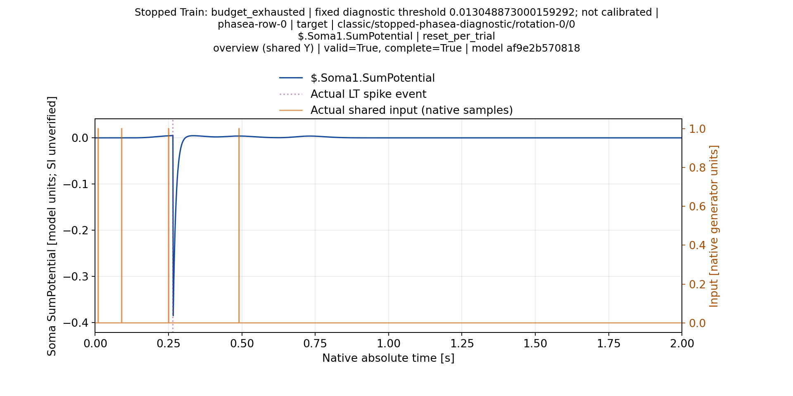

[Сома2](ValidationPlans/M40DiagnosticThresholdReportA1-20261113/selected-plots/trial-0000-soma-002/overview.png), [Сома3](ValidationPlans/M40DiagnosticThresholdReportA1-20261113/selected-plots/trial-0000-soma-003/overview.png), [Сома4](ValidationPlans/M40DiagnosticThresholdReportA1-20261113/selected-plots/trial-0000-soma-004/overview.png).

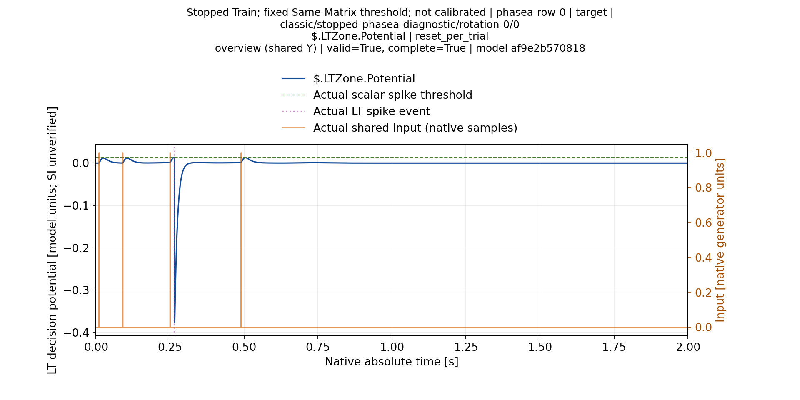

### phasea-row-1: foil, TN

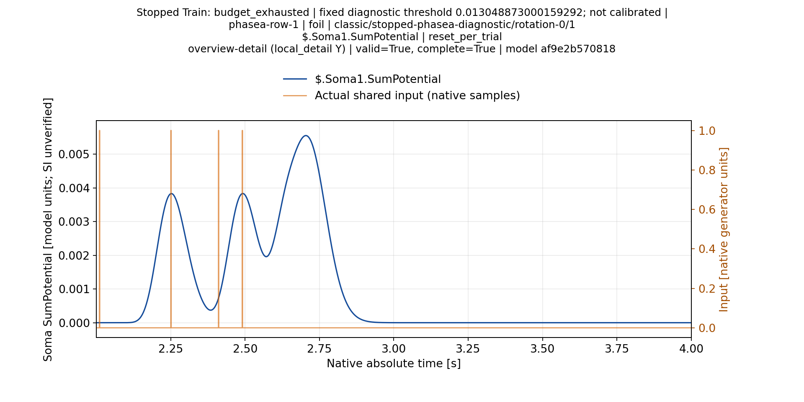

[Сома2](ValidationPlans/M40DiagnosticThresholdReportA1-20261113/selected-plots/trial-0001-soma-002/overview.png), [Сома3](ValidationPlans/M40DiagnosticThresholdReportA1-20261113/selected-plots/trial-0001-soma-003/overview.png), [Сома4](ValidationPlans/M40DiagnosticThresholdReportA1-20261113/selected-plots/trial-0001-soma-004/overview.png).

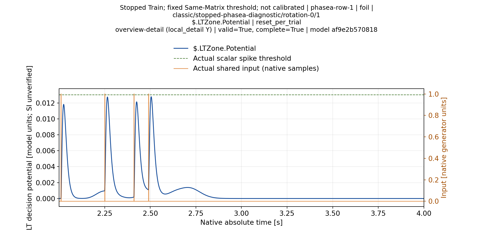

### phasea-row-2: foil, TN

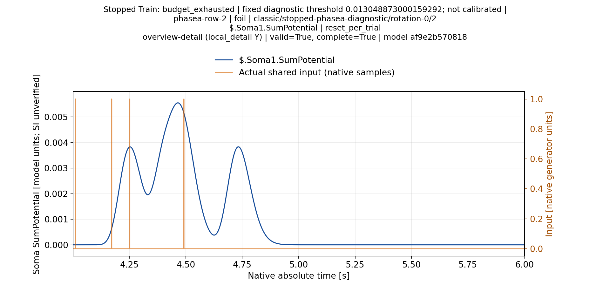

[Сома2](ValidationPlans/M40DiagnosticThresholdReportA1-20261113/selected-plots/trial-0002-soma-002/overview.png), [Сома3](ValidationPlans/M40DiagnosticThresholdReportA1-20261113/selected-plots/trial-0002-soma-003/overview.png), [Сома4](ValidationPlans/M40DiagnosticThresholdReportA1-20261113/selected-plots/trial-0002-soma-004/overview.png).

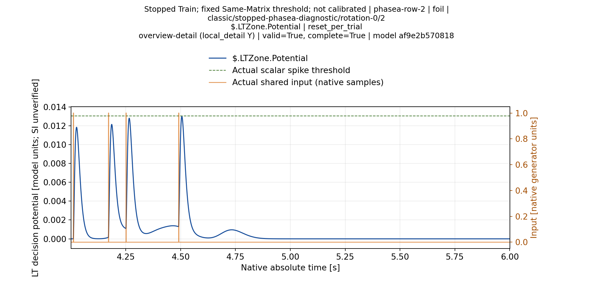

### phasea-row-3: foil, TN

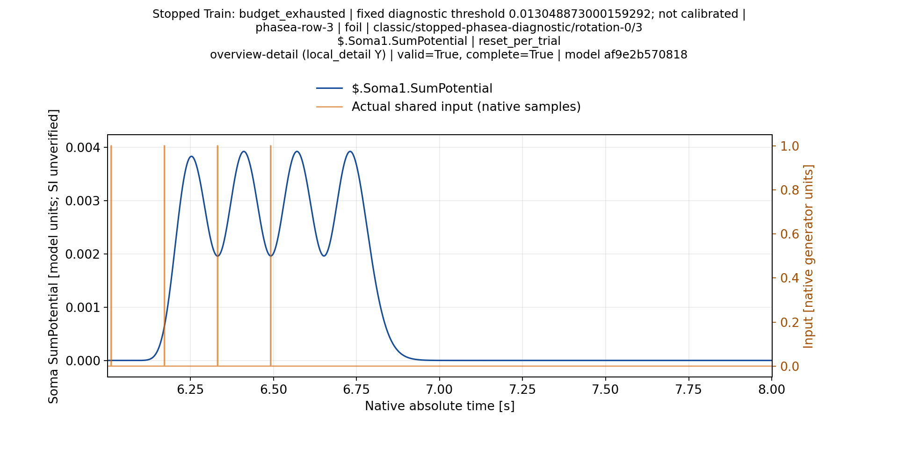

[Сома2](ValidationPlans/M40DiagnosticThresholdReportA1-20261113/selected-plots/trial-0003-soma-002/overview.png), [Сома3](ValidationPlans/M40DiagnosticThresholdReportA1-20261113/selected-plots/trial-0003-soma-003/overview.png), [Сома4](ValidationPlans/M40DiagnosticThresholdReportA1-20261113/selected-plots/trial-0003-soma-004/overview.png).

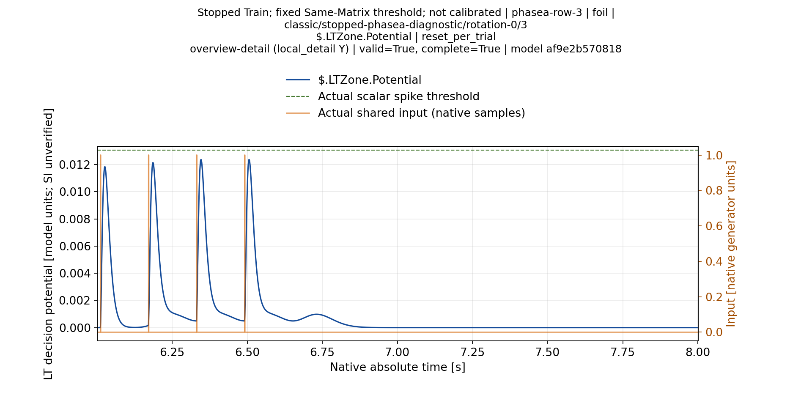

### phasea-row-4: foil, FP

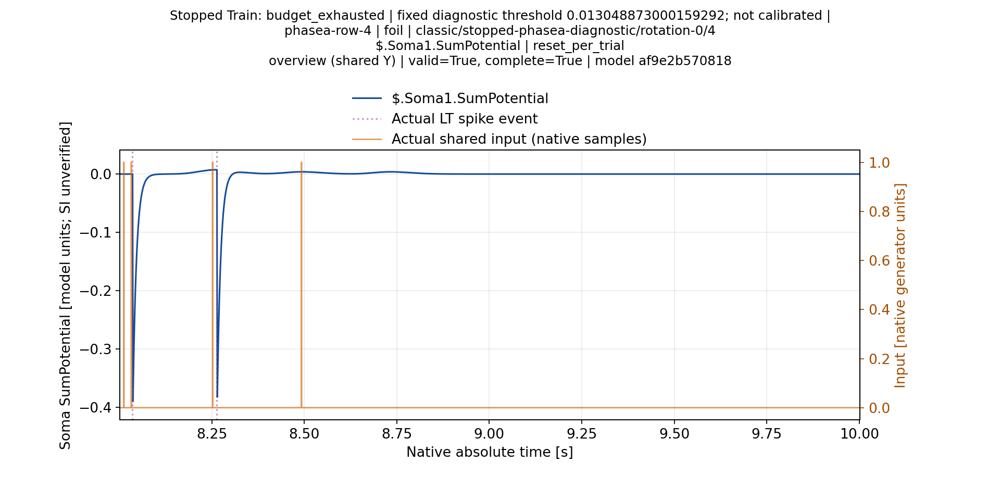

[Сома2](ValidationPlans/M40DiagnosticThresholdReportA1-20261113/selected-plots/trial-0004-soma-002/overview.png), [Сома3](ValidationPlans/M40DiagnosticThresholdReportA1-20261113/selected-plots/trial-0004-soma-003/overview.png), [Сома4](ValidationPlans/M40DiagnosticThresholdReportA1-20261113/selected-plots/trial-0004-soma-004/overview.png).

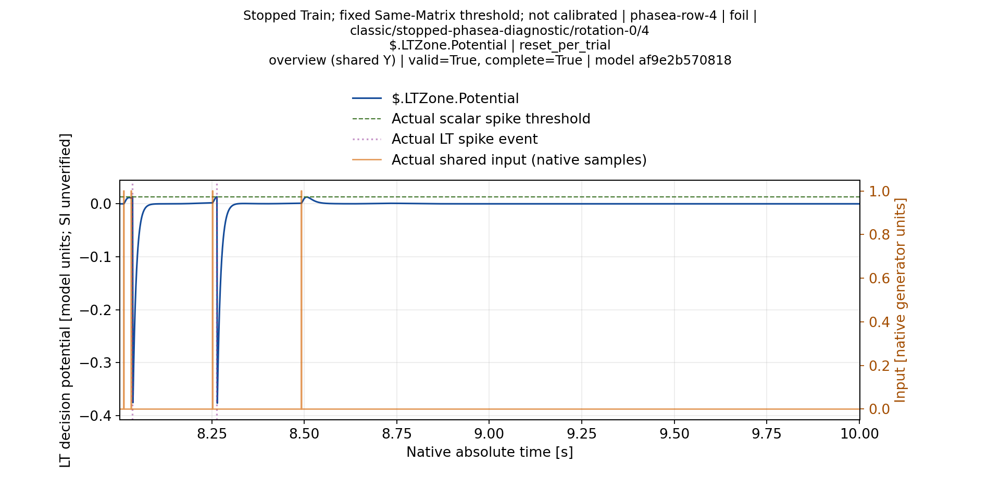

### phasea-row-5: foil, FP

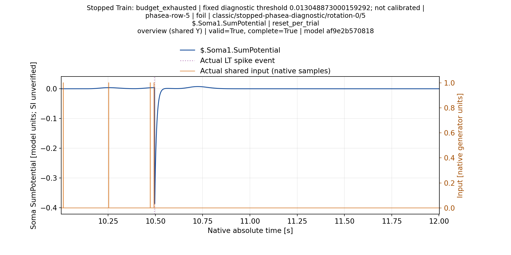

[Сома2](ValidationPlans/M40DiagnosticThresholdReportA1-20261113/selected-plots/trial-0005-soma-002/overview.png), [Сома3](ValidationPlans/M40DiagnosticThresholdReportA1-20261113/selected-plots/trial-0005-soma-003/overview.png), [Сома4](ValidationPlans/M40DiagnosticThresholdReportA1-20261113/selected-plots/trial-0005-soma-004/overview.png).

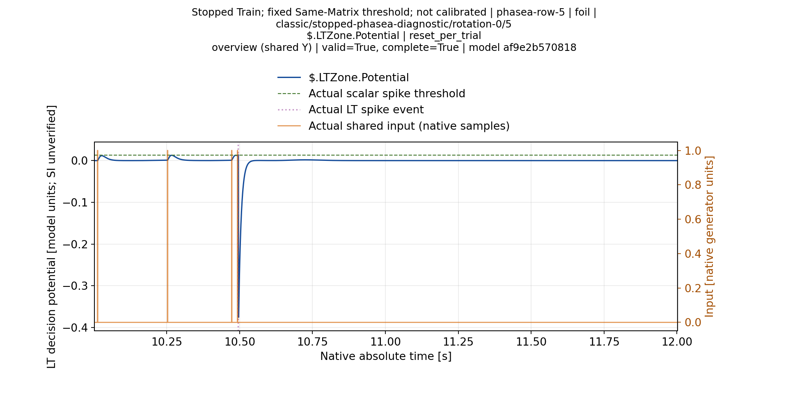

### phasea-row-6: foil, TN

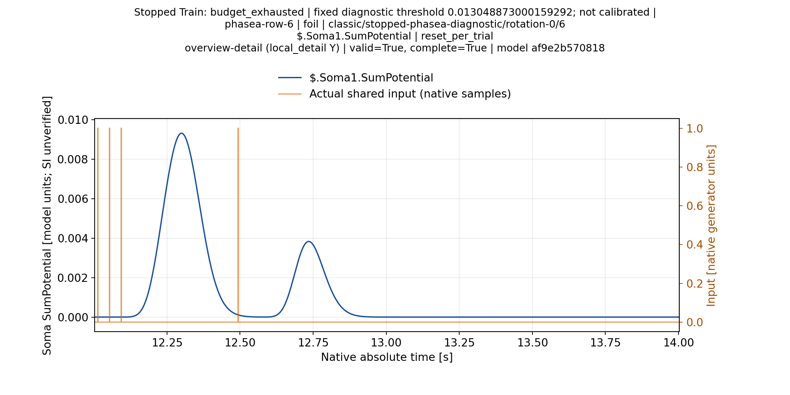

[Сома2](ValidationPlans/M40DiagnosticThresholdReportA1-20261113/selected-plots/trial-0006-soma-002/overview.png), [Сома3](ValidationPlans/M40DiagnosticThresholdReportA1-20261113/selected-plots/trial-0006-soma-003/overview.png), [Сома4](ValidationPlans/M40DiagnosticThresholdReportA1-20261113/selected-plots/trial-0006-soma-004/overview.png).

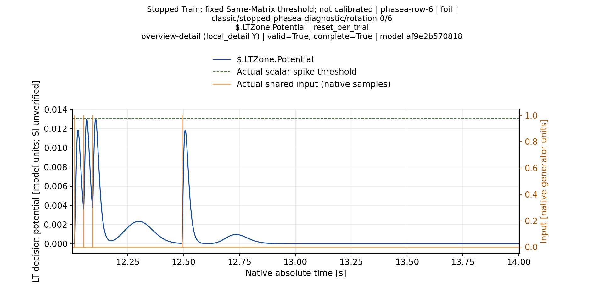

### phasea-row-7: foil, TN

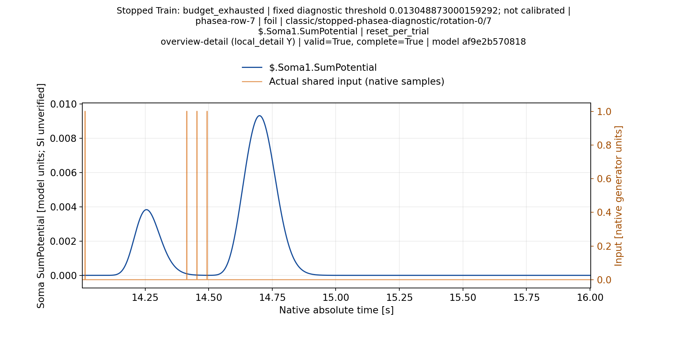

[Сома2](ValidationPlans/M40DiagnosticThresholdReportA1-20261113/selected-plots/trial-0007-soma-002/overview.png), [Сома3](ValidationPlans/M40DiagnosticThresholdReportA1-20261113/selected-plots/trial-0007-soma-003/overview.png), [Сома4](ValidationPlans/M40DiagnosticThresholdReportA1-20261113/selected-plots/trial-0007-soma-004/overview.png).

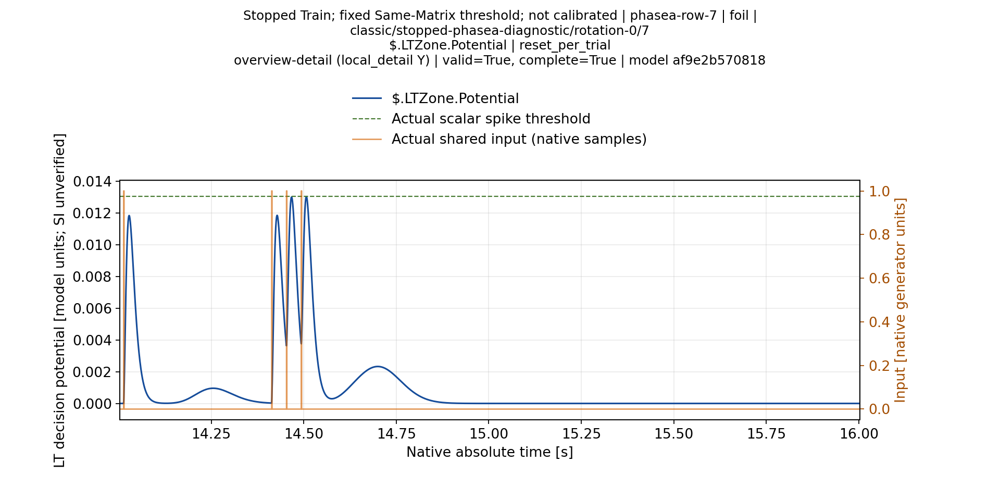

### Деталь раннего целевого ответа

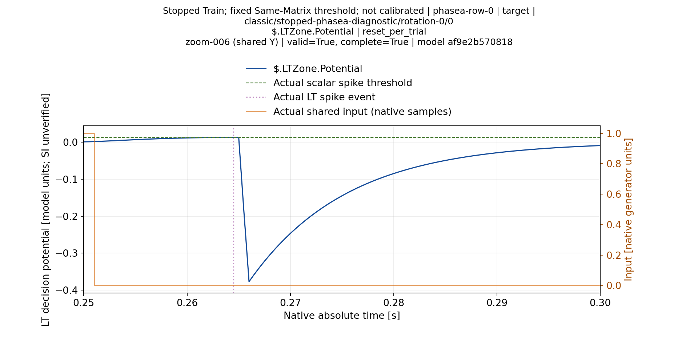

В интервале0.25–0.30s видны третий вход, LT event и последующая отрицательная динамика. Четвёртый вход будет только в0.49s; этот график подтверждает ограничение интерпретации раннего TP.

## Дополнительные увеличения

Выборка ниже показывает участки положительного потенциала из уже построенного кэша, а не новый эксперимент и не пересчёт peak assignment. Для спайковых проб она дополняет полный обзор; выбранный локальный участок не объявляется глобальным максимумом всей пачки.

|Паттерн|Soma1, локальная деталь|LT, локальная деталь|
|---|---|---|
|0|[0.3000–0.3500s](ValidationPlans/M40DiagnosticThresholdReportA1-20261113/selected-plots/trial-0000-soma-001/zoom-007-detail.png)|[0.5000–0.5500s](ValidationPlans/M40DiagnosticThresholdReportA1-20261113/selected-plots/trial-0000-lt-decision/zoom-011-detail.png)|
|1|[2.0005–4.0005s](ValidationPlans/M40DiagnosticThresholdReportA1-20261113/selected-plots/trial-0001-soma-001/overview-detail.png)|[2.0005–4.0005s](ValidationPlans/M40DiagnosticThresholdReportA1-20261113/selected-plots/trial-0001-lt-decision/overview-detail.png)|
|2|[4.0010–6.0010s](ValidationPlans/M40DiagnosticThresholdReportA1-20261113/selected-plots/trial-0002-soma-001/overview-detail.png)|[4.0010–6.0010s](ValidationPlans/M40DiagnosticThresholdReportA1-20261113/selected-plots/trial-0002-lt-decision/overview-detail.png)|
|3|[6.0015–8.0015s](ValidationPlans/M40DiagnosticThresholdReportA1-20261113/selected-plots/trial-0003-soma-001/overview-detail.png)|[6.0015–8.0015s](ValidationPlans/M40DiagnosticThresholdReportA1-20261113/selected-plots/trial-0003-lt-decision/overview-detail.png)|
|4|[8.2020–8.2520s](ValidationPlans/M40DiagnosticThresholdReportA1-20261113/selected-plots/trial-0004-soma-001/zoom-005-detail.png)|[8.5020–8.5520s](ValidationPlans/M40DiagnosticThresholdReportA1-20261113/selected-plots/trial-0004-lt-decision/zoom-011-detail.png)|
|5|[10.7025–10.7525s](ValidationPlans/M40DiagnosticThresholdReportA1-20261113/selected-plots/trial-0005-soma-001/zoom-015-detail.png)|[10.2525–10.3025s](ValidationPlans/M40DiagnosticThresholdReportA1-20261113/selected-plots/trial-0005-lt-decision/zoom-006-detail.png)|
|6|[12.0030–14.0030s](ValidationPlans/M40DiagnosticThresholdReportA1-20261113/selected-plots/trial-0006-soma-001/overview-detail.png)|[12.0030–14.0030s](ValidationPlans/M40DiagnosticThresholdReportA1-20261113/selected-plots/trial-0006-lt-decision/overview-detail.png)|
|7|[14.0035–16.0035s](ValidationPlans/M40DiagnosticThresholdReportA1-20261113/selected-plots/trial-0007-soma-001/overview-detail.png)|[14.0035–16.0035s](ValidationPlans/M40DiagnosticThresholdReportA1-20261113/selected-plots/trial-0007-lt-decision/overview-detail.png)|

После последнего целевого входа в0.49s ответ LT остаётся ниже фиксированного порога:

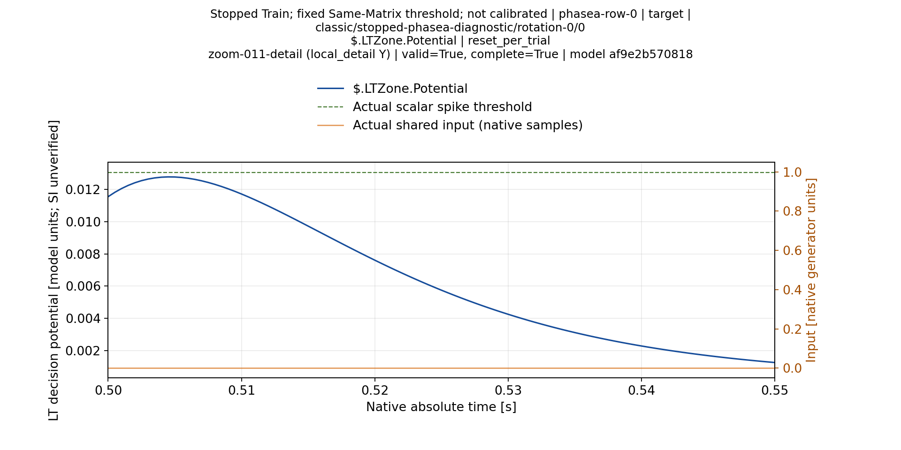
