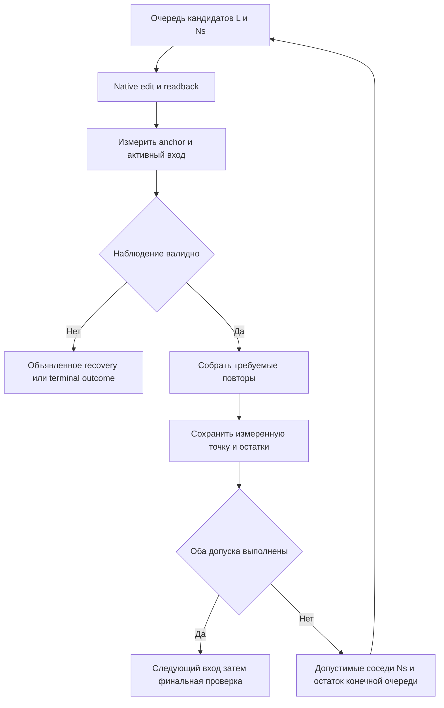
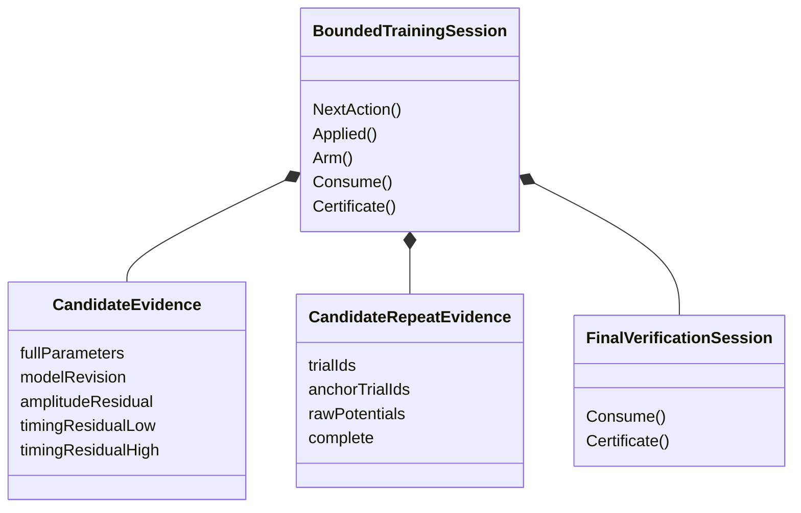

23.11: поддерживаемый revision5-content.ru.json уточнён после чтения всех
четырёх финальных измерений Branch и завершённого распознавания.
Это исходник следующей содержательной сборки; архивированные DOCX a13
и их проверенный пакет исходников сохранены неизменными.
[Исправление смысла terminal-флага и таблица остаточных ошибок](../MeasuredCountSearchStopAnalysis-20261123.ru.md).
Для следующего выпуска подготовлены3 просмотренных графика измеренного
поиска и16 просмотренных временных графиков всех8 реакций новой модели.

# Дополнение к следующей редакции описаний алгоритмов

**Материал опубликован во второй редакции17 ноября:** Classic14 страниц,
Branch13, просмотрены все27. [Текущий выпуск](README.ru.md).
Ниже сохранён исходный текст подготовки с датой его состояния.

Материал подготовлен для следующего Word-выпуска. Выпущенные документы
16 ноября остаются неизменяемой редакцией V2 N1 на8 и9 страницах.
Этот исходник не означает, что новый DOCX уже собран и проверен.
[Реестр семи подходящих примеров](../AlgorithmDescriptionEvidenceReview-20261117.json)
содержит версии, метрики и источники. Примеры группируются по семействам;
разные сроки остановки одной модели не объявляются разными алгоритмами.

## Семейство V2 CapturedPerInput и два нормализатора

Общая задача — совместно подбирать геометрию и амплитудную настройку,
измеряя максимум отклика закреплённого импульса штатной пачки. Амплитудная
цель каждого входа — его собственное исходное измерение Aᵢ⁽⁰⁾.
N0 использует целое число синапсов Nsᵢ, N1 — положительное сопротивление
Rsᵢ в допустимой области конкретного эффективного графа. В обоих вариантах
опорный вход N−1 фиксирован. Для Classic обход циклический, для Branch
обратный; общий кабель требует повторной проверки затронутых входов.

Для точечной, однозначно приписанной вершины основные остатки имеют вид

```math
e_{A,i} = A_i - A_i^{(0)}
e_{t,i} = t_{peak,i} - t_{peak,N-1}
|e_{A,i}| <= epsilon_abs + epsilon_rel |A_i^{(0)}|
|e_{t,i}| <= epsilon_sync
```

Это условие синхронности с реально измеренной опорой. При интервальном
результате измерителя контроллер проверяет обе границы временного остатка;
формула с одним временем не должна скрывать такую неопределённость.
Missing/ambiguous/incomplete не превращаются в числовой нуль. Раздельная
ранняя вершина допустима; слитая вершина без установленной принадлежности
не назначается одновременно двум импульсам. В Test оценивают полный отклик
и реальные LT events; назначение обучающего импульса туда не переносится.

При N0 амплитуда Aᵢ(L,Ns) измеряется заново. Равенство A∝Ns или сохранение
времени пика после добавления синапса не предполагается. Целочисленная
сетка допускает остаток между соседними значениями; достижение Ns cap не
равно Exact. Локальная готовность подтверждается свежим измерением, общий
сертификат — отдельным проходом всех входов конечной solo-модели.

## Реализованный N0 в рабочем примере Classic

Здесь описана конкретно PulseLib
7c6c94785af0c83104d348bb3b733ed1f149c8a8, файл
`Core/TimeLearner/BoundedTraining.cpp`, методы BeginInput, NextCandidate,
Consume, и структуры `BoundedTraining.h`. Более поздние geometry-recovery
изменения не приписываются этому опыту.

В BeginInput длины предлагаются от текущей к ближайшим допустимым целым,
с ограничением числа кандидатов. Counts также начинаются с текущего Ns и
расширяются по соседним целым. Базовый cursor сначала проверяет текущий
нормализатор на предложенных длинах; затем переходит к следующему count.
При улучшенном реально измеренном кандидате с выполненным временным
допуском и невыполненным амплитудным допуском в очередь приоритета
добавляются законные Ns+1 и Ns−1 при той же измеренной геометрии.
Повторно выданный полный вектор исключается из обычной очереди; требуемые
повторные измерения выполняются отдельно и этой дедупликацией не отбрасываются.

Если объявлен n0CandidateRepeats>1, сохраняются все амплитуды, trial IDs,
anchor IDs и revision. Готовность группы требует прохождения допусков
каждым повтором; сохраняются минимальная/максимальная амплитуды и худшие
остатки. Неполная группа остаётся неполной, без сертификата. Это режим
реализации, а не утверждение, что repeats>1 применялся в данном опыте.

```text
взять следующий полный допустимый кандидат L и Ns
применить его через native adapter на границе пробы
измерить anchor и активный вход в той же revision
при invalid выполнить только объявленное recovery или остановиться
при required repeats собрать всю группу свежих измерений
ранжировать только действительно измеренную точку
если timing выполнен и amplitude не выполнена и точка улучшилась
    предложить допустимые соседние counts при этой геометрии
если оба допуска выполнены перейти к следующему входу
после обхода проверить все входы конечной модели
```

Для Word использовать существующую общую блок-схему, раскрывая узел поиска
следующей вложенной схемой. Она описывает этот N0-поиск, не весь lifecycle.



UML следующего уровня дополняет имеющиеся диаграммы сервиса и scheduler:



## Пример Classic N0 с восемью паттернами

Stock NSPNeuronGen,2000Гц, LTMembrane отсутствует; сохранённая модель
L=[45,1,1,1], Ns=1, Rs=86МОм. Train остановился с
invalid_observation/ambiguous; сертификата нет. Порог
0.012765548843211696 предложен на той же матрице и реально проверен новым
native Test. Модель и порог заморожены, reset-per-trial, полные окна2с.

| Паттерн | Роль | Native spike timestamps с | Итог |
|---|---|---|---|
|phasea-row-0|target|0.503|TP|
|phasea-row-1|foil|нет|TN|
|phasea-row-2|foil|нет|TN|
|phasea-row-3|foil|нет|TN|
|phasea-row-4|foil|8.0355 и8.5055|FP|
|phasea-row-5|foil|10.495|FP|
|phasea-row-6|foil|12.065 и12.504|FP|
|phasea-row-7|foil|14.4635|FP|

TP1/FP4/FN0/TN3 удовлетворяет пользовательскому правилу включения. Target
реагирует через13мс после последнего входа0.490с. Есть три разных TN, но
четыре foil вызывают ложные ответы. Значения приведены в абсолютной native
шкале, не в относительных временах каждой строки. Отдельные8 cyclic orders
сохраняют counts, но это одна модель, а не восемь обучений.

Ns в сохранённом состоянии остаётся1. Следовательно, этот пример показывает
классификацию модели из N0-режима, но сам по себе не доказывает полезность
изменения числа синапсов. Нельзя объяснять его успех или ошибки позднейшим
geometry fix. Для причинного сравнения N0 и N1 нужны matched cold Train,
фактические траектории L/Ns/Rs и отдельные оценки конечных моделей.
[Полный отчёт](../ClassicN0ThresholdScientificReport-20261114.ru.md).

## Другие варианты и границы общего семейства

Stock Branch N1 даёт TP1/FP5/TN2, Fast terminal7200 — TP1/FP3/TN4,
Fast terminal21600 — TP1/FP1/TN6. Первые два отвечают до последнего входа;
последний — после него. Эти результаты включаются по правилу TP/TN, с
явным предупреждением о времени ответа, Same-Matrix пороге и stopped Train.
Разная физика storage и разные пороги не позволяют приписывать различие
только нормализатору или бюджету обучения. Числа описывают наблюдаемые
различия моделей, без доказанного причинного эффекта отдельного фактора.

Historical PhaseA Classic6/8 описывается отдельной legacy-вставкой:
сохранённая модель L=[49,41,25,1], порог0.0135, TP1/FP2/TN5. Её normalization
пока не восстановлена из effective legacy configuration, поэтому присваивать
ей N0/N1 или современный V2-поиск нельзя. Replay16 order/delay условий
7 ноября отделён от августовских визуальных наблюдений4/8–6/8, в которых
порядок и увеличенный ITI не проверялись.

Новые короткие cold N4/N1 Classic и Branch имеют TP1/FP6/TN1 и остаются
отрицательными примерами вне каталога работающих вариантов. Следующий
выпуск требует отрисовки обоих Word-документов и просмотра каждой страницы;
при конкуренции за ресурсы эксперименты продолжаются первыми.

## Дополнение того же Branch варианта при окнах 2 и 4 секунды

Серия17 ноября завершена и опубликована: baseline8 и новые24 предъявления
одной frozen terminal21600 модели. При2с/reset,4с/reset,2с/preserve и
4с/preserve получено по TP1/FP1/FN0/TN6. Это шесть различных TN в каждом
условии. Target0.493с следует после последнего входа0.490с; FP остаётся
у phasea-row-4. В Word добавить к существующему примеру Branch N1 Fast,
без создания нового семейства либо четырёх независимых алгоритмов.

Изменение длительности одновременно увеличивает наблюдаемый quiet-tail
и расстояние между паттернами. Нельзя называть это чистым ITI-эффектом.
Все условия этой серии имеют target в позиции0; прежние8 cyclic orders
относятся к отдельному дизайну2с/reset. Полный order × duration × reset
факториал не выполнялся. Модель stopped, сертификата нет, порог подобран
на той же матрице. [Полный отчёт и архивная квитанция](../FrozenWindowResetScientificReport-20261117.ru.md).

Независимый общий native-префикс и галерея24 новых волн ещё проверяются;
до приёмки не добавлять в DOCX утверждение об идентичности waveform.

## Завершённая новая сетка Branch после измеренного поиска Nₛ,23.11

У той же новой модели007f82de… при прежнем пороге0,0858575482028458 получено
TP1/FP1/FN0/TN25; ошибка40;160;240мс совпадает с прежней моделью.
Положительный класс — одна прежняя цель;26 паттернов исключены из её
калибровки, но сетка уже изучалась на предыдущей модели. Все54 PNG
просмотрены,148 исходных членов сохранены на M40 и независимо восстановлены.
Добавлять это к тому же семейству Branch с нормализацией числом синапсов;
не создавать отдельный алгоритм по новой матрице и не заменять исходные
TP1/FP2/TN5. [Полный материал для следующего выпуска](../MeasuredCountBranchNewFoilsResults-20261123.ru.md).
Архивированные DOCX a13 сохраняются без изменений; поддерживаемый JSON
содержит новое дополнение для следующей сборки.

## Остаточная динамика при прежних классах ответов,23.11

Для Branch с новым измеренным поиском числа синапсов завершены14 условий
по7 предшественникам: после №5 и №7 без сброса есть дополнительный целевой
выход до четвёртого импульса, хотя TP/FP/FN/TN не меняются. Все13 одинаковых
контролей пройдены,933 первичных члена независимо восстановлены,56 PNG
просмотрены. [Материал и галерея](../BranchCountPredecessorResults-20261123.ru.md).
В Classic завершены128 наблюдений, все8 положений при двух политиках.
Эффект дополнительного раннего выхода измерен во всех семи непервых
положениях без сброса, при одинаковых TP1/FP1/FN0/TN6 во всех16 условиях. Подчеркнуть в обоих
следующих Word-описаниях различие правильного класса и своевременного выхода.
Не переносить результаты между топологиями и не называть14 предъявлений
разными обучениями. Новый холодный Branch Train с двумя проходами начался;
его будущие результаты в документы пока не подставлять. Прежние a13
и их исходный архив не изменяются.

## Уточнение сигнала порога Classic после полного короткого потока

В следующую содержательную сборку добавить просмотренные графики исходной
Classic-пары: сравнение цели со сбросом и без, ложный ответ №6 и правильное
отклонение. Каталог k6 содержит все32 рисунка, все155 первичных файлов
независимо восстановлены. Архивы и рисунки ещё112 закрытых наблюдений
не считать опубликованными до отдельной приёмки.

Порог проверенной Classic-модели относится к среднему четырёх участков
сомы;29298 отсчётов и граф связей это подтверждают. Объяснить отличие
максимума записанного LT-потенциала от максимума одной сомы и среднего
отдельных максимумов. Мгновенное усреднение не добавляет инерции;
не переносить формулу на непроверенный граф или отсутствующий исторический
сигнал. [Проверка](../ClassicLTDecisionPotentialReadback-20261123.ru.md).
Опубликованный черновик a14-i2 остаётся неизменным; его полный просмотр
не завершён. Обновлённый JSON предназначен для следующей сборки,
а не объявляет новую выпущенную редакцию.
