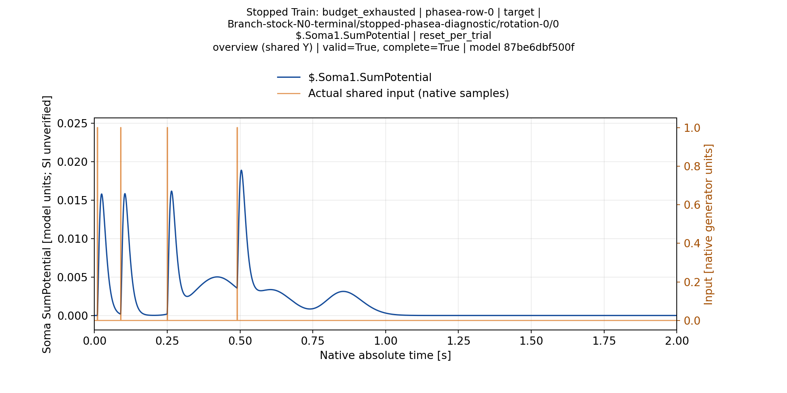
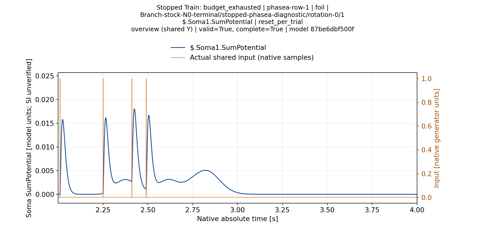
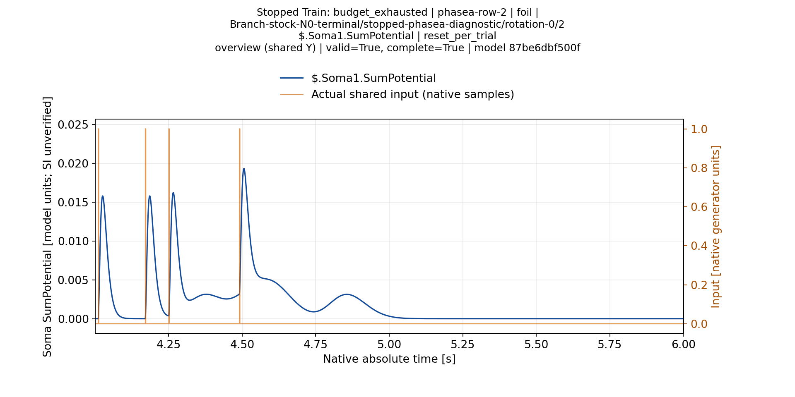
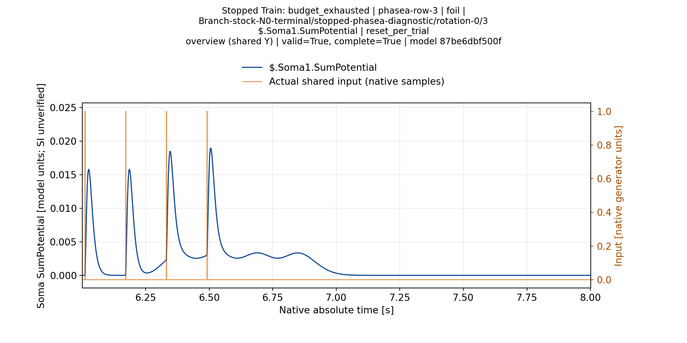
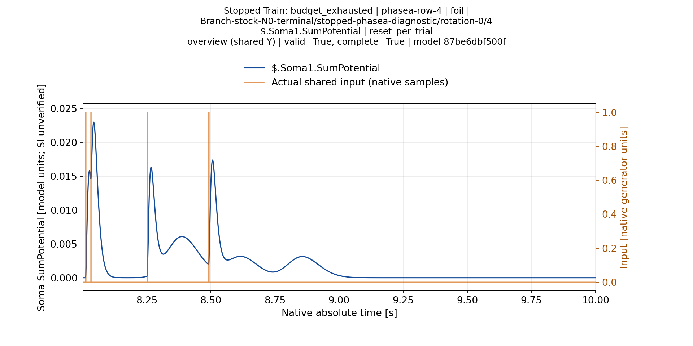
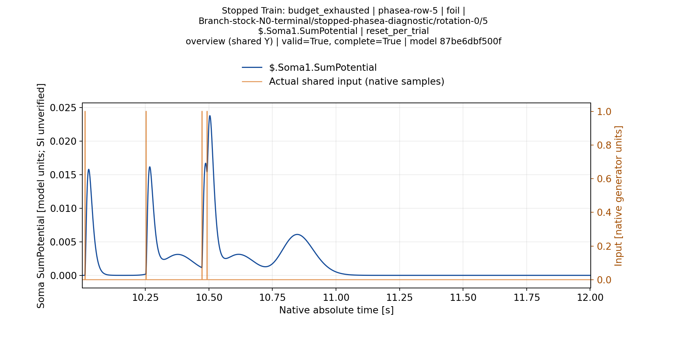
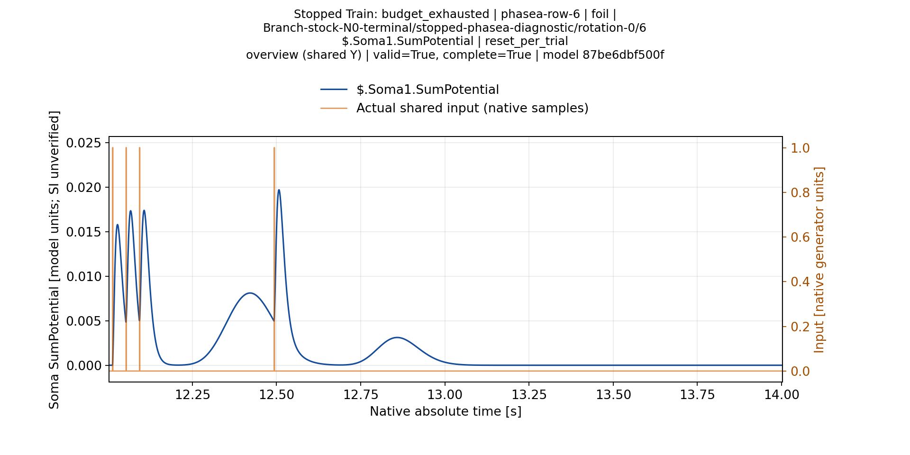
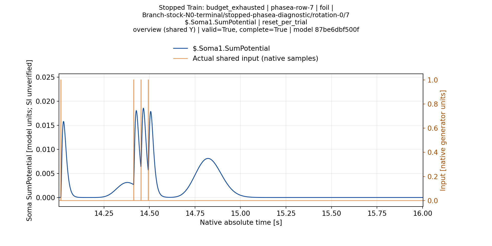

# Branch N0: восемь реакций фактической остановленной модели

Все восемь frozen-проб завершены и валидны. При исходном пороге100 модель не спайкует ни на target, ни на foils: TP0/FP0/FN1/TN7. Это отрицательный диагностический результат с пропуском target;7/8 молчания не считается успешной классификацией.

[Train](ValidationPlans/M40StockN0BranchTrainA1-20261114/RESULT.ru.md) остановлен по исходному временному бюджету:42 измеренных кандидата,9 timing-ready,0 jointly-ready. Исследованы Ns1..5, но общий финальный сертификат отсутствует. Frozen-опыт использует настоящее terminal state L=[38,38,38,1], Ns1/Rs86M. Лучший промежуточный Ns4/L25 не подставлялся. [Import/frozen proof](ValidationPlans/M40StockN0BranchFrozenA1-20261114/RESULT.ru.md) подтверждает неизменность модели и полного source graph.

Stock NSPNeuronGen без LTMembrane,2000Гц, reset-per-trial, полные окна2с; один target и семь foils PhaseA matrix1c1464e248f8744e858bd66df0be99e39969fd65. Здесь одна записанная сома. В этих конкретных nonspiking traces максимумы Soma1.SumPotential и LTZone.Potential совпадают; это не общее правило для Classic или других профилей. Единицы модели, SI/mV не подтверждены.

|Паттерн|Метка|Максимум Soma1 и LT|Спайки|
|---|---|---:|---:|
|phasea-row-0|target|0.018873021|0|
|phasea-row-1|foil|0.018035934|0|
|phasea-row-2|foil|0.019304628|0|
|phasea-row-3|foil|0.018927705|0|
|phasea-row-4|foil|0.022943675|0|
|phasea-row-5|foil|0.023767438|0|
|phasea-row-6|foil|0.019686175|0|
|phasea-row-7|foil|0.018536347|0|

Пять foils имеют максимум выше target в записи без спайков. Идеальное разделение этих максимумов одним порогом отсутствует. Настоящий спайковый порог может менять динамику обратной связью; эта таблица не заменяет отдельный actual threshold experiment и не доказывает невозможность обучения Branch в целом. Время пересечения порога и первого спайка тоже нельзя выводить из времени общего максимума.

## Временные графики всех паттернов

[Принятый production report A2](ValidationPlans/M40StockN0BranchReportA2-20261114/RESULT.ru.md) построил все8 trial/soma pairs, обзоры и увеличения PNG/SVG/PDF без downsampling,1920×960; на увеличениях минимум8px/native tick. Все8 исходных overview ниже просмотрены: единый масштаб Y, читаемые подписи и входы, вершины и хвосты видны, кривые не обрезаны. Полная ручная приёмка всех увеличений не заявляется; исходный manifest visual_acceptance_complete=false сохранён.

Видны быстрые реакции около входов и более широкий запаздывающий вклад. Наличие нескольких вершин в полном Test-отклике само по себе не делает его невалидным и не определяет принадлежность вершины закреплённому импульсу при Train. Обучение, full-pattern Test и fresh all-input certificate остаются разными проверками.

## Происхождение и границы

Frozen native SDK root74e5d206d4b619fcf81f77f11b54ebec7b8f0f6e/Pulse7c6c94785af0c83104d348bb3b733ed1f149c8a8, runtime105ccc46bf2d23aa093ee6ec5fb088d9f33faa8e572f8191869f8cc279377a8a. Source package SHA25628fa5dd184a7b1d45d2c2a62f2200406d346c91d65067e7b080686d137355a8a, model revision87be6dbf500ff125fec276415e8f140b3c6e13d13fc83c5f6eeb5b99287b26b7. Новая правка поиска N0 Pulse58c здесь не использовалась.

[Весь frozen primary66,099,340B сохранён в Git](ValidationPlans/M40StockN0BranchFrozenPrimaryA1-20261114/RESULT.ru.md),624 logical members. Независимый replay всего нового архива ещё открыт. Выбранные8 оригинальных PNG занимают1,240,052B; полный cache M40: `/media/user/Data/TimeLearnerRefactor/readbacks/s11-stock-n0-branch-report-m40-a2/worker/tmp/stock-n0-frozen-gallery`.

[Первый report A1](ValidationPlans/M40StockN0BranchReportA1-20261114/RESULT.ru.md) сохранил unit1/1, но общая runtime-аттестация отказала после обновления libc ОС. Он не переименован в PASS. A2 заново построил только отчёт в новом процессе после обновления; исходные native observations/модель не пересчитывались и не менялись. Исторические августовские4/8–6/8 и результаты иных протоколов этим отрицательным опытом не отменяются.
