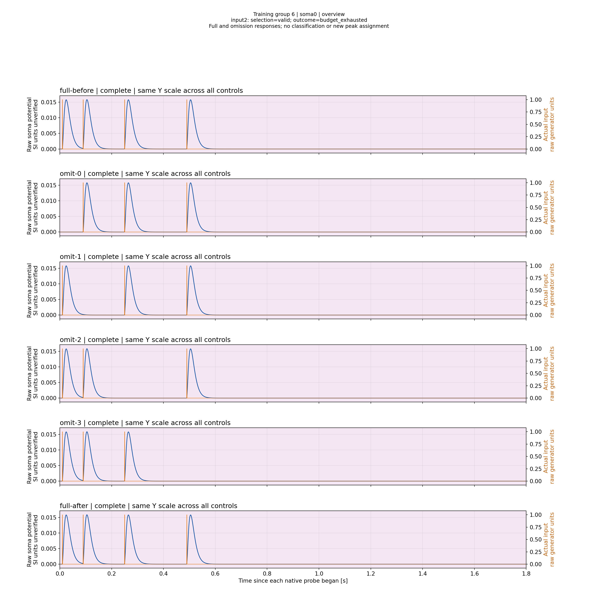
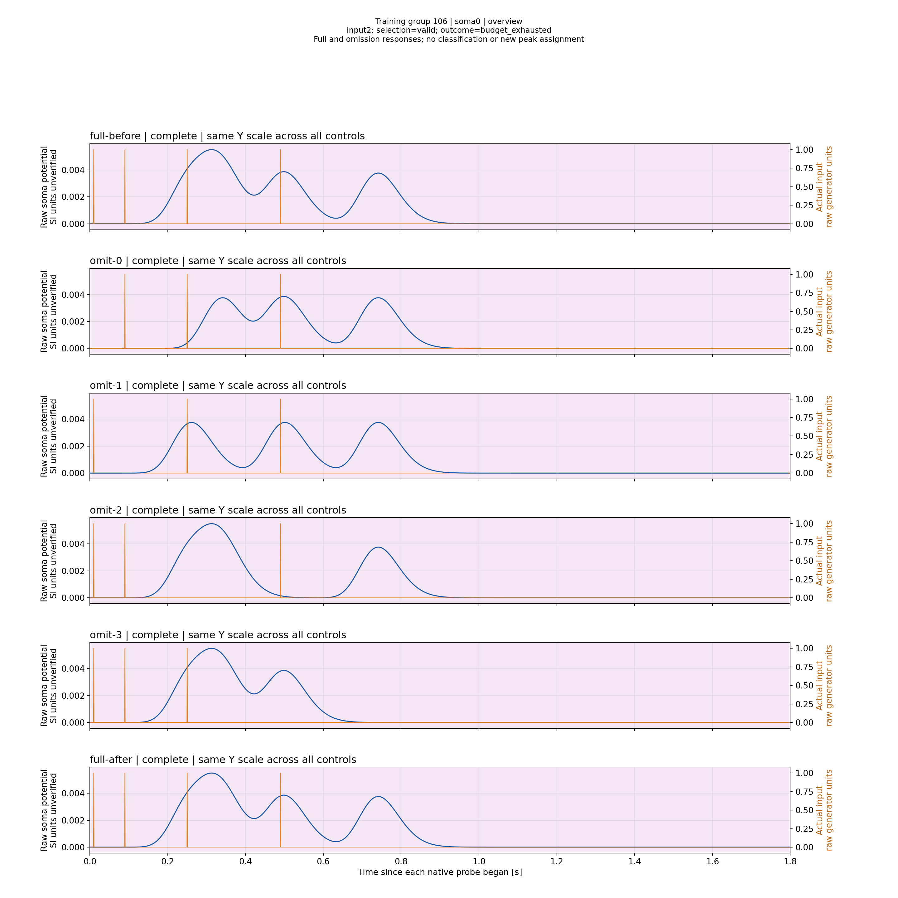
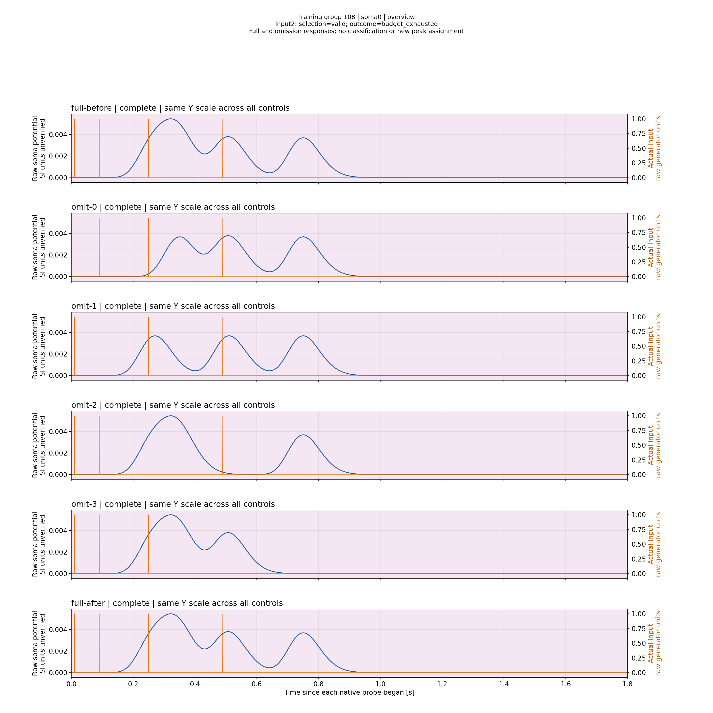

# Branch N4/N1: временная готовность и блокировка нормализации

Полный холодный Train не завершил обучение: budget_exhausted, certificate=null. Получены 51 измеренный кандидат для input2 и 51 изменение структуры; четыре кандидата удовлетворяли временному допуску, ни один — одновременно амплитудному. Все сопротивления остались 86 МОм. Это наблюдаемый предел текущей реализации, а не доказанная физическая невозможность.

Использованы stock-профиль без LTMembrane, 2000 Гц, CapturedPerInput, anchor3, абсолютный амплитудный допуск 1e-5 и временной 0.02 s, recovery budget4. Параметры не ослаблялись. У Classic сравниваемого запуска recovery budget16: эти серии не являются равнобюджетным сравнением топологий.

| Измеренный путь | Временная ошибка | Амплитудная ошибка | Rs |
|---|---:|---:|---:|
| L1 | −240 ms | 0 | 86 МОм |
| L25 | −15 ms | −0.0118549032499361 | 86 МОм |
| L26 | −6 ms | −0.011918946239878103 | 86 МОм |

В domain evidence L26 физический минимум канала равен 2880071.5552629367 Ом, но effective domain остаётся 86M..86M с locked_by_shared_bank=true. Inputs0/1/2 с одинаковой точкой подключения принадлежат одному физическому банку. Попытка менять только одного владельца блокируется. Следующая проверка — одновременное согласованное изменение всех владельцев банка на неизменной геометрии, с исходным replay и matched-контролем. До такой проверки не утверждаем, что именно групповая нормализация обеспечит сходимость.

Терминальная структура [27,27,27,1] не имеет final verification. Последняя группа108 полна по raw данным, selection valid, но не потреблена контроллером из-за остановки по бюджету. Отдельно учитываем качество геометрии измерения, потребление контроллером и исход обучения.

## Измеренные формы с фактическими входами

Внутри рисунка у полной пачки и omission-контролей одинаковый масштаб Y. Между рисунками Y различается; единицы потенциала — исходные единицы модели, SI не подтверждены. Обзор показывает форму, допуски проверяются численно. Выбраны Soma0 и группы первого/последнего потреблённого кандидата и последней непотреблённой пробы; это один обучающий паттерн, не распознавание матрицы из восьми.

Первая потреблённая группа6:

Последняя потреблённая группа106. Для input2 выбрана отдельная вершина около0.499 s; более высокая ранняя вершина не заменяет максимум закреплённого импульса:

Терминальная непотреблённая группа108:

Исходные [результаты Train](ValidationPlans/M40BranchFullDomainCold4A1-20261113/RESULT.ru.md), [проверка отчёта A3](ValidationPlans/M40BranchFullDomainReportA3-20261113/RESULT.ru.md) и [визуальная проверка](ValidationPlans/M40BranchFullDomainReportA3-20261113/VISUAL_REVIEW.ru.md). Полная компактная публикация первичного corpus пока не завершена; эта ограниченность остаётся открытой. Научная классификация данной Branch-модели ещё не измерена.
