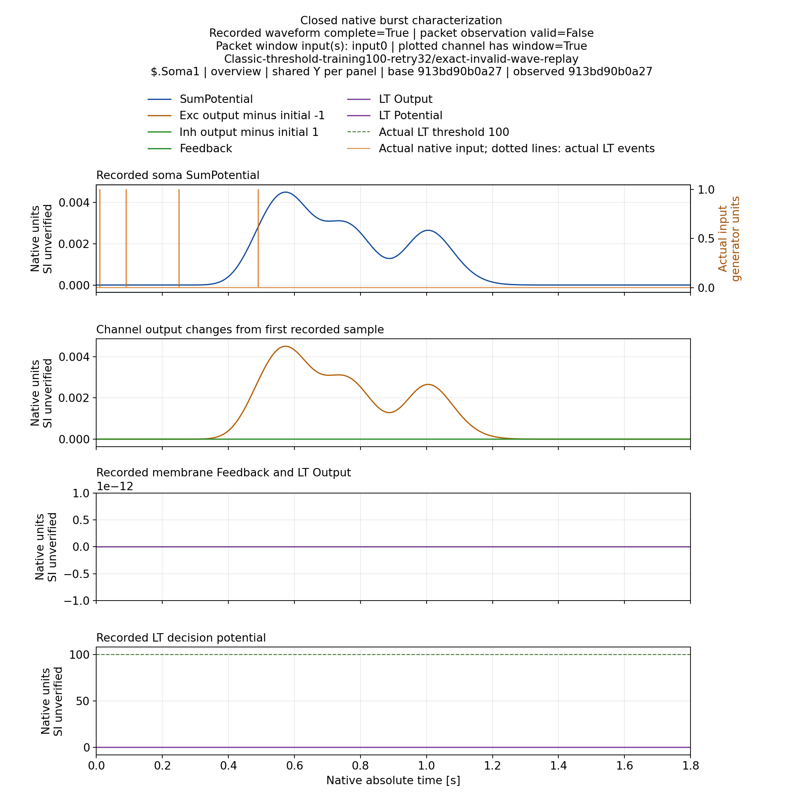
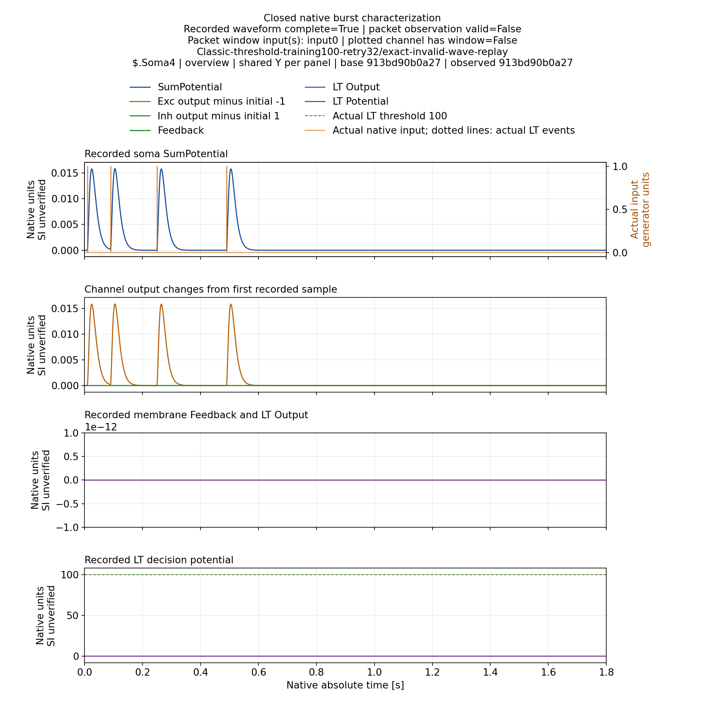
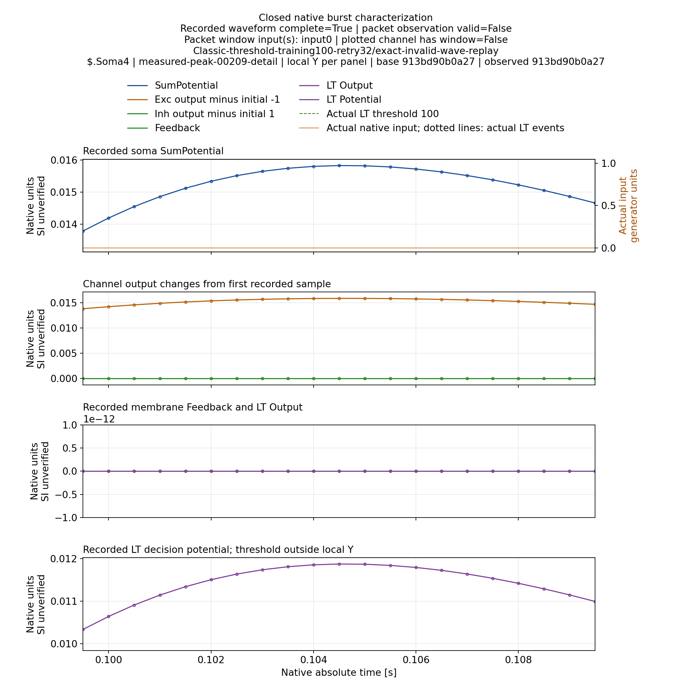

# Полнота сигнала, область измерения и читаемость графиков — 07.11.2026

Исправлена неоднозначная подпись `peak measurement valid=False` в диагностических
отчётах. Теперь отдельно указаны полнота записанного сигнала, валидность пакета
измерений и наличие измерительного окна именно у показанного soma channel.
Полная запись с несколькими пиками не объявляется повреждённой из-за отказа
training assignment. Это изменение представления; C++ сопоставление откликов
и его ограничения данным исправлением не изменены.

Контракт пользователя: **Train — максимум закреплённого импульса; Test — общий
максимум реакции на паттерн в полном окне**. Для классификации дополнительно
проверяются реальные выходные спайки, включая поздние ложные срабатывания.
Общий максимум не становится индивидуальным training measurement.

## Изменение production renderer

В `Scripts/StructTrain/TimeLearner/channel_diagnostic_reports.py` введён явный
`observation_context`, manifest schema 2 и подписи с областью окна. Legacy field
сохранён для чтения, но больше не служит единственной подписью рисунка.
Весь видимый текст этого renderer имеет размер не менее 12 pt. Положение
легенды рассчитывается по фактическим границам заголовков и первой панели:
минимальный зазор 12 px и проверка горизонтальных границ. Если компоновка не
помещается, renderer отказывает вместо публикации перекрытого рисунка.
Остальные пользователи общего `figure_title` сохраняют прежний default.

Код финального render: root `9303d8442a8a2e13e968b48ecac888aacbea4bc9`.
Измеренные данные, thresholds, временные окна и физика не менялись.

## Проверка на M40

Использована сохранённая native Classic запись из
`cd8d32168c3580948d0684f6ccad9f64f8527d94`, без новых native calculations.
В ней четыре soma channels, а packet window относится только к input0/channel0.
Следовательно, отказ этого пакета нельзя приписать отдельному измерению Soma4,
которого данный пакет не выполнял. Baseline и observed model hashes сохранены.

Три production tests прошли без skips: отказ при отсутствии scope, независимые
caption flags и реальные различия Soma1/Soma4 в исходном native observation.
Перестроены все четыре soma reports: 163 views, 491 hashed cache files. Для
каждого view численные metadata и временная область точно совпали с исходным
render `8bc32a401e5b330597ee4f0328b6683f69ad6a7a`; новые font/layout metadata
проверены отдельно. Все views имеют минимум 12 pt и зазоры легенды около
27.77 px сверху и снизу. Проверены 16 bindings исходных native файлов и 380
hashes исходников инструмента. Это не новые независимые нейронные эксперименты.

Полный cache:
`/media/user/Data/TimeLearnerRefactor/ReportsCache/channel-observation-scope-normal-a4`.
Среда: существующий plot venv, Matplotlib 3.9.4 / Pillow 13.0.0. В Git сохранены
три выбранных PNG (814374 bytes), manifests, recipe и compressed evidence.
Вся группа worker закрыта, lease освобождена после проверки closure.

## Попытки и ограничения доказательств

| Попытка | Фактический исход |
|---|---|
| A1 | Три tests прошли; render не запущен из-за отсутствия Matplotlib в system Python |
| A2 | Render завершён через существующий venv; wrapper ошибочно разбирал только последнюю строку многострочного JSON |
| A3 | Read-only проверка A2 подтвердила файлы и metadata; последующий визуальный просмотр обнаружил перекрытие легенды с заголовком |
| A4 | После изменения layout tests повторены, выполнен новый render; три выбранных рисунка просмотрены и приняты |

A1/A2 failures сохранены, технический A3 PASS не объявляется визуальной
приёмкой. Его [первичная проверка](ChannelObservationScopeInitialVerification.json)
не проверяла отсутствие перекрытия; этот пробел закрыт A4 и ручным просмотром.
Полные 163 views вручную не просмотрены. Branch, N>4, вся trial/mode matrix и
воспроизведение всех отчётов из чистого checkout остаются отдельными gates.

Evidence A1–A3: `65523bff729cf8d1f454218bbc6f60f4032917b9`.
Финальный A4: `9ff92911338fe91caa8ebf1fcaa0f4785c5f4be4`.
[Bundle A4](../../../Reports/StructTrain/TimeLearner/s07-channel-observation-scope-m40-a4/a4/bundle.json)
содержит 19 members, 48764 compressed bytes, SHA256
`db9738ac247e05d773c7f6be84f4a682d941dede0c387da598aeb7a6f8c527bd`.
[Независимая metadata-проверка](ChannelObservationScopeVerification.json)
и [визуальная приёмка](ChannelObservationScopeVisualQA.json).

## Принятые рисунки

Soma1: полная запись, packet assignment отказал, измерительное окно есть.

Soma4: полная запись; окно packet относится к другому каналу. Эти данные нельзя
выдавать за новую пробу обучения input3.

Детальный масштаб показывает реальные sample markers. Порог 100 вне локального
диапазона явно указан; LT decision potential не подменяется Soma SumPotential.

