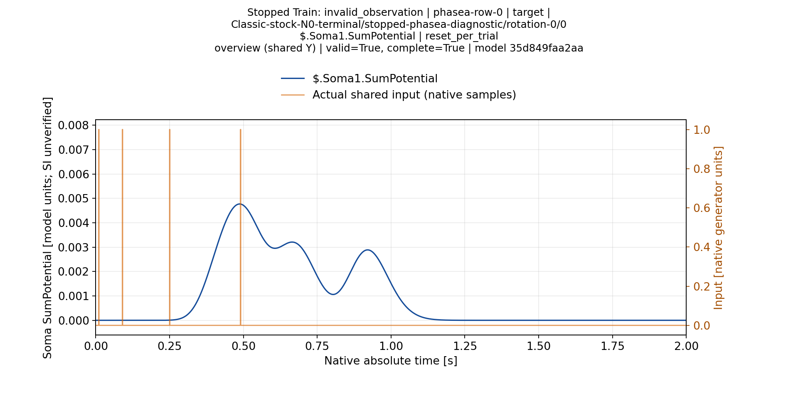
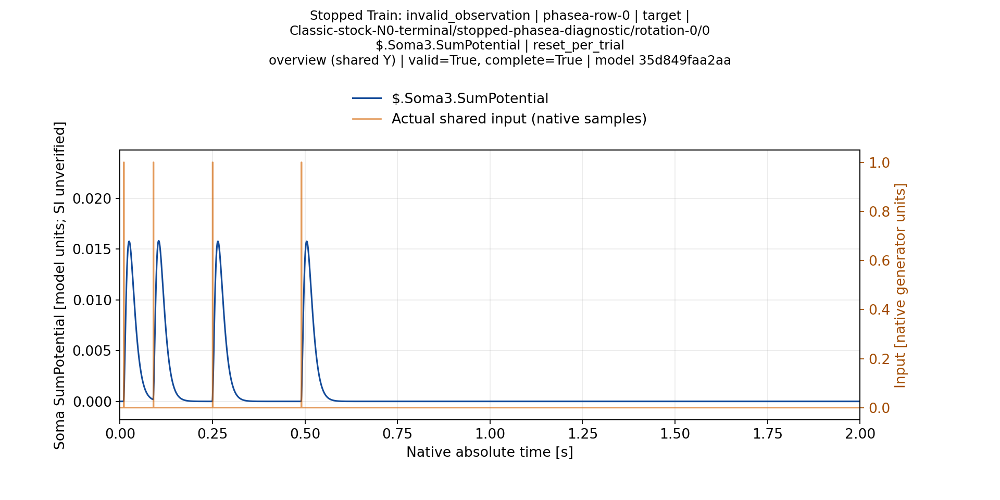
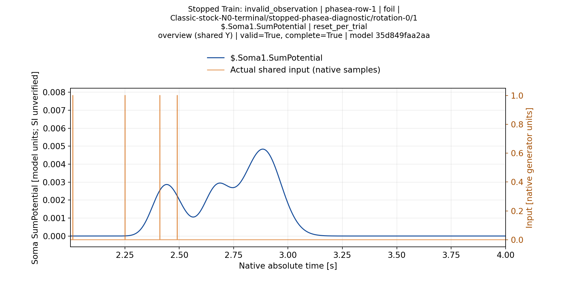
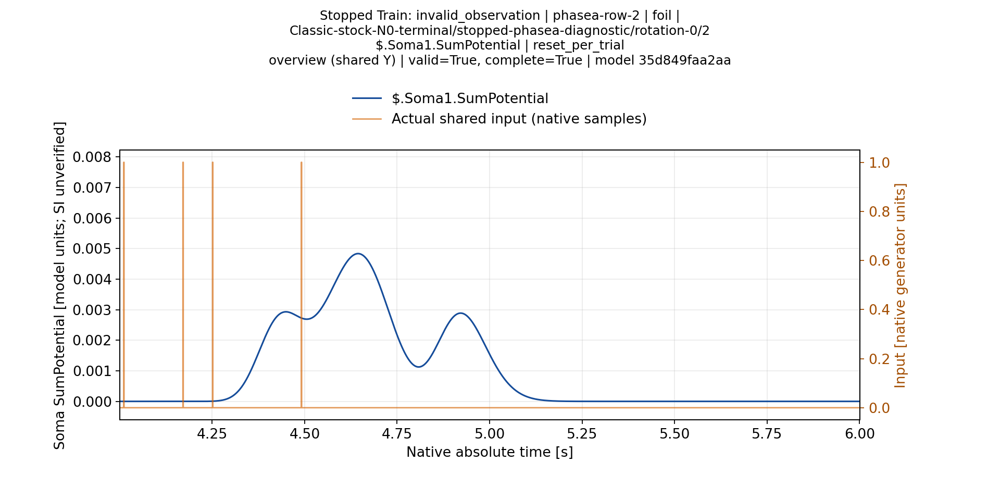
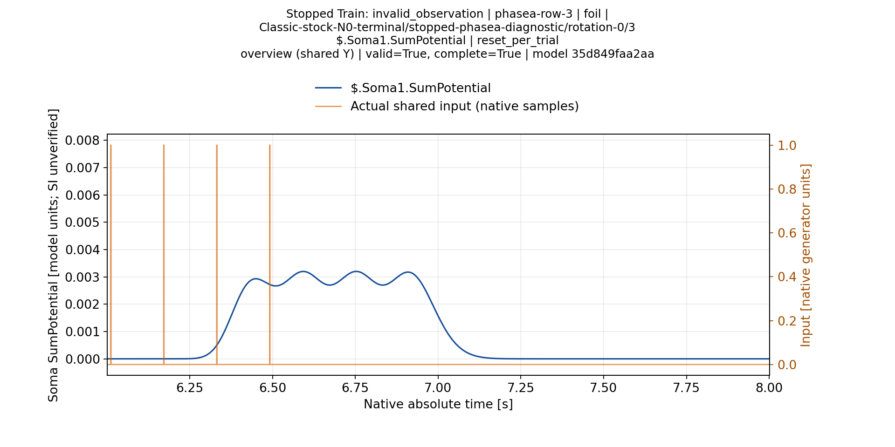
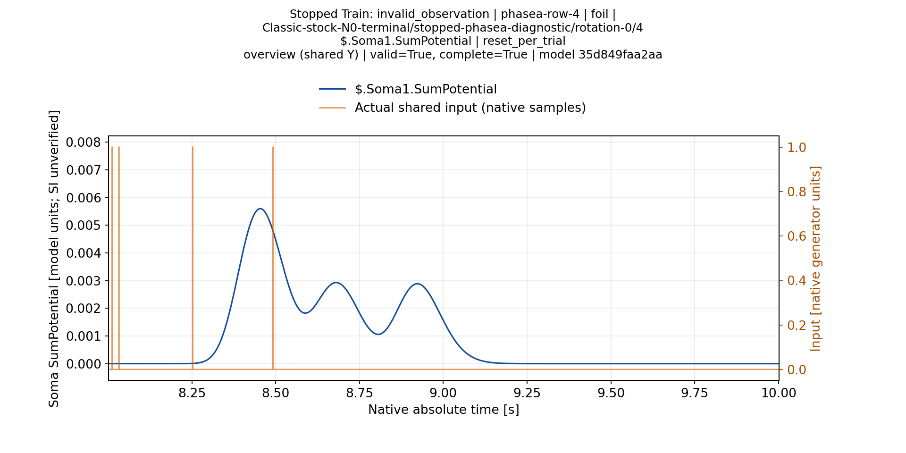
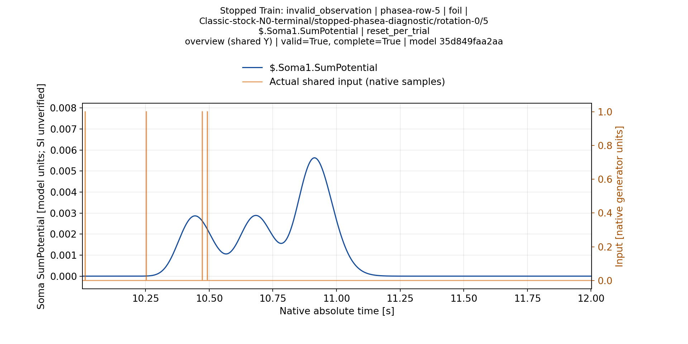
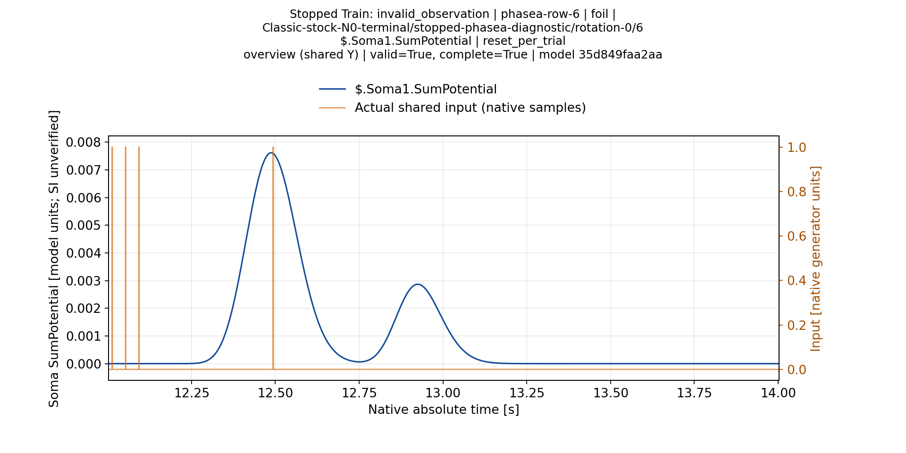
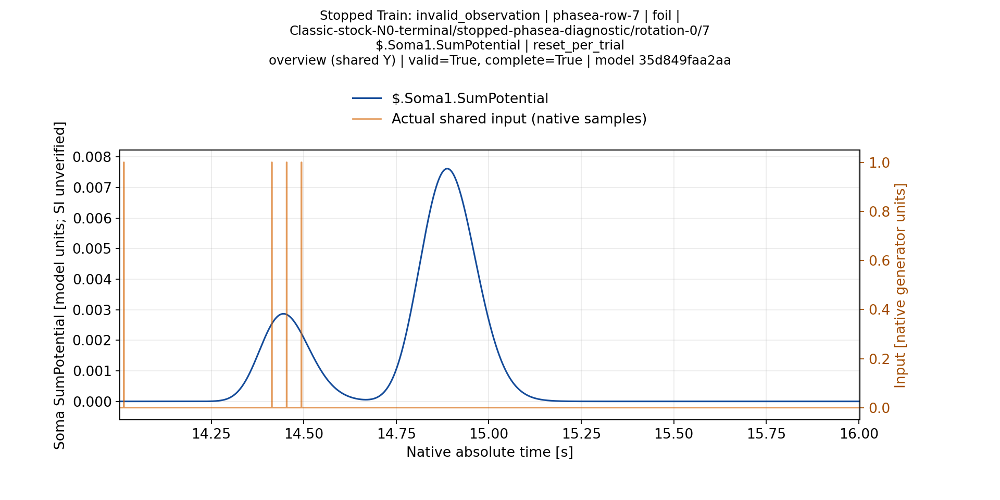

# Classic N0: реакции остановленной модели на все восемь паттернов

Получены восемь полных валидных реакций фактической модели после остановки Train. При исходном пороге100 все паттерны молчат: TP0/FP0/FN1/TN7. Это отрицательная диагностическая оценка: целевой паттерн пропущен. Accuracy7/8 здесь не означает успешную классификацию.

[Train](ValidationPlans/M40StockN0ClassicTrainA1-20261114/RESULT.ru.md) завершился invalid_observation/ambiguous:13 измеренных кандидатов, ни одного timing-ready, Ns>1 ещё не исследовалось. Для frozen Test взято настоящее конечное состояние L=[45,1,1,1], Ns1, Rs86M; лучший промежуточный кандидат и шаблон не подставлялись. [Frozen execution/import proof](ValidationPlans/M40StockN0ClassicFrozenA1-20261114/RESULT.ru.md) подтверждает неизменность всей модели и source graph.

Использован stock NSPNeuronGen **без LTMembrane**,2000Гц, reset-per-trial, полные окна2с. Матрица PhaseA1c1464e248f8744e858bd66df0be99e39969fd65: один target и семь foils. Это проверка исходного порядка, без выводов о перестановках/ITI и без независимой оценки. Августовские визуально подтверждённые4/8–6/8 другого исходного протокола этот опыт не отменяет.

Ниже — максимумы на всём записанном окне каждого паттерна. Это описательные измерения, а не присвоение максимума отдельному входному импульсу при Train. Единицы модели; перевод в SI/mV не подтверждён. LTZone.Potential — канал принятия порогового решения; порог100 нельзя прикладывать к отдельной Soma.SumPotential.

|Паттерн|Метка|Максимум Soma1|Максимум LTZone.Potential|Спайки|
|---|---|---:|---:|---:|
|phasea-row-0|target|0.004769066|0.013003673|0|
|phasea-row-1|foil|0.004834544|0.012527425|0|
|phasea-row-2|foil|0.004834542|0.012508353|0|
|phasea-row-3|foil|0.003198965|0.012503890|0|
|phasea-row-4|foil|0.005598200|0.017207756|0|
|phasea-row-5|foil|0.005626837|0.017701234|0|
|phasea-row-6|foil|0.007614688|0.013672512|0|
|phasea-row-7|foil|0.007614691|0.013677236|0|

В nonspiking-записи четыре foil имеют максимум LT выше target. Поэтому эти максимумы не дают идеального порогового разделения данной матрицы. Это ещё не доказательство невозможности разделения при настоящем спайковом пороге: обратное влияние спайка способно изменить последующую динамику. Первый Same-Matrix опыт по midpoint rule предложил0.012765548843211696, но отказал до новых native-проб при смене libc. Позже [отдельный A2 с новым явно объявленным runtime завершён](ClassicN0ThresholdScientificReport-20261114.ru.md): baseline waveform точно равен исходному, настоящий candidate run дал TP1/FP4/FN0/TN3, target0.503с после последнего input0.49с. Это реальные спайки при одном заранее выбранном пороге, без нового подбора по исходу. Старый runtime не переписан; прежний proxy/A1 не переименованы в принятую классификацию. Время общего максимума тоже не заменяет проверку времени первого реального спайка относительно последнего входного импульса.

## Визуальная проверка

[Production report1/1](ValidationPlans/M40StockN0ClassicReportA2-20261114/RESULT.ru.md) построил32 пары «паттерн × сома», PNG/SVG/PDF обзоры и увеличения без прореживания. На увеличениях минимум8 пикселей на native timestep; оригиналы1920×960. Все11 выбранных ниже обзорных PNG просмотрены: подписи читаемы, вершины и хвосты видны, фактические входы наложены на отдельную правую ось, обрезания кривых нет. Масштаб Y для одной сомы одинаков во всех паттернах. Полный manual acceptance всей галереи и всех увеличений не заявлен; исходный manifest visual_acceptance_complete=false сохранён.

На Soma1 виден широкий многовершинный отклик длинного пути. В нескольких foil вершина выше target. На target Soma2–4 видны быстрые реакции коротких путей. Эти наблюдения не подтверждают завершённую синхронизацию: обучение остановлено до её финальной проверки. Несколько вершин полного Test-отклика сами по себе не являются ошибкой измерения закреплённого импульса при Train.

### Target: все четыре сомы

### Остальные семь паттернов: Soma1

## Воспроизводимость и границы

Native SDK root74e5d206d4b619fcf81f77f11b54ebec7b8f0f6e/Pulse7c6c94785af0c83104d348bb3b733ed1f149c8a8, runtime105ccc46bf2d23aa093ee6ec5fb088d9f33faa8e572f8191869f8cc279377a8a. Source package SHA256d8d545f9d0e9a038e7dc232ad86de94213496ac94481a1c32a822b3b98c3f070, model revision35d849faa2aaea5d2620f0fd59d9934c77760b7fde0dd49d3284539f69f68263. Кандидат правки N0 Pulse58c в этих наблюдениях не использовался.

Полный воспроизводимый cache M40: `/media/user/Data/TimeLearnerRefactor/readbacks/s11-stock-n0-classic-report-m40-a2/worker/tmp/stock-n0-frozen-gallery`. В Git входят метрики, provenance и11 выбранных исходных PNG суммарно1,652,436B. [Полный frozen primary50,654,144B сохранён в Git](ValidationPlans/M40StockN0ClassicFrozenPrimaryA1-20261114/RESULT.ru.md):330 members, неизменённые source/models/observations. Независимый replay этого нового архива ещё открыт. [Реестр текущей готовности](ExperimentReadiness.ru.md) отделяет этот отрицательный результат от приёмки controller kernel, будущего SDK gate и физического сравнения нового поиска.
