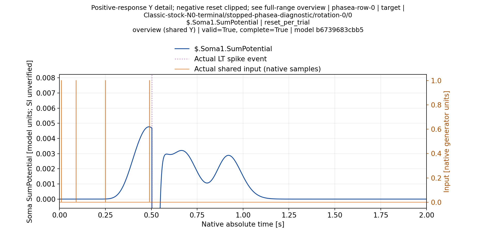
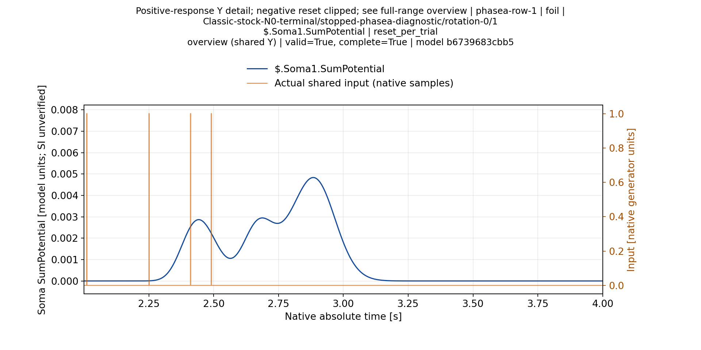
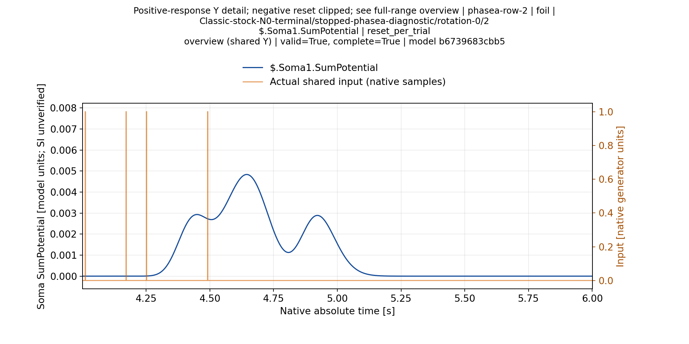
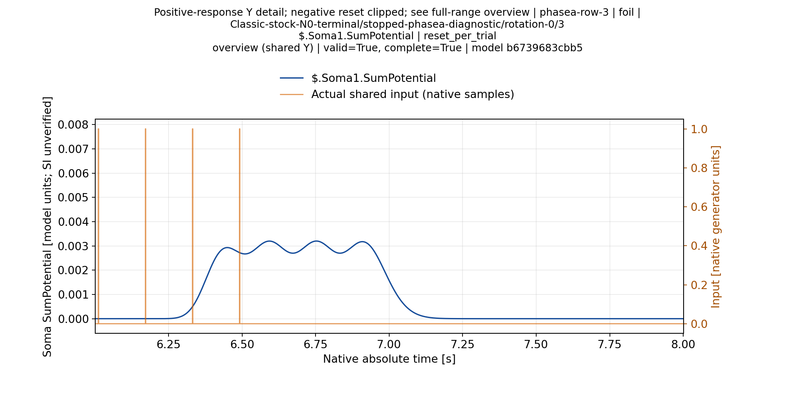
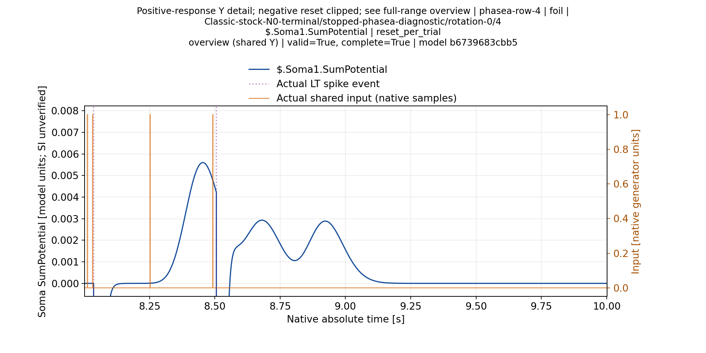
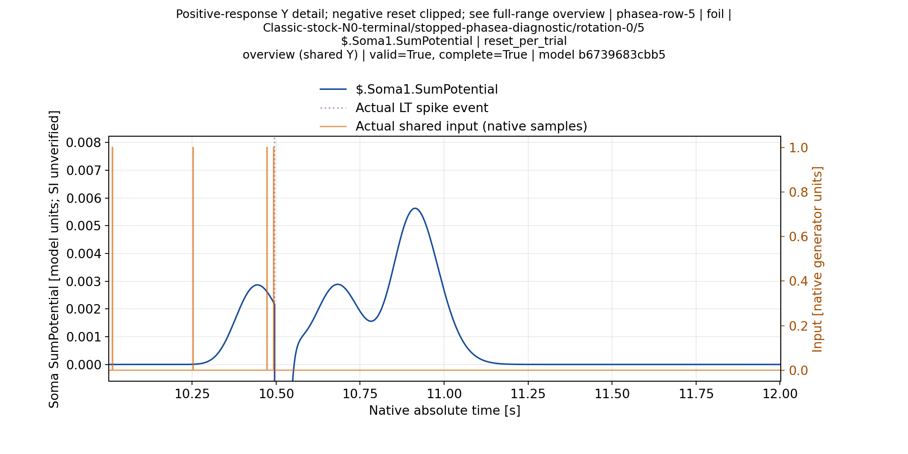
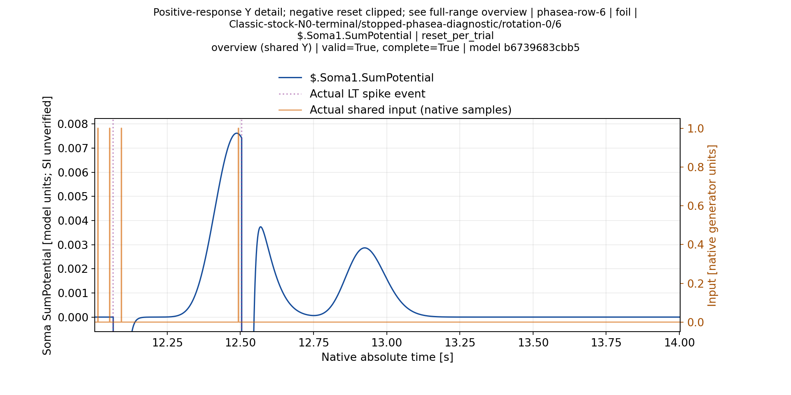
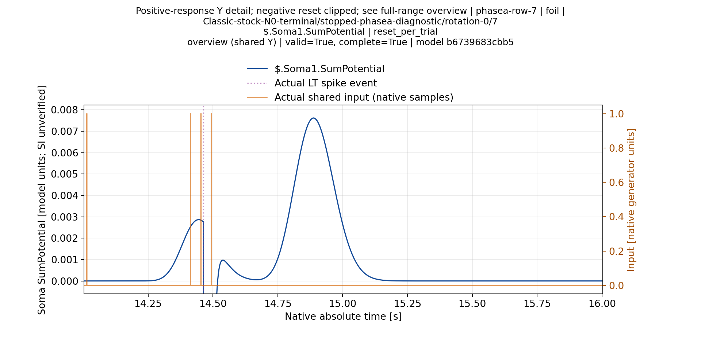

# Classic N0:64 frozen пробы с target во всех позициях —14.11.2026

**Во всех восьми проверенных порядках получены TP1/FP4/FN0/TN3.** По64 пробам:TP8/FP32/FN0/TN24,32 правильных ответа из64 и32 ложных реакции из56 foil. Каждый pattern сохранил класс ответа во всех позициях. Target каждый раз дал один спайк примерно0.503с от начала своей пробы —13мс после последнего actual input0.49с. Перестановка не устранила ложные срабатывания этой модели при этом пороге и reset policy.

## Что зафиксировано

Та же реальная stopped Classic N0 модель L=[45,1,1,1],Ns1,Rs86M, stock NSPNeuronGen **без LTMembrane**,2000Гц; тот же threshold0.012765548843211696.64 полных окна по2с,reset_per_trial, восемь cyclic rotations исходных8 pattern IDs/hashes. Новый Train и подбор порога не выполнялись. Это8 детерминированных предъявлений каждого pattern одной модели, не8 независимых обучений либо случайных seeds. ITI и continuous stream не менялись и отдельно здесь не проверены.

Source model revision35d849faa2aaea5d2620f0fd59d9934c77760b7fde0dd49d3284539f69f68263; C++ SDKroot74e5d206d4b619fcf81f77f11b54ebec7b8f0f6e/Pulse7c6c94785af0c83104d348bb3b733ed1f149c8a8, runtime377e0ebdee7bb1fa1cc11346438a1d2102b2124f08e3054b6347400c10a4f335. Новое исправление N0 geometry здесь не использовалось. Исходное обучение остановлено invalid_observation/ambiguous, certificate=null. Порог ранее выбран на той же матрице и теперь зафиксирован; это Historical Same-Matrix diagnostic, не независимая калибровка/оценка.

## Фактический итог

|Pattern|Метка|Результат в каждой позиции|Число таких ответов|
|---|---|---|---:|
|phasea-row-0|target|TP|8|
|phasea-row-1|foil|TN|8|
|phasea-row-2|foil|TN|8|
|phasea-row-3|foil|TN|8|
|phasea-row-4|foil|FP|8|
|phasea-row-5|foil|FP|8|
|phasea-row-6|foil|FP|8|
|phasea-row-7|foil|FP|8|

|Позиция target, начиная с1|Rotation|Target spike от начала пробы,мс|После последнего input,мс|TP/FP/FN/TN|
|---:|---:|---:|---:|---|
|1|0|503|13|1/4/0/3|
|2|7|503|13|1/4/0/3|
|3|6|503|13|1/4/0/3|
|4|5|503|13|1/4/0/3|
|5|4|503|13|1/4/0/3|
|6|3|503|13|1/4/0/3|
|7|2|503|13|1/4/0/3|
|8|1|503|13|1/4/0/3|

Времена в таблице округлены для чтения; полные значения сохранены в первичных данных. Ранние и поздние foil spikes учитываются, молчание target не выдаётся за успешную детекцию. Неизменность класса не является заявлением о побайтном равенстве всех64 waveforms: такое равенство проверено для первых8 относительно исходного опыта.

## Проверки и доступность данных

[Production1/1 и полные результаты](ValidationPlans/M40ClassicN0OrderMatrixA3-20261114/RESULT.ru.md): все64 observations complete/valid; first8 waveform samples/model_before точно равны исходному8-trial run. Native model.json/model-after.json побайтно равны исходной модели; source package/manifest неизменны. Outer completed3706.5094792968594с, whole group закрыта. Канонический scorer использует labels/IDs и полное множество trials; положение target в первой строке не является условием результата.

[Полный compact primary](ValidationPlans/M40ClassicN0OrderPrimaryA1-20261114/RESULT.ru.md):55,527,604B XZ,396 logical members вместо1.234GB expanded. В Git доступны все необходимые модели,64 observations, восемь baseline observations, конфиги и receipts. Независимый semantic restore этого нового архива ещё открыт. A1/A2 неверный режим запуска отклонён до native execution; failures сохранены и не считаются опытами модели.

## Все8 паттернов: проверенная исходная матрица

Ниже явно повторно использованы проверенные рисунки [исходного реального опыта](ClassicN0ThresholdScientificReport-20261114.ru.md). Первые8 новых waveform samples, inputs и model_before **точно совпали** с его candidate run, поэтому это визуализация воспроизведённого baseline, а не подмена нового порядка старым. Оранжевый — actual input, пунктир — actual LT events; единицы модели, SI не подтверждён. Для положительного диапазона Y отрицательный reset clipped; полный диапазон и LT decision figures доступны в исходном отчёте. Новая собственная gallery для каждого положения target строится отдельно.

### phasea-row-0:target,TP

### phasea-row-1:foil,TN

### phasea-row-2:foil,TN

### phasea-row-3:foil,TN

### phasea-row-4:foil,FP

### phasea-row-5:foil,FP

### phasea-row-6:foil,FP

### phasea-row-7:foil,FP

## Границы вывода

Получен валидный отрицательный результат для разделимости и положительный контроль повторяемости классов в восьми заданных cyclic orders при2с/reset_per_trial. Это не доказательство независимости от любого порядка/ITI/reset, не оценка других моделей и не завершённое обучение. Другой реальный порог может менять динамику через spike feedback; offline sweep этих spiking CSV не заменяет нового native прогона. Надёжная классификация без большинства ложных срабатываний пока не получена. Августовские визуально подтверждённые4/8–6/8 другого исходного протокола этим опытом не отменяются.
