# Classic N0: реальный спайковый опыт с одним заранее выбранным порогом — 14.11.2026

При пороге0.012765548843211696 получены **TP1/FP4/FN0/TN3**, то есть4/8 правильных ответов и4/7 ложных реакций на foil. Target дал спайк0.503с после последнего фактического входа0.49с, с задержкой13мс. Это наблюдаемая реакция на завершённый target в данном опыте, но плохая разделимость. Завершённое обучение, независимая оценка и устойчивость к порядку/ITI не подтверждены.

## Что именно проверялось

Взята настоящая остановленная Classic N0 модель L=[45,1,1,1],Ns1,Rs86M, stock NSPNeuronGen **без LTMembrane**,2000Гц, reset-per-trial, восемь окон по2с. Её Train закончился invalid_observation/ambiguous, certificate=null. Это прежний SDK root74e5d206d4b619fcf81f77f11b54ebec7b8f0f6e/Pulse7c6c94785af0c83104d348bb3b733ed1f149c8a8; новый N0 geometry fix здесь не использовался.

Модель revision35d849faa2aaea5d2620f0fd59d9934c77760b7fde0dd49d3284539f69f68263. Same-Matrix midpoint rule выбрал ровно один threshold между target максимумом0.01300367280159831 и наибольшим строго меньшим foil максимумом0.012527424884825084. Выбор сделан на той же матрице, поэтому это diagnostic Historical Same-Matrix, не independent Test и не завершённая калибровка. Новые пороги после результата не подбирались.

После смены системных библиотек объявлен отдельный runtime377e0ebdee7bb1fa1cc11346438a1d2102b2124f08e3054b6347400c10a4f335. Сначала реально повторён baseline100: waveform **точно совпал** с исходной записью, все8 паттернов молчат (TP0/FP0/FN1/TN7). Затем с тем же frozen состоянием выполнен настоящий candidate run, а не offline sweep. Все16 наблюдений complete/valid; модель и исходный граф не изменены. [Исходные результаты и provenance](ValidationPlans/M40StockN0ClassicThresholdA2-20261114/RESULT.ru.md).

## Реальные ответы

Время приведено в абсолютной native шкале. Для foil считается любой спайк в полном окне; ранние события не отбрасываются.

|Паттерн|Метка|Спайки, с|Последний вход, с|Ответ|
|---|---|---|---:|---|
|phasea-row-0|target|0.503|0.49|TP|
|phasea-row-1|foil|нет|2.4905|TN|
|phasea-row-2|foil|нет|4.491|TN|
|phasea-row-3|foil|нет|6.4915|TN|
|phasea-row-4|foil|8.0355;8.5055|8.492|FP, в том числе ранний|
|phasea-row-5|foil|10.495|10.4925|FP|
|phasea-row-6|foil|12.065;12.504|12.493|FP, в том числе ранний|
|phasea-row-7|foil|14.4635|14.4935|FP, ранний|

У target входы0.01/0.09/0.25/0.49с. То, что он ответил после четвёртого входа, не устраняет ложные реакции на четыре других паттерна. На этой остановленной модели пока нельзя заявить надёжную классификацию. Результат4/8 не является переоценкой августовских визуальных4/8–6/8 другого исходного протокола.

## Визуальная проверка и воспроизводимость

[Собственный read-only отчёт принят1/1](ValidationPlans/M40StockN0ClassicThresholdReportA2-20261114/RESULT.ru.md) из actual candidate run: все8 паттернов ×4 записанные сомы с фактическими входными импульсами; отдельно LTZone.Potential, настоящий threshold и реальные LT events. Общий максимум при Test описывает полный отклик, а не подменяет assigned-impulse максимум Train. Порог LTZone не наносится на отдельные Soma.SumPotential как будто это одна величина. Единицы модели, перевод в SI/mV не подтверждён. Просмотрены27 исходных выбранных PNG и11 дополнительных Soma Y-details. Полная gallery2534 PNG не выдаётся за целиком просмотренную. Отрицательный reset на full-range рисунках около−0.38 существенно больше положительного отклика; ниже отдельно показана положительная часть с явным clipping отрицательного участка. Это выбор масштаба оси, не удаление samples. В дополнительном LT Y-detail A1 найдена неверная подпись оси; его8 LT PNG не используются до исправленного server render. Исходные LT figures ниже подписаны корректно.

[Полные модели, первичные трассы и receipts сохранены в Git без JSON rewrite](ValidationPlans/M40StockN0ClassicThresholdPrimaryA2-20261114/RESULT.ru.md):83,917,844B XZ/612 members; полная производная gallery остаётся кэшем M40. [Исходный fixed100 отчёт](ClassicN0FrozenScientificReport-20261114.ru.md) сохраняет свой отдельный результат. [Предыдущая A1](ValidationPlans/M40StockN0ClassicThresholdA1-20261114/RESULT.ru.md) отказала до новых native runs при несовпадении runtime; её proxy не выдаётся за эти actual spikes.

## Все восемь паттернов: Soma1 и реальные входы

Ниже положительный диапазон Y одинаков для всех8 Soma1. Большие отрицательные сбросы выходят ниже оси; их полный вид доступен отдельно. Пунктир — реальное LT-событие; оранжевый — фактически записанный вход. Один большой максимум полного Test-отклика не является измерением закреплённого импульса при Train.

### phasea-row-0: target, TP

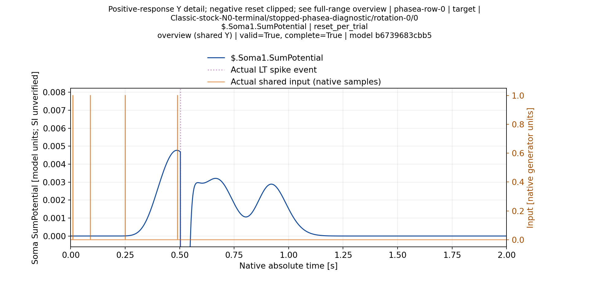

[Полный диапазон Soma1](ValidationPlans/M40StockN0ClassicThresholdReportA2-20261114/completed/worker/tmp/fixed-threshold-eight-pattern-gallery/trial-0000-soma-001/overview.png), [фактический LT decision channel](ValidationPlans/M40StockN0ClassicThresholdReportA2-20261114/completed/worker/tmp/fixed-threshold-eight-pattern-gallery/trial-0000-lt-decision/overview.png).

### phasea-row-1: foil, TN

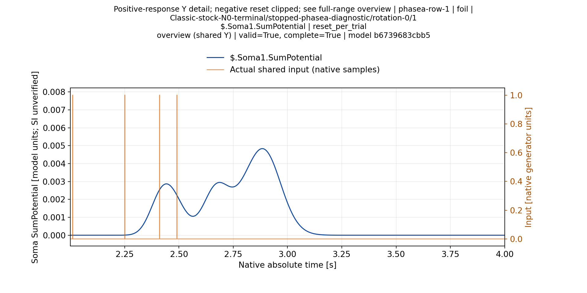

[Полный диапазон Soma1](ValidationPlans/M40StockN0ClassicThresholdReportA2-20261114/completed/worker/tmp/fixed-threshold-eight-pattern-gallery/trial-0001-soma-001/overview.png), [фактический LT decision channel](ValidationPlans/M40StockN0ClassicThresholdReportA2-20261114/completed/worker/tmp/fixed-threshold-eight-pattern-gallery/trial-0001-lt-decision/overview-detail.png).

### phasea-row-2: foil, TN

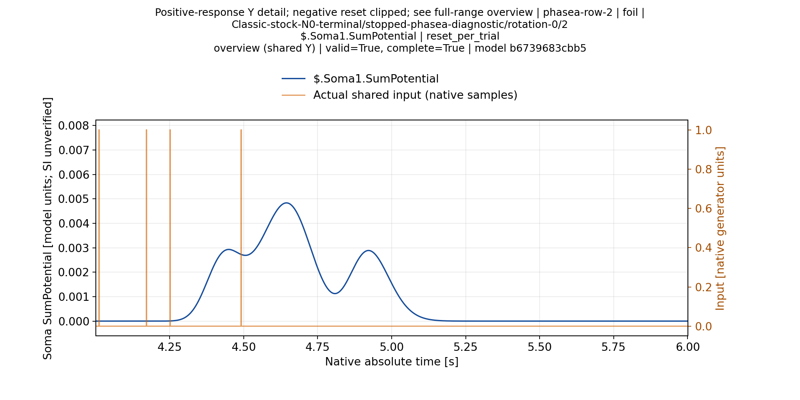

[Полный диапазон Soma1](ValidationPlans/M40StockN0ClassicThresholdReportA2-20261114/completed/worker/tmp/fixed-threshold-eight-pattern-gallery/trial-0002-soma-001/overview.png), [фактический LT decision channel](ValidationPlans/M40StockN0ClassicThresholdReportA2-20261114/completed/worker/tmp/fixed-threshold-eight-pattern-gallery/trial-0002-lt-decision/overview-detail.png).

### phasea-row-3: foil, TN

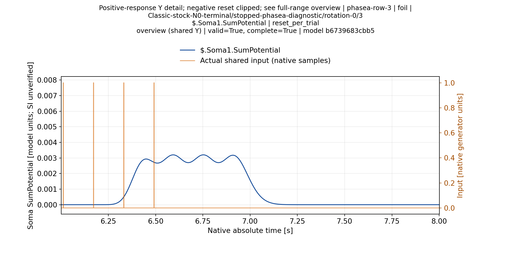

[Полный диапазон Soma1](ValidationPlans/M40StockN0ClassicThresholdReportA2-20261114/completed/worker/tmp/fixed-threshold-eight-pattern-gallery/trial-0003-soma-001/overview.png), [фактический LT decision channel](ValidationPlans/M40StockN0ClassicThresholdReportA2-20261114/completed/worker/tmp/fixed-threshold-eight-pattern-gallery/trial-0003-lt-decision/overview-detail.png).

### phasea-row-4: foil, FP

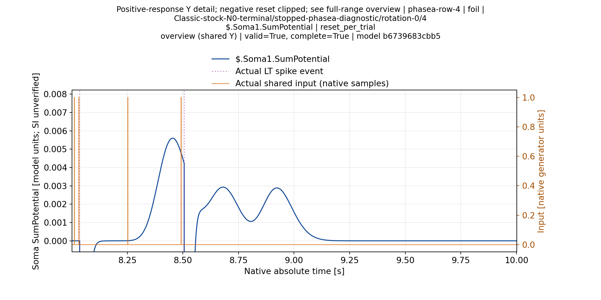

[Полный диапазон Soma1](ValidationPlans/M40StockN0ClassicThresholdReportA2-20261114/completed/worker/tmp/fixed-threshold-eight-pattern-gallery/trial-0004-soma-001/overview.png), [фактический LT decision channel](ValidationPlans/M40StockN0ClassicThresholdReportA2-20261114/completed/worker/tmp/fixed-threshold-eight-pattern-gallery/trial-0004-lt-decision/overview.png).

### phasea-row-5: foil, FP

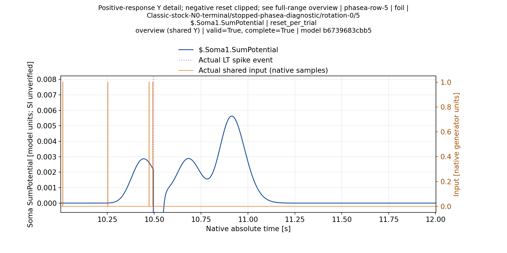

[Полный диапазон Soma1](ValidationPlans/M40StockN0ClassicThresholdReportA2-20261114/completed/worker/tmp/fixed-threshold-eight-pattern-gallery/trial-0005-soma-001/overview.png), [фактический LT decision channel](ValidationPlans/M40StockN0ClassicThresholdReportA2-20261114/completed/worker/tmp/fixed-threshold-eight-pattern-gallery/trial-0005-lt-decision/overview.png).

### phasea-row-6: foil, FP

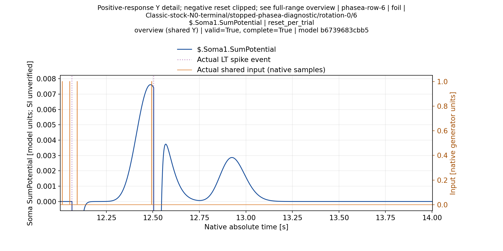

[Полный диапазон Soma1](ValidationPlans/M40StockN0ClassicThresholdReportA2-20261114/completed/worker/tmp/fixed-threshold-eight-pattern-gallery/trial-0006-soma-001/overview.png), [фактический LT decision channel](ValidationPlans/M40StockN0ClassicThresholdReportA2-20261114/completed/worker/tmp/fixed-threshold-eight-pattern-gallery/trial-0006-lt-decision/overview.png).

### phasea-row-7: foil, FP

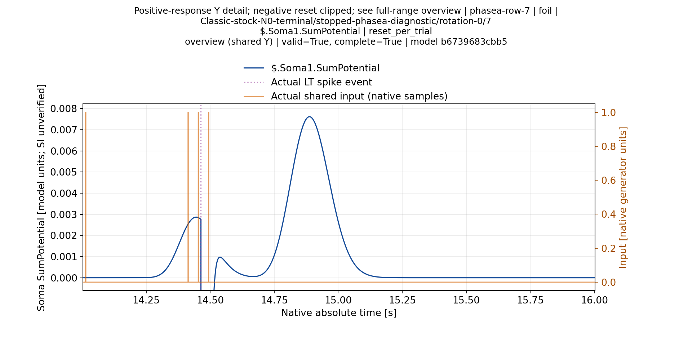

[Полный диапазон Soma1](ValidationPlans/M40StockN0ClassicThresholdReportA2-20261114/completed/worker/tmp/fixed-threshold-eight-pattern-gallery/trial-0007-soma-001/overview.png), [фактический LT decision channel](ValidationPlans/M40StockN0ClassicThresholdReportA2-20261114/completed/worker/tmp/fixed-threshold-eight-pattern-gallery/trial-0007-lt-decision/overview.png).

## Target: остальные сомы и момент спайка

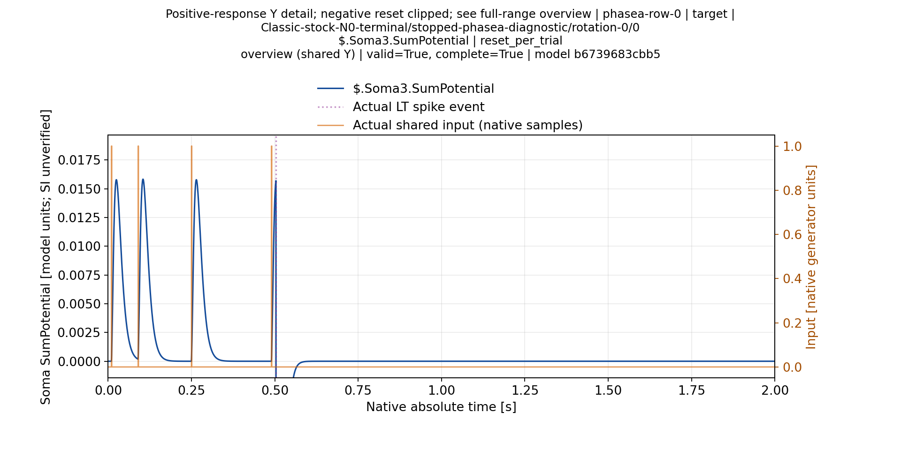

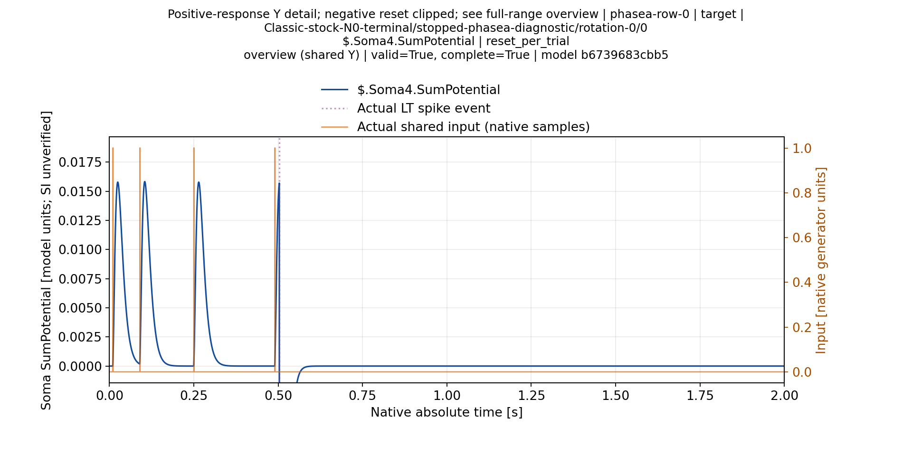

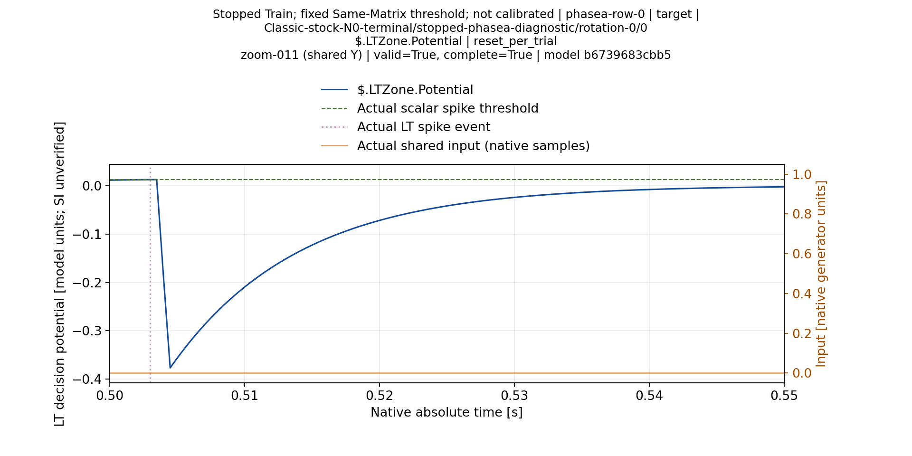

На zoom0.50..0.55с событие0.503с отмечено из первичной записи; после него виден отрицательный reset. Последний input0.49с лежит перед этим увеличением и виден на overview. After-children samples могут отражать уже изменённое LT состояние; отсутствие нарисованного sample выше порога не отменяет записанного native LT event.

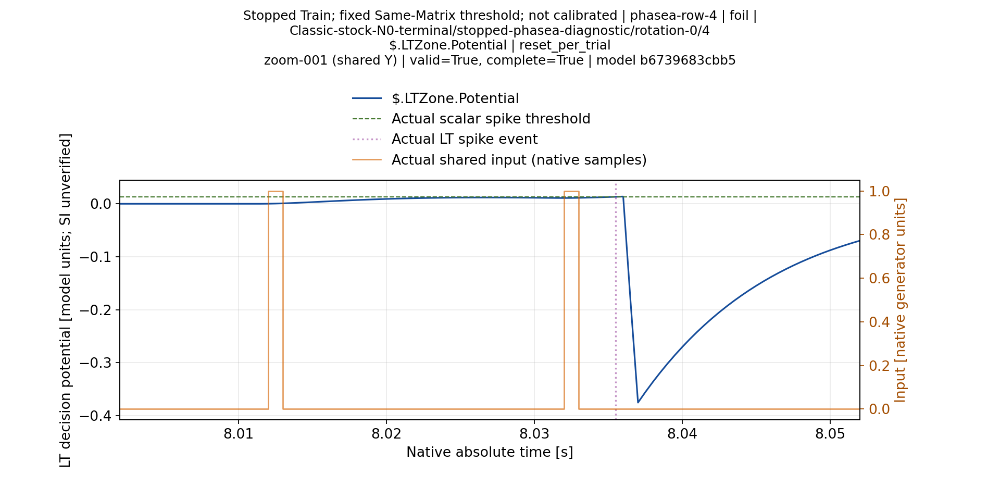

Ранний foil4 spike8.0355с появляется после двух близких входов, задолго до конца его пачки8.492с. Возможное накопление быстрых ответов — визуальная гипотеза причины FP, а не подтверждённое вмешательством объяснение.
