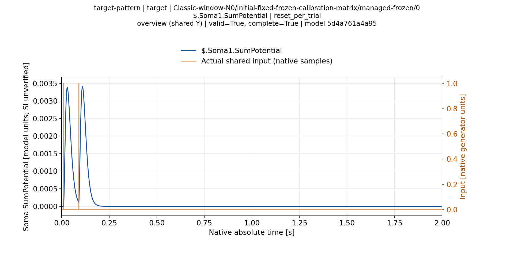
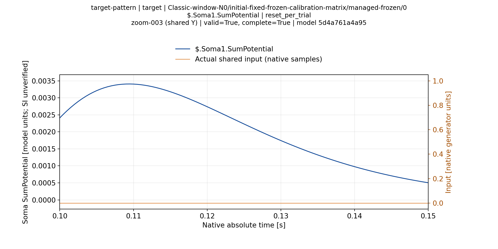
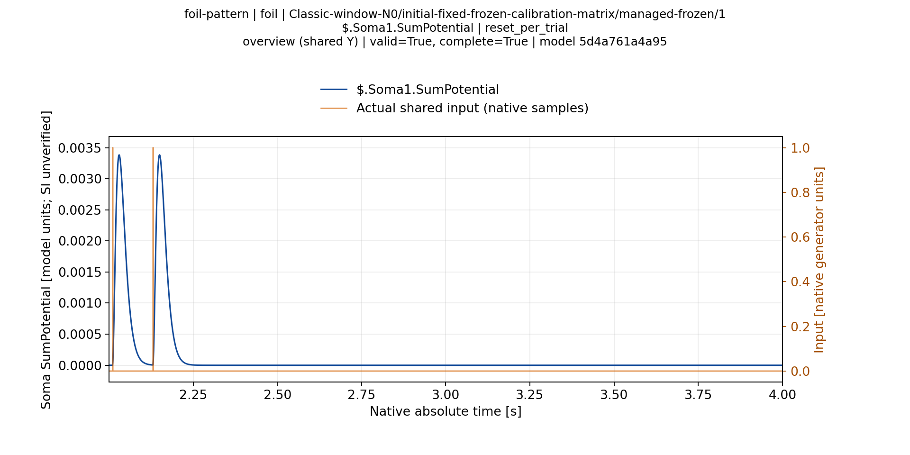
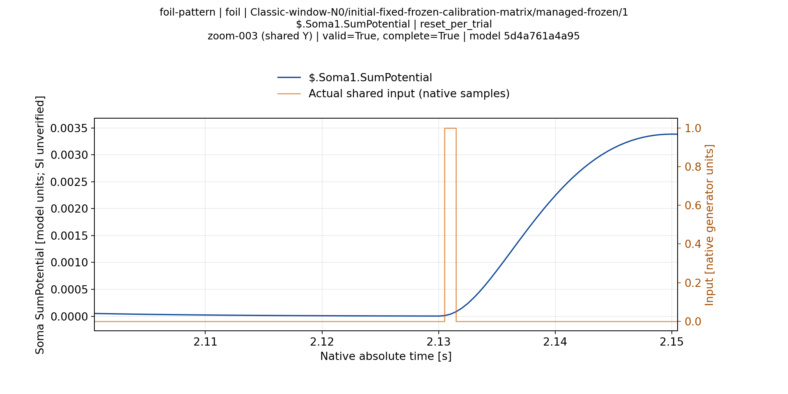
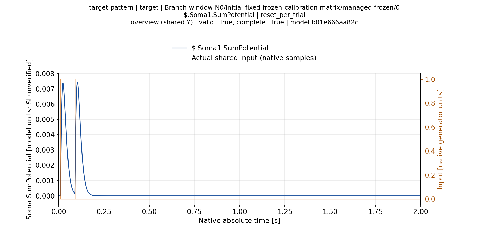
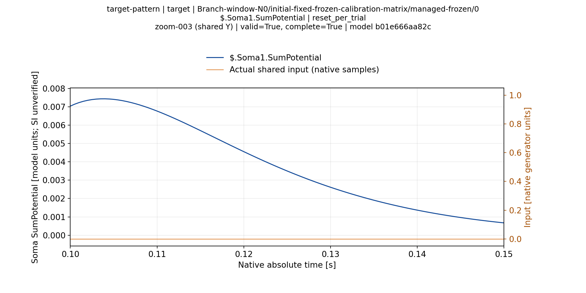
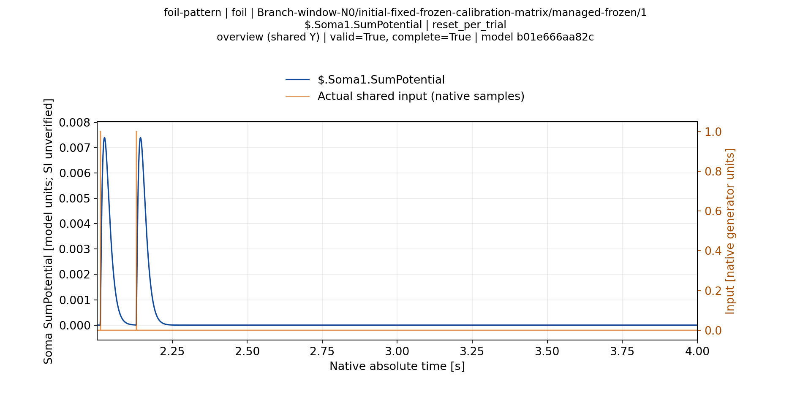
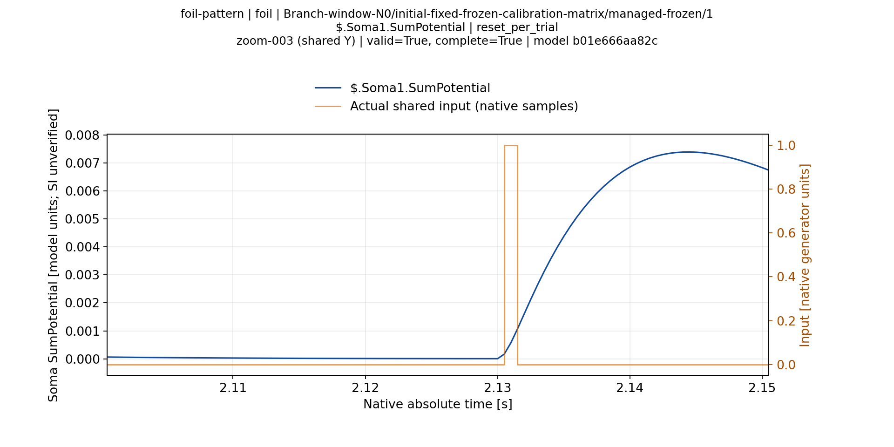

# Временные отчёты инженерного Console2 — 11.11.2026

Обе реальные топологии прошли автоматические проверки отчётов2/2: полные наблюдения, соответствие первичным данным, сохранность model/source hashes, все trial–soma пары и матрицы калибровки. Процесс завершён, вся группа закрыта, lease освобождён. [Результат](ValidationPlans/M40Cold7ConsoleReports2A3-20261111/actual-result.json). Полный кэш PNG/SVG/PDF хранится на M40; в Git добавлены только8 выбранных PNG.

Ручной просмотр8 выбранных изображений подтвердил читаемые оси и waveform, видимые фактические входы на overview и применимых zoom, отсутствие визуального обрезания. Размер1920×960; zoom использует все native samples,14.208px на timestep. Просмотр не распространяется на весь кэш или остальные сомы. [Пофайловые SHA и область просмотра](ValidationPlans/M40Cold7ConsoleReports2A3-20261111/selected-visual-review.json).

Это initial-fixed-frozen ответы до отдельной калибровки; их графики сами по себе не подтверждают успешную классификацию. Результат последующей реальной калибровки и повторного frozen Test описан [отдельно](Cold7Console2RuntimeAcceptance-20261111.ru.md). Вся серия инженерная: N=2,N0,2000Hz,Sync=.2,same-matrix, два уникальных паттерна; N4/default .02 и independent evaluation остаются открытыми. SI-единицы не подтверждены.

## Classic-window-N0

## Branch-window-N0

