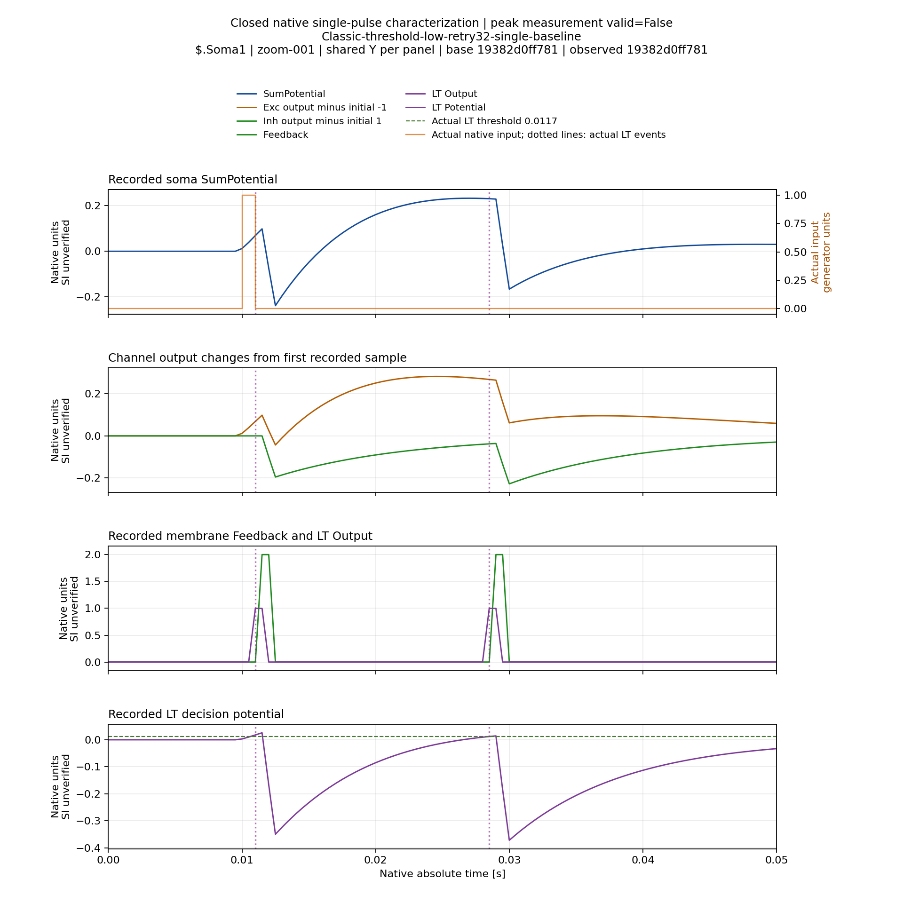
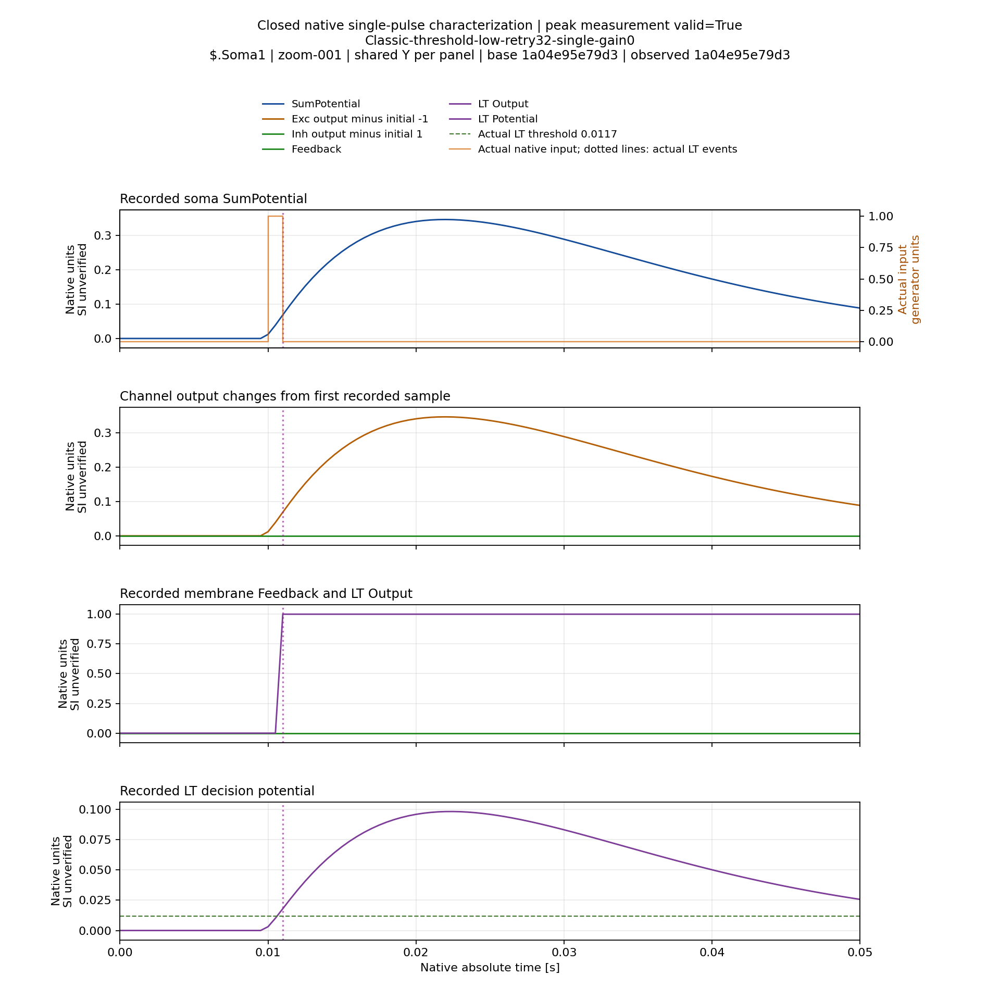
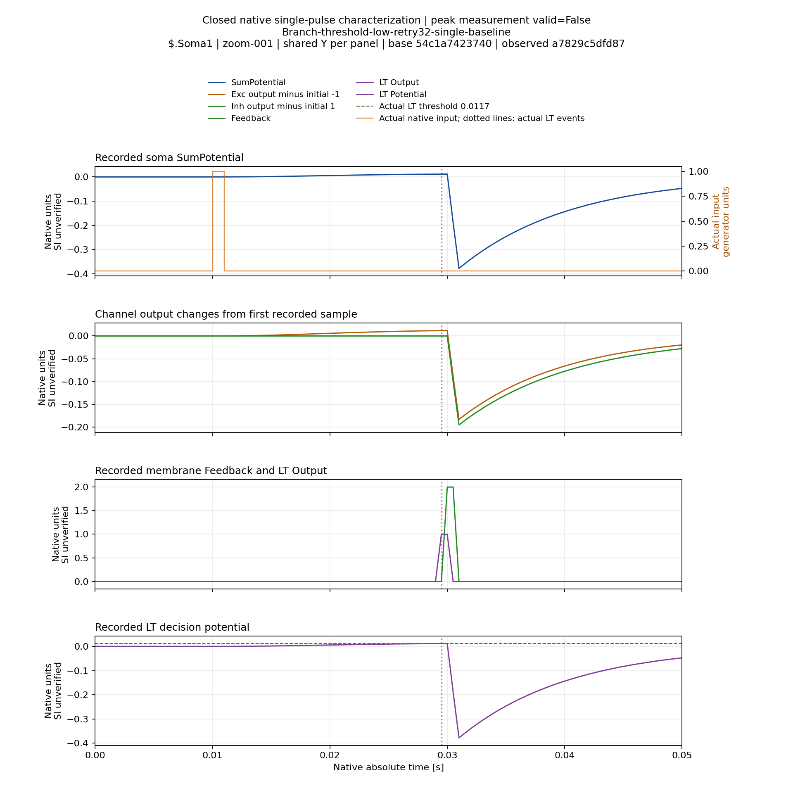
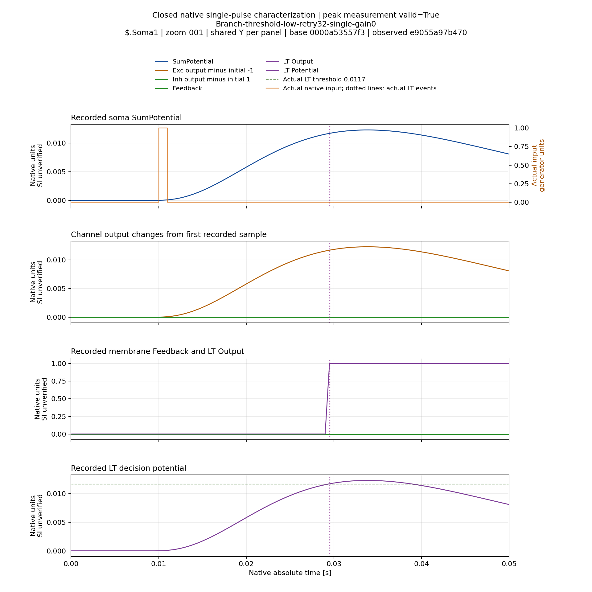
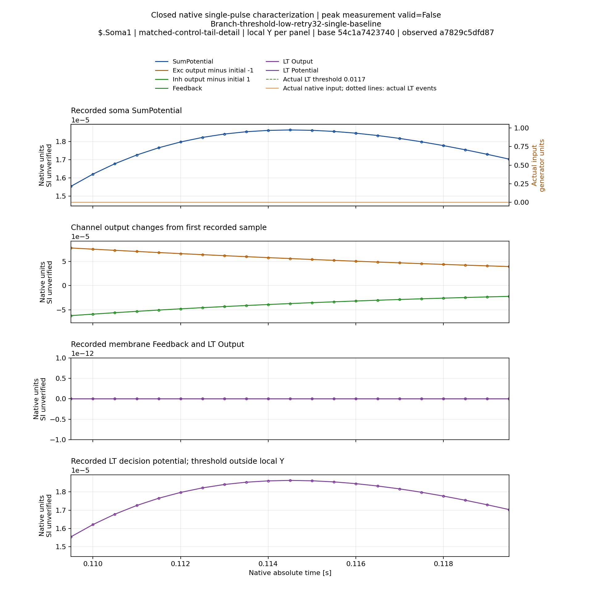
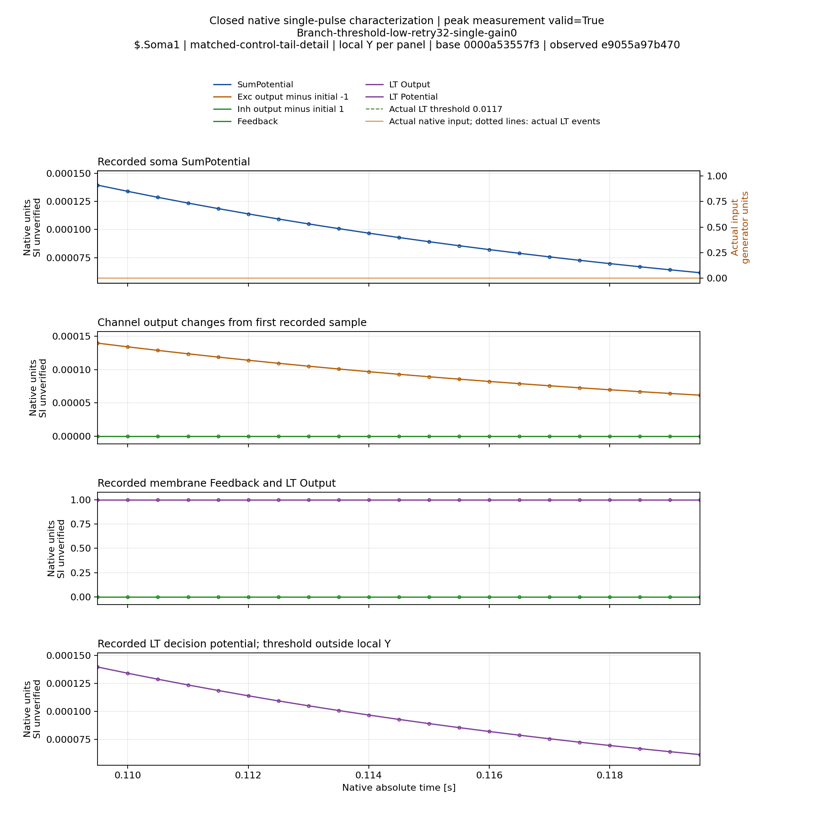

# Влияние мембранной обратной связи на неоднозначные отклики — 07.11.2026

В двух сохранённых stock-состояниях обнуление FeedbackGain устранило дополнительные
положительные максимумы сомы. При этом неизменённая реконструкция через storage
точно воспроизвела исходные волны. Это диагностический причинный результат в
указанных условиях, не новое обучение и не успешная классификация.

## Проверка происхождения

[Native primary](FeedbackProfileConsoleNormalVerification.json): compiled
root844b2789ea0c087c1a0f676d9584ce7b8a7a4d36 /
Pulse1f97e4facc5bf03887bc337450190cc7b24c3ebf, M40. Прошли26 native controls и29
прежних readers. Выполнены12 полных Console проб: Classic/Branch × burst/single
× original/derived-baseline/derived-gain0. Все1555 archive members и789 source
hashes сверены с Git. Primary commit fea18ada6b6446ac422fb728d119ec06bc257ae5;
Reports/StructTrain/TimeLearner/s07-feedback-console-normal-m40-a2/primary.tar.xz.
Все четыре original/derived-baseline пары дали точное совпадение входа и сомы
при совпадающем относительном времени с учётом roundoff. Только после этого
были разрешены gain0 пробы. Original burst также воспроизвёл исходный Train.

Первичный итог suite сохранён failed: после аудита12 executions один test
прочёл JSON array object-only loader. Это не ошибка физического расчёта.
[Исправленные два readers](FeedbackProfileConsoleReaderVerification.json)
прошли отдельно без повторного расчёта моделей:9 members,434 tool hashes,
1315 неизменных input files сверены с первичным Git archive. Первичный failed
terminal не переписан. Группы процессов закрыты, leases released; восемь
предыдущих runtime не изменились. ASan нового API и второй сервер ещё открыты.

## Условия

Использованы точные low/Retry stopped состояния предыдущей stock серии:
четыре физических входа,2000Гц, исходный NSPNeuronGen, threshold0.0117,
без дополнительной LTMembrane. У Branch сохранён physical selector2; single
предъявляет pulse0, а не pulse2. Длительность1.8с,3601 отсчёт, первый onset0.01с.
Amplitude floor1e-6 не повышался. В burst сохранены исходные четыре импульса.

Source package полностью проверяется/imported. Производные immutable storage
images наследуют фактическую физику исходных образов; full graph import сохраняет
индивидуальные Rs/C, топологию, связи, частоту и порог. Меняются только явные
image class names и объявленный uniform FeedbackGain. Это проверяется полным
production graph-delta auditor и image dependency/fingerprint audit. Общие
prototypes и исходные модели не изменяются. Новый idle controller не получает
старые references/history/certificate; baseline waveform gate проверяет, что
такая реконструкция не изменила измеряемую физическую реакцию.

## Наблюдения основной сомы

| Проба | Исходный gain / unchanged reconstruction | FeedbackGain0 |
|---|---|---|
|Classic, один импульс|3 максимума:0.0115,0.027,0.0485с|1 максимум:0.022с|
|Branch, один импульс|2 максимума:0.030,0.1145с|1 максимум:0.034с|
|Classic, четыре импульса|12 максимумов|4 максимума|
|Branch, четыре импульса|7 максимумов|4 максимума|

Classic single: амплитуды исходных максимумов0.09811046/0.23209749/0.03053042;
gain0 максимум0.34666429. Branch single:0.01185933 и0.00001862736;
gain0 максимум0.01231888. Времена отсчитаны от начала пробы; единицы потенциала
native, соответствие SI отдельно не установлено. Все остальные сомы Classic
также записаны; таблица описывает Soma1. Нельзя переносить её на все каналы.

При всех четырёх gain0 comparisons совпали число отсчётов, входные samples и
относительное время; soma samples изменились. Изменение касается не только
числа максимумов: меняются их время, амплитуда и распространение реакции на
другие сомы. Поэтому нельзя трактовать gain0 как фильтр, удаляющий лишь
«лишние» пики из неизменённого сигнала.

## Значение для рефакторинга

На этих двух состояниях обратная связь участвует в формировании неоднозначного
отклика. Это сильнее гипотезы, основанной на совпадении времени пиков с LT events:
выполнено контролируемое физическое вмешательство с точным baseline.
Однако оно не определяет единственно правильный response feature для обучения
с исходной физикой и не объясняет автоматически все264 invalid observations.

FeedbackGain0 не становится default, исправлением peak assignment либо
доказательством улучшения распознавания. Для исходной физики ещё требуется
определить измеряемую волну, проверить её назначение в штатной пачке и затем
повторить обучение с независимым final gate. Если отдельное исследование
выберет иной физический профиль, холодное обучение должно заново захватить
CapturedPerInput на этом профиле; старые references/certificates переносить
нельзя. Математическая цель, исходные допуски и исторические августовские
4/8–6/8 сохраняются.

## Визуальная проверка

[Временные отчёты приняты](FeedbackProfileVisualVerification.json):12 проб,
30 trial/soma pairs,1213 полных/50мс/detail views и2 дополнительных matched-tail
увеличения. Проверены3669 cache files/403646846B. Все70+8 archive members и373
уникальных tool hashes сверены с Git. Обе группы закрыты, leases released.
Полный cache находится на M40 в
/media/user/Data/TimeLearnerRefactor/ReportsCache/feedback-profile-joint-normal-a1;
дополнительные детали — feedback-profile-matched-tail-normal-a1 рядом с ним.
В Git сохранены metadata/primary и только6 выбранных PNG общим объёмом1468877B.

[Все шесть выбранных рисунков просмотрены индивидуально](FeedbackProfileSelectedVisualQA.json).
Отсчёты не прореживаются; окно50мс даёт более14 горизонтальных pixels/tick
при2000Гц, деталь10мс — более71. Общие контекстные шкалы показывают также
отрицательный rebound; слабые особенности требуют отдельного увеличения.
У matched-tail рисунков одинаковое время и независимо подписанные local Y:
по высоте кривых нельзя сравнивать амплитуды без чтения осей. Полный cache
вручную не просматривался. Надпись training probe в старом burst-render title
обозначает предъявление training burst; это frozen diagnostics без обучения.

### Classic: исходная физика и FeedbackGain0, первое50мс окно

### Branch: основной отклик, первое50мс окно

### Branch: один и тот же поздний участок при local Y

В baseline виден слабый максимум; при gain0 в том же временном окне виден
монотонный спад. На обоих рисунках вход равен нулю. Feedback/LT Output и
LT decision potential записаны непосредственно, не восстановлены из soma.
В частности, gain0 изменяет продолжительность LT Output: это дополнительная
причина не считать удаление максимумов улучшением spike morphology или
классификации. Нового Train/evaluation здесь нет.

Следующая отдельная диагностика — сохранённые training100/Retry состояния,
в которых burst имел3 maxima/4 actual inputs. Root package теперь может явно
выбирать существующее source condition через source_threshold; это selector
архивных состояний, не изменение threshold модели. Для них требуется replay
штатной пачки и single-pulse comparison. Их результат нельзя выводить из
low/gain0 серии: исходная физика/параметры и механизм missing отличаются.
