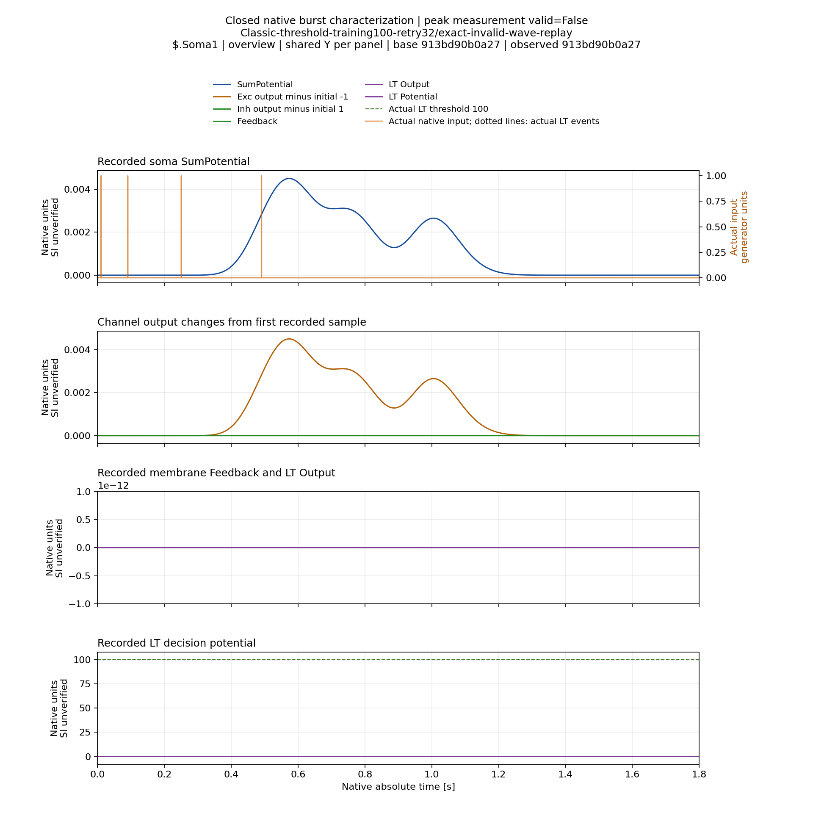
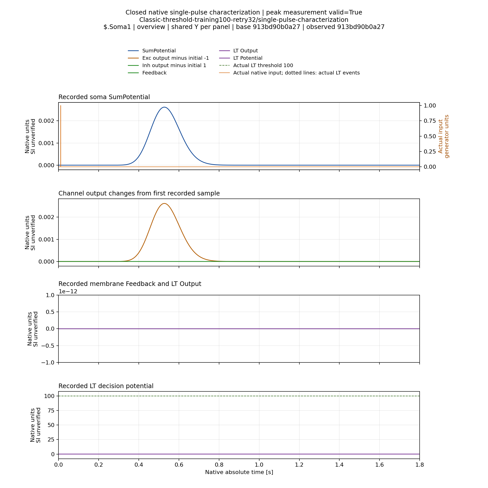
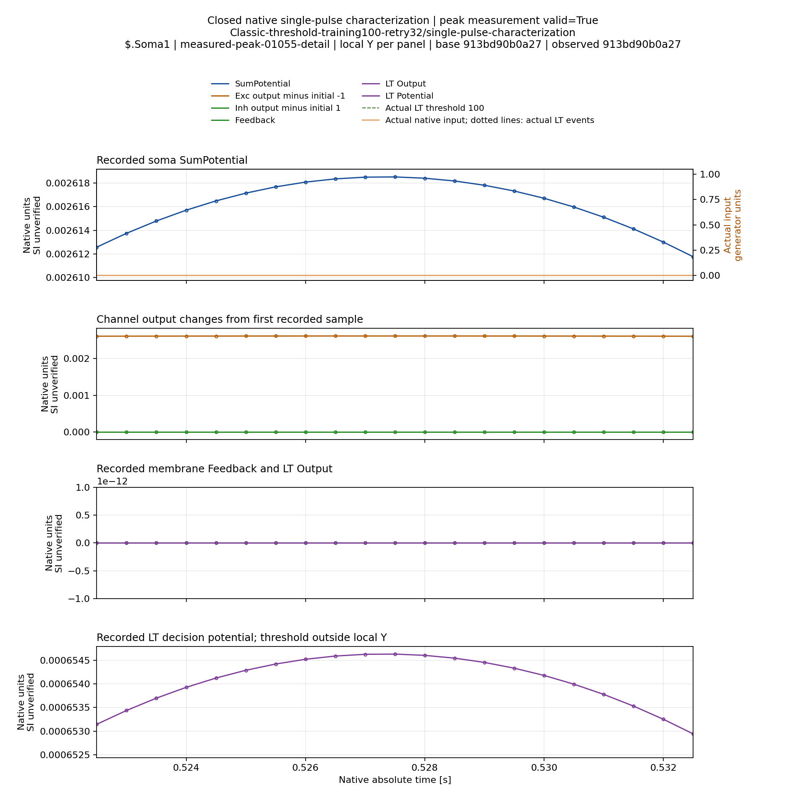
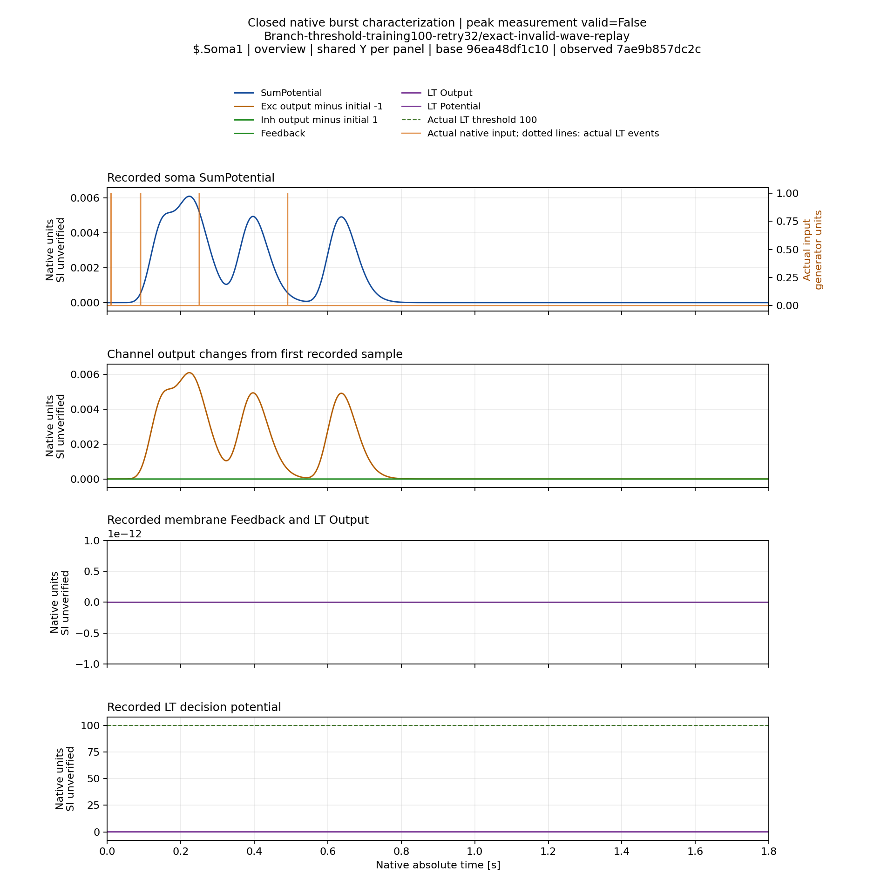
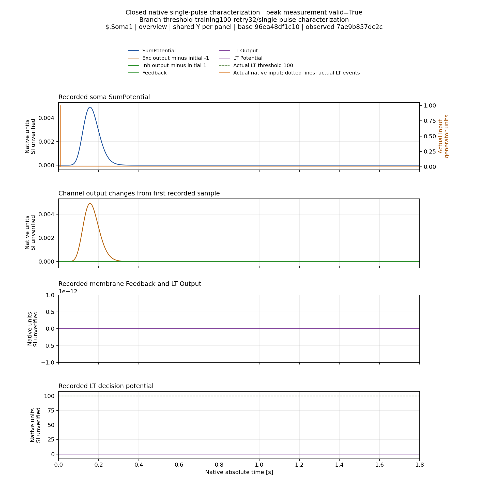
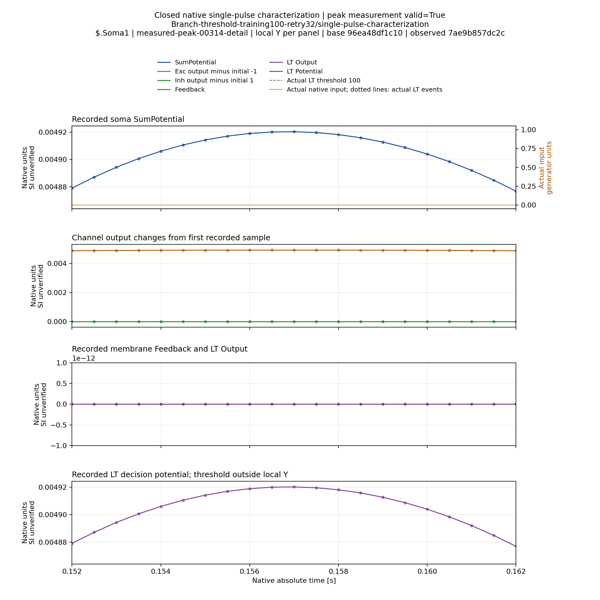

# Штатная пачка с тремя максимумами и изолированный импульс — 07.11.2026

При пороге100 обе выбранные stopped-модели отвечают на одиночный импульс
одним положительным максимумом; исходная пачка имеет три максимума на четыре
реальных импульса. Это не исправление обучения или доказательство классификации.
Число локальных максимумов не позволяет само по себе объявить один физический
ответ отсутствующим.

Уточнение после визуального обсуждения 07.11.2026: Train должен измерять
максимум закреплённого импульса, Test — реакцию на паттерн целиком.
`peak measurement valid=False` на burst-графиках означает отказ действующего
способа training assignment, а не численную некорректность всей записи.
Наибольший пик полной пачки измерим, но его принадлежность закреплённому
импульсу не следует из одного рисунка. [Разбор кода и требования исправления](PeakMeasurementContractReview-2026-11-07.ru.md).

## Источники и проверка

Использованы exact archived Classic/Branch training100/Retry32 состояния из
принятой stock серии. Физика, learned параметры, target, threshold100 и native
reset policy не изменялись. Нет нового Train, threshold sweep или gain0.
Четыре физических входа,2000Гц,1.8с окно/3601 samples. В Classic записаны все4
сомы; у Branch сохранён source solo selector. Single mode предъявляет pulse0
при сохранении physical N; штатный burst не заменялся одиночной диагностикой.

[Combined verification](HighThresholdCombinedVerification.json): compiled
root844b2789ea0c087c1a0f676d9584ce7b8a7a4d36, tool9402e7da09ab5479d74fe3a801988e8ca420ae26,
M40. Новые2 Classic probes завершены; Branch2 переиспользованы из неизменного
[первичного archive](HighThresholdSinglePulseFailureVerification.json), без
повторного расчёта. Его failed terminal сохраняет исходный clock-comparison
failure. [Исправление clock arithmetic](RelativeClockAlignment.ru.md) не меняло
сигналы или допуски обучения. В обеих топологиях full burst теперь подтверждён
как exact replay original Train; префикс до второго actual onset также exact.

Primary нового gate cd8d32168c3580948d0684f6ccad9f64f8527d94,
Reports/StructTrain/TimeLearner/s07-high-threshold-classic-normal-m40-a1.
Сверены все633 archive members/375 tool hashes и2088 reused Branch bindings
относительно опубликованного commit2ba950373a79e896d3f7817d3cbdbeb1bad192ee.
Runtime неизменен, worker group closed/lease released. Отдельно подтверждено:
механическое выделение analyze_pair сохранило все summary fields двух прежних
опубликованных low cases. Новый native SDK не собирался. Второй host этим gate
не проверен.

## Измеренный одиночный отклик

| Модель/сома | Максимум от начала пробы, с | Амплитуда относительно native baseline |
|---|---:|---:|
|Branch Soma1|0.157|0.004920245103354537|
|Classic Soma1|0.5275|0.0026185129070909197|
|Classic Soma2/3/4, каждая|0.0245|0.015781441626431136|

Onset одиночного импульса0.01с. Единицы потенциала native, SI соответствие
отдельно не установлено. Основная сома Classic здесь Soma1, как в выбранном
source probe; ответы других сом не подменяют её измерение. Положительный
single maximum не является training certificate: изолированное предъявление
отличается от штатной пачки.

## Интерпретация и открытый вопрос

Дополнение: [количественная проверка наложения](SuperpositionDiagnostic-2026-11-07.ru.md)
теперь выполнена на тех же полных данных. Сумма сдвинутых одиночных откликов
близко воспроизводит оба burst и также даёт три максимума вместо четырёх.
Это поддерживает гипотезу наложения для этих состояний, но не доказывает
общую линейность и не создаёт индивидуальные TrainingCertificate.
Там же показан causal counterexample для выбора глобального пика в Train.

Это другая ситуация, чем low threshold/feedback серия с несколькими максимумами
на один импульс. Изолированный отклик существует, а при штатной пачке число
экстремумов меньше числа onsets. Возможны наложение/изменение формы откликов,
состояние синапсов и другие эффекты. Эти4 пробы не различают механизмы и не
доказывают линейную суперпозицию. Нельзя восстанавливать отсутствующий peak
по предсказанной задержке, выбирать произвольные три/четыре waves либо объявлять
PhysicalInfeasible по этой локальной остановке.

Следующий анализ должен сопоставить полные временные формы, фактические onsets,
каналы и допустимость выбранного response feature. Изменение ISI внутри паттерна
было бы отдельным вмешательством, а не проверкой ITI между паттернами. Здесь
не менялись ни ISI, ни ITI. Августовские4/8–6/8 в исходном протоколе сохраняются.

## Графики

[Полный temporal report](HighThresholdTemporalVerification.json) завершён:
4 пробы/10 trial-soma pairs,393 views,1187 проверенных cache files/131740593B.
Все29 archive members и375 tool hashes сверены с Git; group closed/lease released.
Полный cache на M40: /media/user/Data/TimeLearnerRefactor/ReportsCache/high-threshold-joint-normal-a1.
В Git только metadata/primary и6 выбранных PNG общим объёмом1381204B.
[Все шесть PNG просмотрены индивидуально](HighThresholdSelectedVisualQA.json);
полный cache вручную не просматривался. Новых native расчётов для render не было.

Overview показывает всю реакцию и actual input pulses. Детали10мс дают более71
pixels/native tick и показывают каждый отсчёт. Порог100 сильно растягивает Y
панели LT decision potential в overview; local-Y детали явно отмечают порог
за пределами видимого диапазона. Верхняя панель сомы остаётся читаемой.

### Classic: штатная пачка и одиночный импульс

### Branch: штатная пачка и одиночный импульс

Форма burst с широким первым участком согласуется с гипотезой наложения;
это интерпретация рисунков, не доказанная линейная модель. На выбранных графиках
Feedback/LT Output нулевые. Следующий причинный тест должен сохранять исходную
физику и отличать наложение от состояния синапсов; результат нынешнего native
критерия остаётся missing, без подстановки четвёртого peak.
