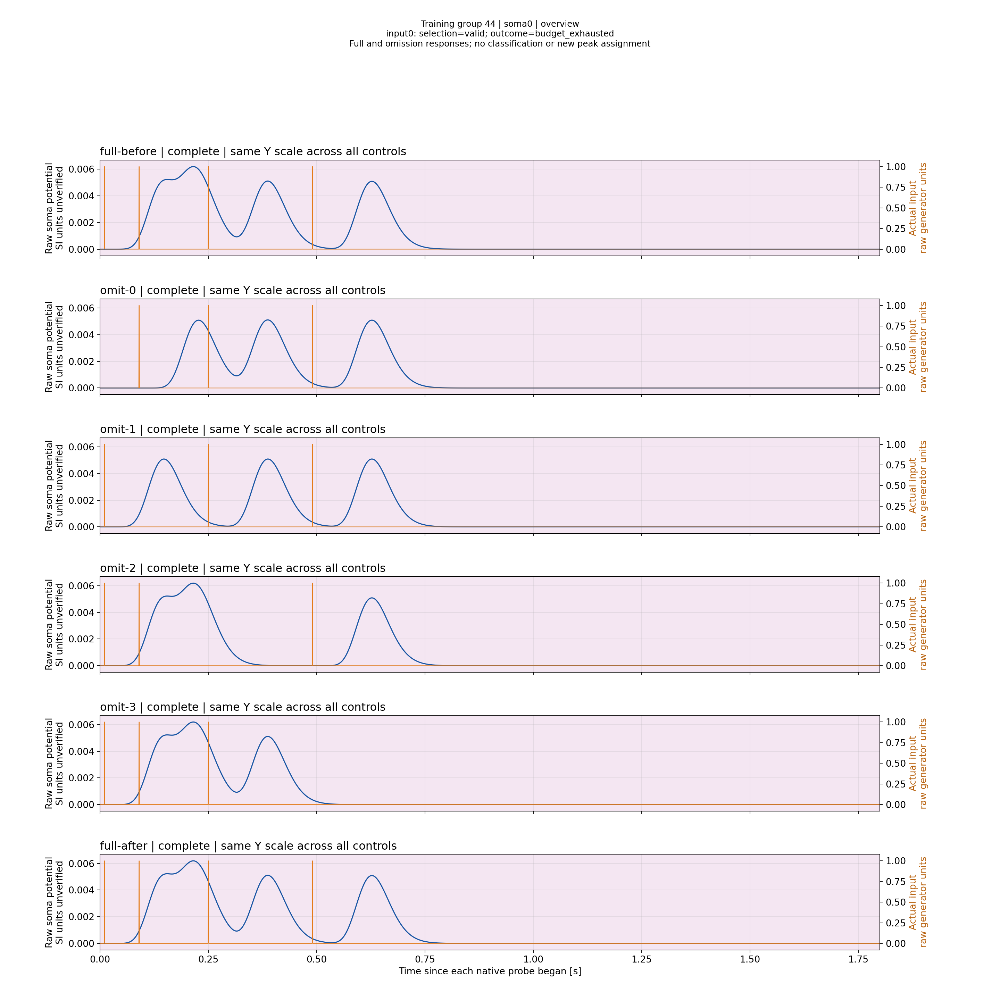
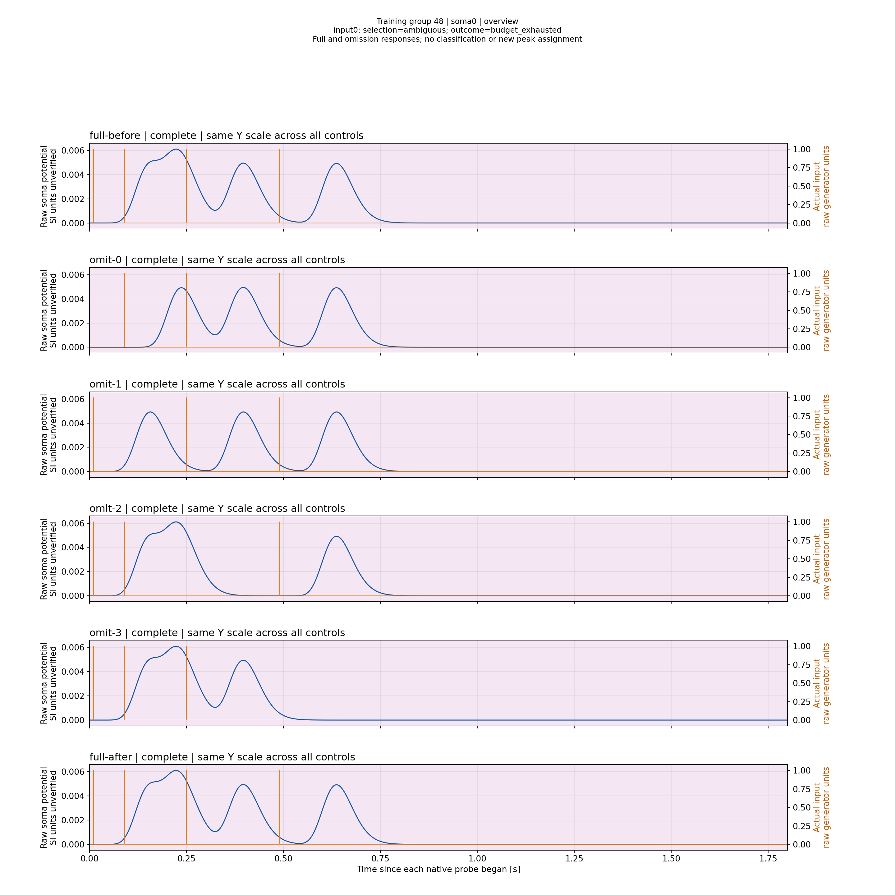
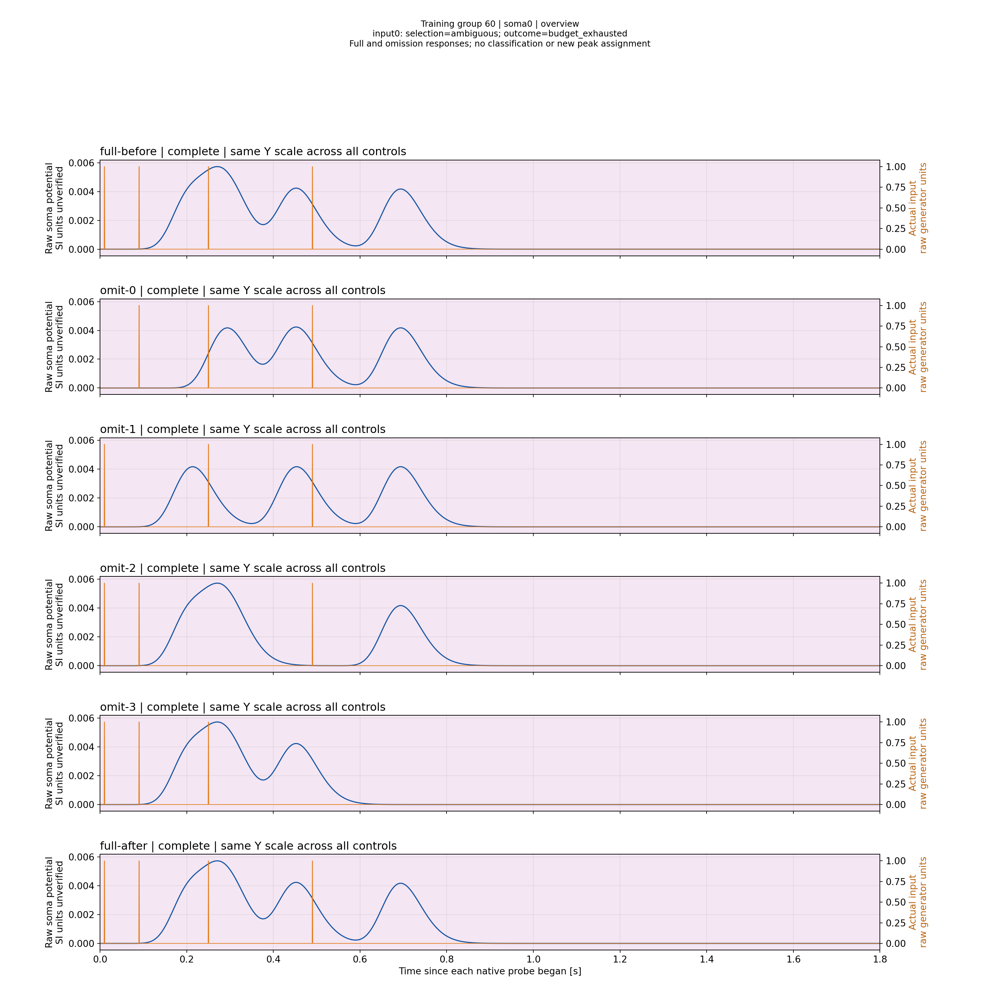

# Где пропадает отдельный отклик закреплённого импульса

В сохранённом Classic N4/N1 опыте приRs86МОм переход L14→L15 меняет число наблюдаемых вершин полной пачки с четырёх на три. Первая вершина L14 назначается input0 по полным omission controls; первая широкая вершина L15/L21 не имеет уникально необходимого импульса по действующему критерию. Это конкретный отрицательный измерительный результат, не доказательство физической невозможности и не оценка классификации.

Данные: original budget16 corpus модели3b8a160f..., complete groups44/48/60;18 полных observations по3601 samples при2000Гц. Модели групп разные, остальные длины1, все Rs86МОм/Ns1, исходная stock physics без LTMembrane. Новые Train/Console не запускались. [Actual-file report test1/1 принят](ValidationPlans/M40L14L15TransitionA1-20261113/RESULT.ru.md); пакет полностью восстановлен и проверен. Никакой ambiguity не заменён valid.

|L input0|Вершины полной пачки от начала пробы, s|Привязка по necessity|Измерение input0|
|---:|---|---|---|
|14|0.1550;0.2155;0.3870;0.6275|0;1;2;3|valid, выбран ранний пик|
|15|0.2230;0.3965;0.6370|нет уникального;2;3|ambiguous, пик не выбран|
|21|0.2705;0.4525;0.6940|нет уникального;2;3|ambiguous, пик не выбран|

Это измеренные координаты source curves, не прогноз задержки. Для ambiguous группы временной остаток input0 не вычисляется из общего максимума. В L14 valid означает допустимое локальное измерение: его timing residual−0.3495s и amplitude residual−0.0105569 всё ещё вне исходных20ms/1e−5. Сходимость не достигнута.

## Ранний слабый максимум при L14

Ранний максимум ниже следующей вершины, но именно он относится к закреплённому input0. Удаление pulse0 убирает эту раннюю вершину, а удаление pulse1 сохраняет отдельный ранний отклик. Поэтому допустима пользовательская трактовка «раздельная ранняя вершина с хвостовым влиянием». Выбор самого высокого пика всей пачки здесь дал бы другой импульс и другое время.

Первая впадина очень мелкая: frame310/0.1550s имеет raw potential0.005224540241517417; frame331/0.1655s —0.0052062927391640645. Разность1.8247502353352374e−5 native units,21 native шага между максимумом и минимумом. В обзорном PNG глубина впадины почти неразличима; для строгого визуального разбора требуется локальный Y zoom. Новый порог prominence этим наблюдением не вводится, valid и tolerances не пересматриваются.

## При L15 отдельной ранней вершины уже нет

В полной пачке ранний участок стал плечом перед широким максимумом0.2230s. После omit0 и omit1 внутри его исходного basin остаются вершины: unique_necessary для input0 не установлен. Импульсы влияют на амплитуду и форму, поэтому no_necessary_input не означает «нет влияния». Это отличается от цензурирования: все шесть проб этой группы завершены.

Короткая соседняя ветвь сохраняет раздельные отклики: [Soma2 L15](ValidationPlans/M40L14L15TransitionA1-20261113/selected-plots/group-000048-soma-001-overview.png). Фактические входы показаны отдельно на каждом control, пропуск pulse0/pulse1 виден непосредственно.

## При L21 неоднозначность сохраняется

Первая широкая вершина сохраняется при разных omissions; две поздние относятся к input2/input3. Для L22 исходная следующая группа не завершена по времени; её нельзя приравнять к этой полной группе L21. Отдельная [Rs серия L22](L22BurstResistanceScientificReport-20261113.ru.md) увеличила амплитуду, но в четырёх проверенных условиях число вершин осталось тремя.

## Что это меняет

Первое ограничение данного stock-поиска связано с идентифицируемостью назначенного отклика при росте длины, а не только с низкой амплитудой. Это не обосновывает подстановку global maximum, автоматический рост budgets или ослабление tolerances. Утверждать невозможность для других Rs/физических профилей/режимов нельзя. Исторические4/8–6/8 исходного протокола сохраняют свой статус; эти современные критерии не переписывают те наблюдения.

Просмотрены четыре selected original PNG, построено24 views всех четырёх сом. [Visual review и SHA](ValidationPlans/M40L14L15TransitionA1-20261113/VISUAL_REVIEW.json), [original plot manifest](ValidationPlans/M40L14L15TransitionA1-20261113/selected-plots/manifest.json). Y-шкала одинакова между full/omission внутри каждого рисунка, но не обязана совпадать между разными геометриями. Масштаб2880×2880 позволяет читать controls; слабая впадина L14 отдельно отмечена как требующая focused view. Полные galleries остаются кэшем M40.
