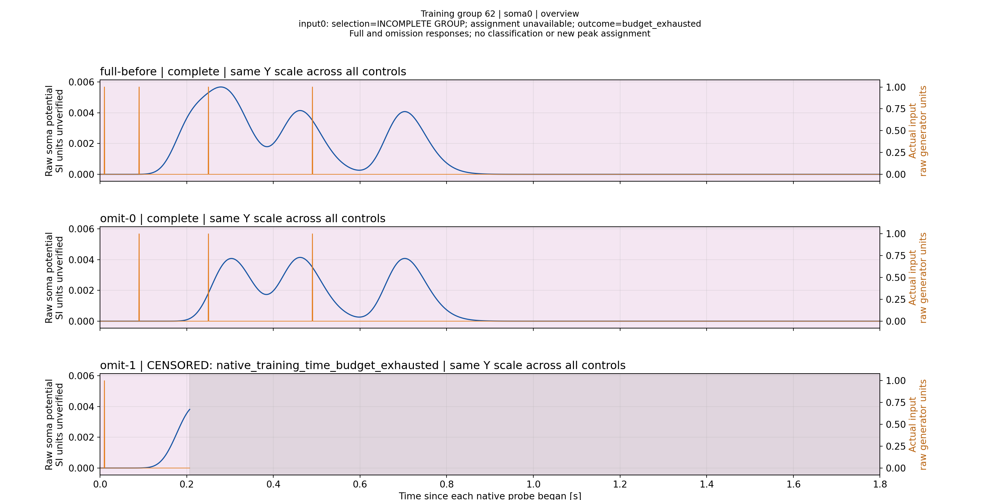
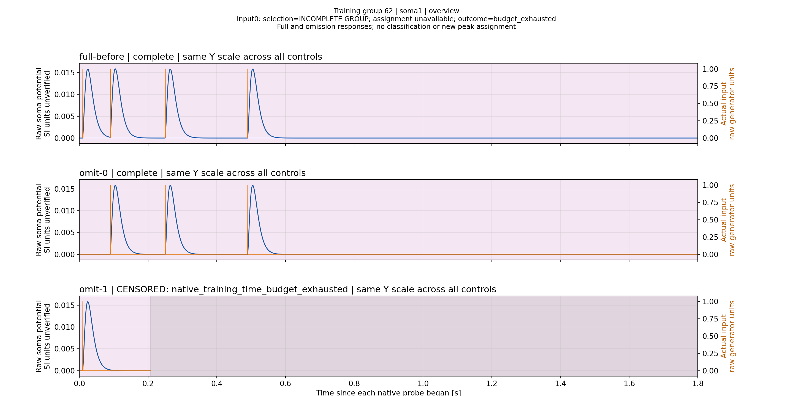

# L22: влияние сопротивления и принадлежность ранней вершины

Промежуточный научный отчёт по одной штатной пачке. Численная серия завершена, два original PNG группы62 просмотрены. Полный Rs-gallery/report validation ещё выполняется; большой byte-exact restore принят1/1. Работающая классификация, завершённое обучение и Exact не заявляются.

## Что исследовалось

Actual Classic N4/N1 stopped model3b8a160f2fe6f5ace6aa377f5d42117bcc922bcdd746358ca8d7c34fc67a6b1c: L=[22,1,1,1], Ns1, Rs86МОм, frequency2000Гц, threshold100, исходная stock physics без LTMembrane. Исходный Train: budget_exhausted/certificate=null. Это отдельная геометрия; ранее обсуждавшийся график913bd90b0a27... относится к L54.

В fixed-geometry серии меняли только excitation bank input0. Пять Console runs: исходный replay, matched no-op и три Rs вмешательства. Девять physical observations, поскольку четыре вмешательства/no-op имеют отдельную warm baseline. Между matched/changed совпали absolute clocks, окна, stimulus rows и actual events; warm baselines побайтно равны. Source files не изменились. Все наблюдения complete,3601 samples каждое. [Исходный результат и сравнения](ValidationPlans/M40L22PrimaryEnvelopeA1-20261113/original-study/worker/tmp/l22-burst-resistance-study/result.json) сохранены без переписывания.

|Rs input0, МОм|Глобальный максимум Soma1|Максимальное отличие waveform Soma1 от matched|
|---:|---:|---:|
|86|0.005683014493454208|0|
|64.5|0.0076080042832809|0.0019250042648812915|
|43|0.011492021514233342|0.005809064829495503|
|21.5|0.023283525200348487|0.01760056851561065|

Во всех changed условиях waveform Soma2–4 совпала с matched во всех отсчётах. Потенциалы указаны в native units; перевод в SI не подтверждён. Общий максимум здесь — диагностическая величина, он не подставляется вместо максимума закреплённого импульса и не используется для объявления амплитудной нормализации.

Для86/64.5/43МОм найдены три геометрические вершины; их времена отличаются не более одного dt0.0005s. Геометрию последней точки и полный сравнительный график ещё предстоит проверить. Из увеличения амплитуды не следует восстановление однозначной принадлежности.

## Что уже видно из исходного Train

Group62 этой же model revision содержит два полных observations: full-before и omit-0 по3601 samples. Третий omit-1 остановлен после415 samples; end_reason=native_training_time_budget_exhausted. Остальные три controls отсутствуют. Группа incomplete, selection=null: её нельзя превращать в законченный omission experiment.

На первой соме удаление pulse0 уменьшает первую вершину с0.0056830 до0.0040802 и сдвигает её с0.2790 до0.3035s относительно начала пробы. Вершина остаётся. Это наблюдаемое влияние pulse0 на форму сигнала, но не доказательство уникальной необходимости именно этого импульса для существования вершины. Не следует интерпретировать no_necessary_input как «импульс не влияет».

Оранжевым показан реально записанный вход для каждой пробы. Шкала Y единая между тремя панелями одной сомы. Серый участок последней панели — отсутствующие данные, а не молчание. Видимая крайняя точка возрастающей кривой не является измеренным пиком. Масштаб исходного PNG2880×1440 позволяет видеть отдельные вершины и момент обрыва; данные не прореживались.

На следующей короткой дендритной ветви видно четыре раздельных отклика исходной пачки и три после удаления pulse0. В censored записи успел пройти лишь первый импульс; отсутствующие поздние реакции нельзя оценивать как отрицательные ответы.

Эти два PNG прочитаны из завершённого render substep работающего read-only report job. Его общий исход пока pending. [Original plotting manifest](ValidationPlans/M40L22RecordedReportsA1-20261113/preview/manifest.json) не переписан; visual_acceptance_complete=false сохраняет свой исходный смысл. Здесь зафиксирован просмотр только двух выбранных overview, не приёмка всей галереи.

## Проверка переноса и объяснение траектории поиска

Новый replay точно воспроизвёл original group62 full-before: значения всех четырёх сом и stimulus совпали во всех3601 rows. Абсолютные clocks отличаются659.042 против0; относительные сетки отличаются максимум на8.64e-14s. Это согласие реакции после импорта, а не matched absolute-clock comparison.

[Полная привязка отклонённых групп к геометрии](TrainingSearchHistoryReport.ru.md) показывает: после L1/L2/L3 predictor предложил L54, затем исследовались L52/L50/L48/L45/L40 и другие варианты. Тринадцать complete groups отклонены как ambiguous; список15 valid candidates L1–14 не описывает весь поиск. Нельзя исправлять предполагаемое «игнорирование длинных кандидатов», которого эти исходные данные не подтверждают.

## Ограничения и следующий шаг

Сначала закончить visual review Rs-gallery и full restore/production audits опубликованного [48.78MB primary](ValidationPlans/M40L22PrimaryEnvelopeA1-20261113/RESULT.ru.md). Затем сопоставить собственные complete omission waveforms уже измеренных L15/L21/L54, прежде чем назначать новые прогоны или менять измеритель. Слившуюся вершину не превращать автоматически в valid assigned peak; допускается раздельная ранняя вершина с хвостовым влиянием.

Не повышать budgets/tolerances и не менять CapturedPerInput по этим общим максимумам. Отдельная научная оценка потребует frozen модели, реального подтверждения порога и всех test patterns. Этот опыт одной пачки не заменяет такую матрицу и не отменяет исторические4/8–6/8 исходного протокола. SeriesD не возобновляется.

## Повторное использование уже исследованных controls

Сверены old temporal manifest и members нового восстановленного primary. Все18 CSV групп12(L3),14(L54),42(L45) совпадают по SHA256 и размеру: [точная таблица](ValidationPlans/M40L22RecordedReportsA1-20261113/REUSED_CONTROLS.json). Поэтому [ранее просмотренные full/omission графики и выводы](ClassicFullDomainAssignmentScientificReport-20261112.ru.md) применимы к этим же primary текущего corpus; новые прогоны L54 для повторения того же наблюдения не требуются. Это не независимые повторы. Full outcome budget4 и нового budget16 сохраняются разными, даже при совпадающих CSV.

Повторно просмотрен original L54 overview: первая широкая вершина изменяется, но сохраняется при omit0 и omit1; совпадение самого высокого пика с желаемым временем само по себе не устанавливает принадлежность. Следующий неразобранный участок — complete controls перехода L14→L15 и L21, с сохранением существующего критерия и всех исходных отрицательных статусов.

[Полное восстановление нового N4 primary принято](ValidationPlans/M40L22PrimaryRestoreA1-20261113/RESULT.ru.md):1/1 за351.980s, затем production source/five-native audits. Исходные numerics и ограничения этого отчёта сохраняются; классификация не установлена.

[Адресный разбор L14/L15/L21 по18 сохранённым complete trials запущен](ValidationPlans/M40L14L15TransitionA1-20261113/STATUS.ru.md). Это обработка уже имеющихся данных, не новые пробы или независимые retrains. Результаты/визуальная приёмка пока pending.
