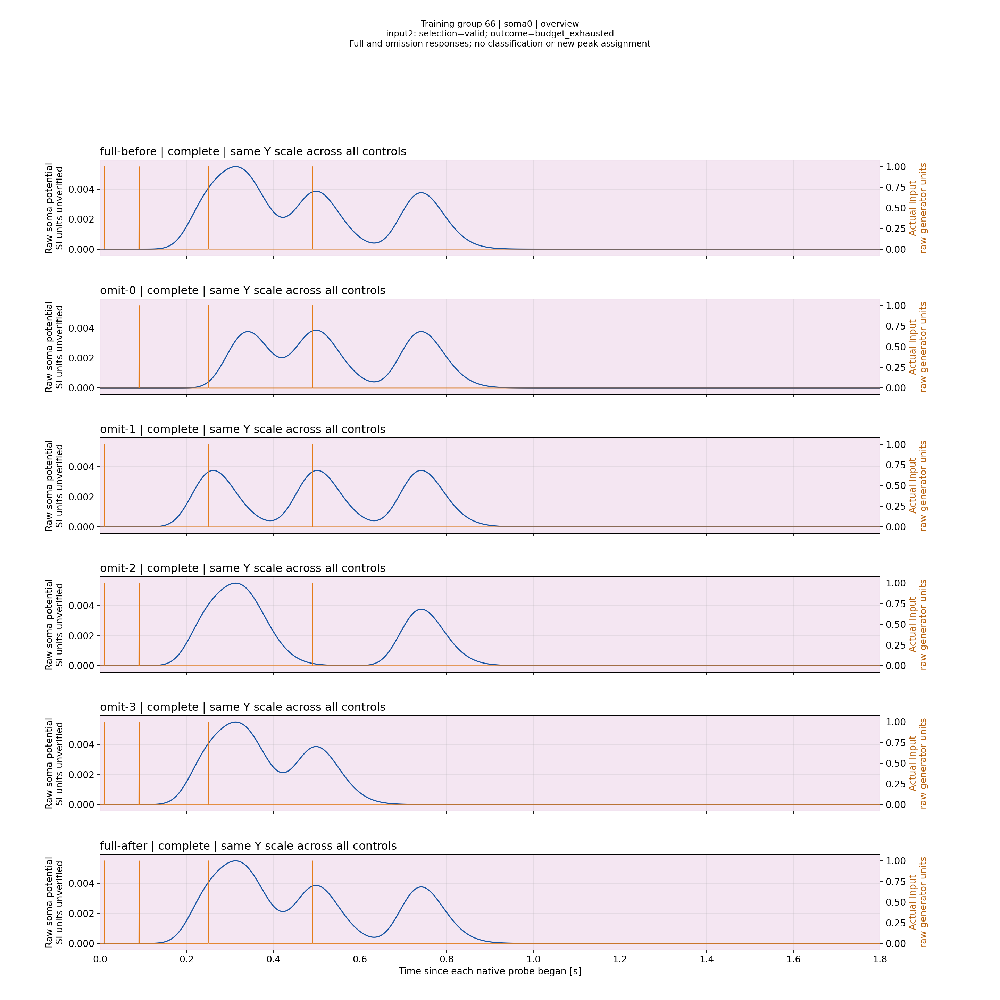
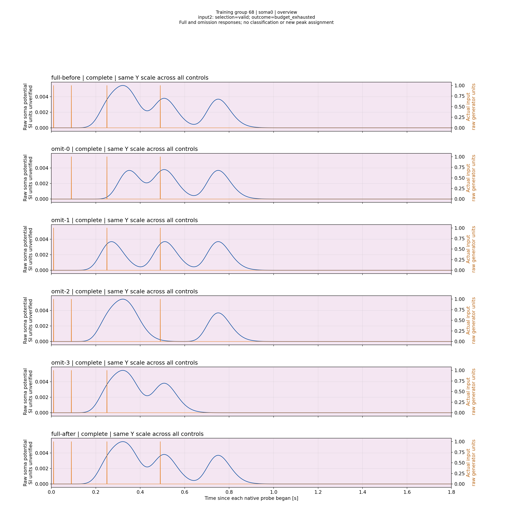
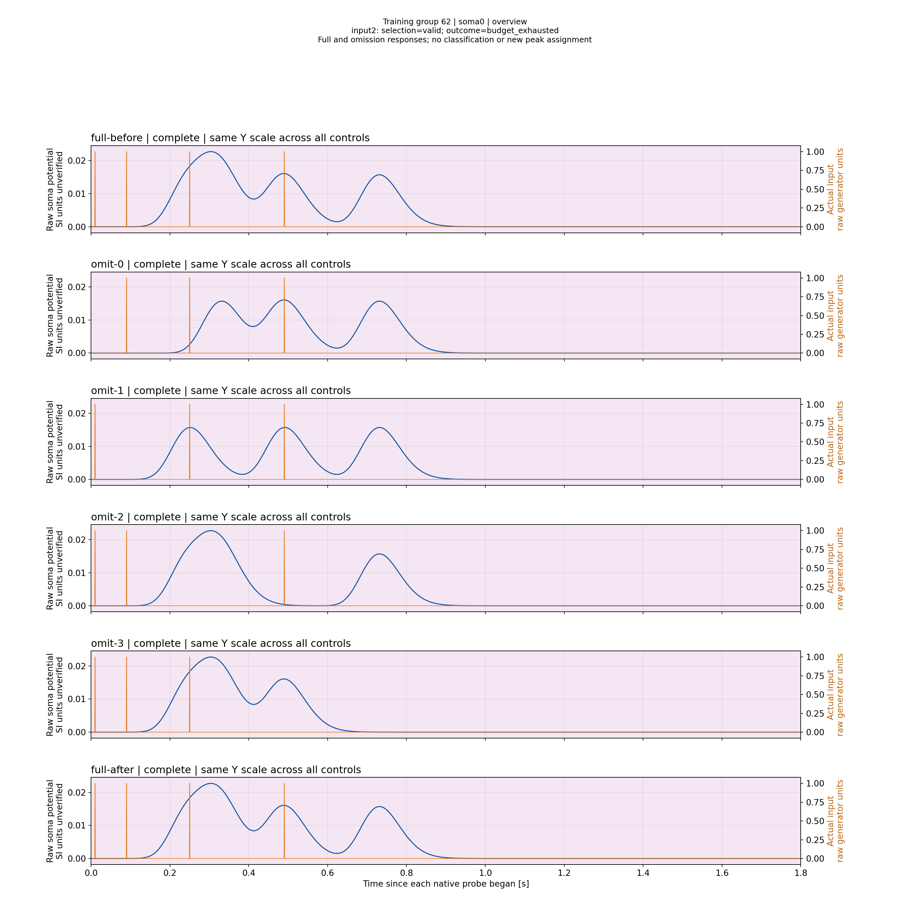
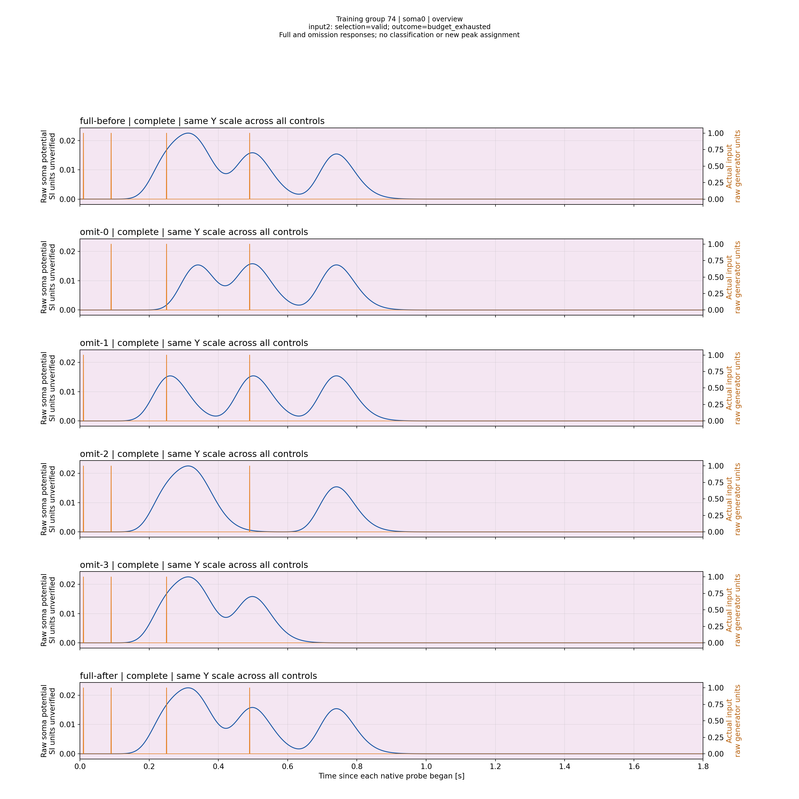
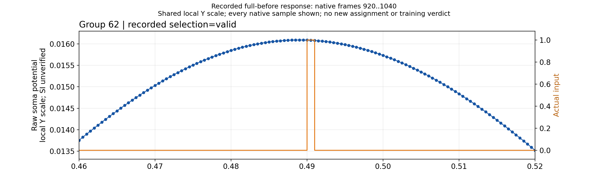
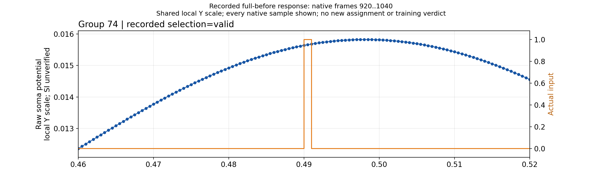

# Branch N0: физическая проверка нормализации на новой геометрии — 14.11.2026

Два холодных Train на одинаковой исходной модели и текущих системных библиотеках завершились с валидными данными и исходом **budget_exhausted**, без сертификата. Исправление поиска открыло проверку Ns на новых длинах: лучший амплитудный остаток среди timing-ready кандидатов уменьшился с 0.0003079757232195002 до 0.0000452931682249913, примерно в 6.80 раза. Он всё ещё в 4.53 раза больше допуска 0.00001. Сходимость всех входов и классификация этим опытом не подтверждены.

## Условия и причинная проверка

Использованы stock Branch NSPNeuronGen без LTMembrane, четыре входа, N0, CapturedPerInput, anchor N−1, 2000Гц. Допуски и бюджеты не менялись: amp_abs=1e−5, amp_rel=0, min_amp=1e−6, SyncTolerance=0.02; 1800с native Train,128 search probes,1280 edits,128 candidates,4 sweeps,4 invalid recoveries. Отдельные300с finalization не увеличивают search budget. Полная пачка и assigned-input measurement сохранены; глобальный максимум вместо закреплённого импульса не подставляется.

До правки: Pulse04a10aa94da7adb887ccabd73a7b7ea2d8dd7600 через baseline root d69c463ab8b99c36e3424502fe24bc55f96162a6, старый Console с текущим отдельно объявленным runtime377e0ebdee7bb1fa1cc11346438a1d2102b2124f08e3054b6347400c10a4f335. После правки: Pulse58c6e6d51c749a13a79498a681e14ea2fe353ed7, root37db99e11a6e9a721cd4b610134fc9172c6e4f01; свежий [SDK99/99](ValidationPlans/M40N0GeometrySdkA1-20261114/RESULT.ru.md), фактически построенный из root0286ddb07064d3446dd37ce8536937d89576f345, runtime d1d584b53286ee8dd6254897dc3dcd8e7deb9bc90a9b4789166ffd7979acd56b. Полные исходные commits указаны в runtime manifests, а не восстанавливаются по сокращению Pulse04a.

[Before controls и DATA/physical proof](ValidationPlans/M40N0GeometryBeforeTrainA2-20261114/RESULT.ru.md), [After controls и DATA/physical proof](ValidationPlans/M40N0GeometryAfterTrainA2-20261114/RESULT.ru.md). Controls опубликованы до исходов. После обновления ОС оба плана заново подготовлены штатным production-путём в одном контексте библиотек; старые manifests не переписывались, runtime guard не ослаблен. Одинаковы configuration/initial identities, capture_revision5a916bc7c77f2176c065d57e3d68dd0783902b40418eec42cf089eb10b36abf5 и source_origin37c6b49683d49e8811842d6171f3482a6078ec21141cf4450449c99dd095799f.

Первые **31 измеренный кандидат** точно совпали по full_parameters, input_index, amp/time residuals и within flags. На следующем шаге before проверяет L=[27,27,27,1],Ns1, а after — L=[27,27,26,1],Ns=[1,1,2,1], то есть начинает нормализацию на новой геометрии. Подписи/semantic IDs между binaries не требуются равными и не выдаются за одинаковые.

Оба задания работали одновременно на M40 вместе с отдельным fixed-threshold опытом. Это контролируемое совпадение начального состояния и измеренной общей части, но не независимые случайные повторы и не benchmark производительности. Не смешивать A2 с отклонёнными до native A1, где старый исходный runtime guard обнаружил смену библиотек.

## Наблюдения

|Показатель|До исправления|После исправления|
|---|---:|---:|
|Measured candidates|36|37|
|Search probes|74|75|
|Applied edits|36|37|
|Timing-ready candidates|9|13|
|Joint timing+amplitude-ready|0|0|
|Groups / native probes|78 /467|79 /474|
|Sampled frames|1,679,598|1,706,874|
|Primary bytes по native counters|69,581,101|70,748,100|
|Лучший timing-ready input2, L|[26,26,25,1]|[27,27,26,1]|
|Его Ns|[1,1,4,1]|[1,1,4,1]|
|Amplitude residual|+0.0003079757232195002|+0.0000452931682249913|
|Timing residual, с|−0.015499999999974534|−0.006499999999959982|
|Настоящий terminal L|[32,32,32,1]|[28,28,27,1]|
|Настоящий terminal Ns|[1,1,1,1]|[1,1,2,1]|

Rs=86M на всех входах. Best candidate и actual terminal state различаются: последний граф не подменяется лучшей промежуточной точкой. Последние непотреблённые/частичные измерения сохранены как таковые. Оба поиска работали на input2, до свежей проверки всех входов не дошли; final_group_ids пусты, certificate=null. Отсутствие сходимости за1800с не доказывает PhysicalInfeasible.

## Исправление и оставшаяся научная задача

[Подтверждённый дефект](N0GeometryNormalizationReview-20261114.ru.md): старый gate сравнивал новый geometry-local кандидат с глобально лучшим, что могло блокировать необходимый просмотр соседних Ns. Исправление отдельно ограничивает локальный поиск для каждой физической области и не повышает общий бюджет. [Elder kernel](ValidationPlans/ElderN0GeometryABA4-20261114/RESULT.ru.md) и [M40 kernel](ValidationPlans/M40N0GeometryABA1-20261114/RESULT.ru.md) дали одинаковые baseline5 expected failures / candidate6/6 PASS; физический опыт выше подтверждает изменение реальной траектории.

На проверенной новой геометрии Ns3/4/5 дают соответственно amp residuals −0.003971548037342454 /+0.0000452931682249913 /+0.004050080126674294 при timing-ready. Это наблюдаемая дискретная сетка, не доказательство глобальной недостижимости амплитудной цели: другие геометрии и физические режимы не исчерпаны. Нельзя автоматически ослабить допуск, включить C-trim либо выдать лучший остаток за Exact.

Полные compact archives сохранены в Git: [before32,720,612B](ValidationPlans/M40N0GeometryBeforeTrainPrimaryA2-20261114/RESULT.ru.md), [after32,932,880B](ValidationPlans/M40N0GeometryAfterTrainPrimaryA2-20261114/RESULT.ru.md). [Собственные Train waveforms приняты production1/1](ValidationPlans/M40N0GeometryTrainingReportA1-20261114/RESULT.ru.md),6 выбранных полных waveform PNG и2 boundary clock views просмотрены; независимое восстановление этих новых archives ещё открыто. Полная приёмка этапов1–12 и всей матрицы не заявляется.

## Собственные waveforms и omission controls

Каждый рисунок содержит шесть полных реальных проб: full-before, четыре omission и full-after. Y одинаков внутри группы, но между разными моделями следует читать числовые оси: Ns меняет амплитуду. Фиолетовая область здесь — полный proposed measurement window0..1.8с, не доказанная принадлежность всей кривой одному импульсу. Принадлежность проверена отдельными production selection/omission доказательствами. Overview позволяет видеть широкие вершины; сверхточная оценка остатков берётся из чисел, не с картинки. Native boundary views в архиве не увеличивают назначенный пик и не выдаются за его визуальную приёмку.

### before: последний общий кандидат

### before: первый различающийся кандидат

### before: лучший измеренный timing-ready кандидат

### after: последний общий кандидат

### after: первый различающийся кандидат

### after: лучший измеренный timing-ready кандидат

## Назначенный пик в native масштабе

[Отдельный focus принят1/1](ValidationPlans/M40N0GeometryPeakFocusA1-20261114/RESULT.ru.md): оба оригинальных PNG просмотрены,121 sample frames920..1040 без downsampling. Ниже full-before — проба до omission в каждой из моделей; Y local, сравнивать числовые оси. Before maximum frame978 и after frame996 находятся внутри изображений. Это дополнение к полным omission controls, без новых измерений и переоценки assignment.

