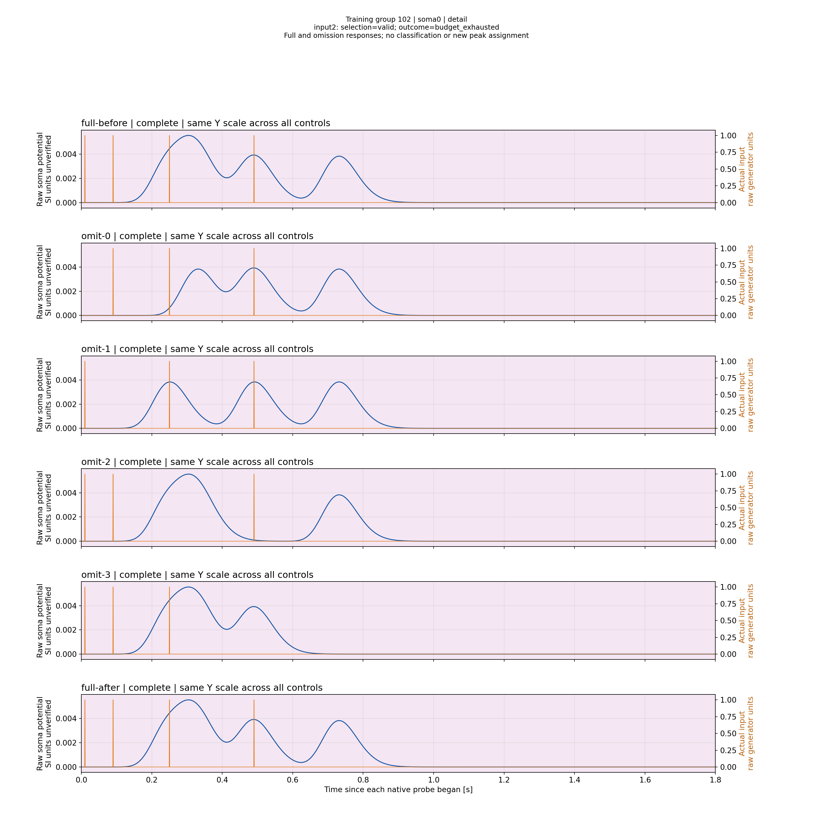
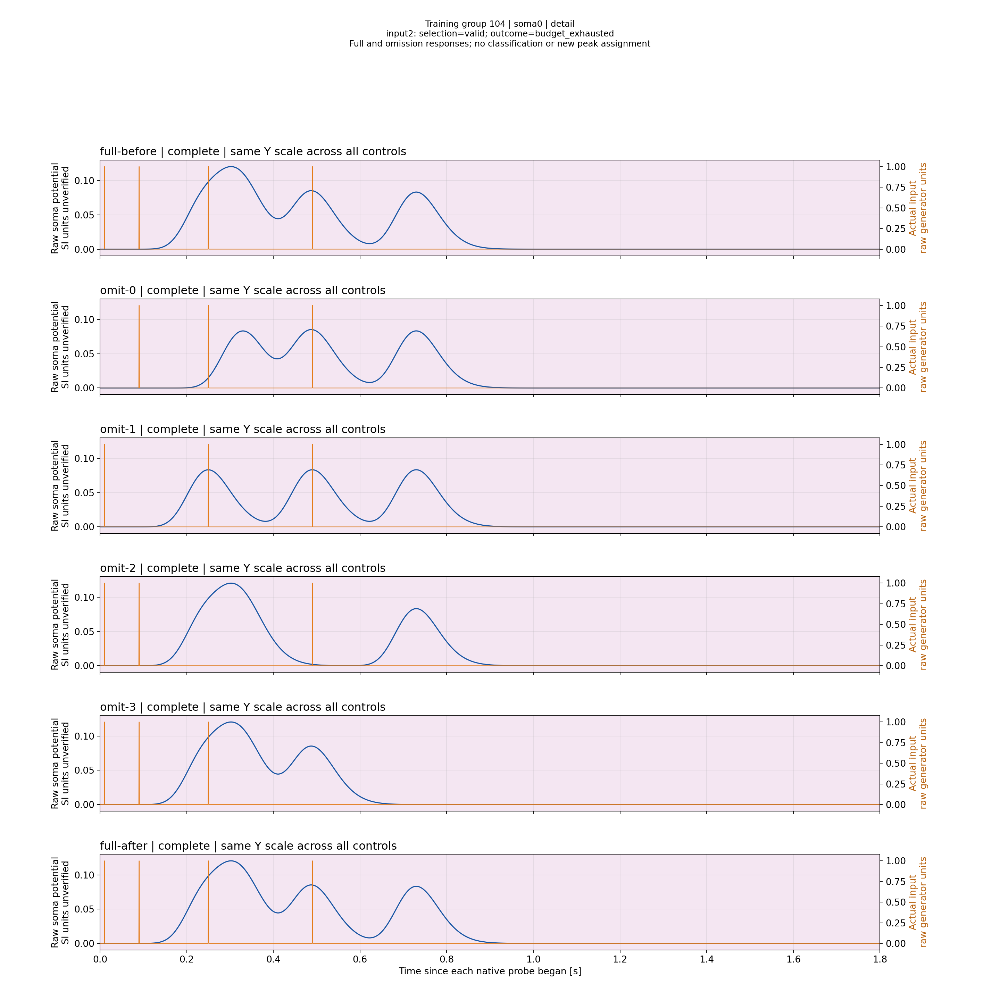

# Branch N4/N1: измеренный интервал нормализации, 13.11.2026

Same-budget повтор с одним дополнительным локальным ходом Rs завершён. Найдены две реальные точки на одной геометрии: обе удовлетворяют временному допуску, но имеют амплитудную ошибку разного знака. Обучение в целом не завершено: BudgetExhausted, certificate=null. Классификация восьми паттернов в этом опыте не измерялась.

## Условия и сравнимость

Native root4acc1f0ec10708bc4632a793f34630c259e807c3, Pulse9656b420685cbbd7eaac582ee0f21a5c3afe61f4; runtime fingerprint6210f7a12104465b4eb15790977a0ece5e46a0c34e37ea4a844323fac55fac5b. Перед запуском приняты77/77 адресных controller checks. Проверяющий Python actor181d4d1980423ad82edb9839a3d3fe77f118e6a0. Эти результаты не относятся к следующему варианту coupled-search7c6c9478.

[Реальное сравнение job/initial/CSV](ValidationPlans/M40N1LocalTurnBranchTrainA3-20261113/actual-start-comparison/comparison.json) подтверждает побайтовое равенство native job и initial-state прежнему полному Branch baseline. SHA256 job93556039955e15a3de1ec88b55d546b2f54bb7e680deb3fc1e499799a524c55d. Первые600 CSV совпадают; первое различие — train_stopped_trial_601.csv. CSV содержит абсолютное время, поэтому само различие байтов ещё не доказывает изменения формы напряжения; фактическое изменение Rs подтверждено отдельными consumed candidate records.

Пределы прежние: native wall1800s, model7200s, search probes128, edits1280, candidates/input128, sweeps4. Amp absolute1e-5, relative0, sync0.02s; фиксированный опорный вход3. Новое холодное обучение выполняется штатной пачкой, измеряется максимум закреплённого импульса. Слитая неоднозначная вершина не заменяется общим максимумом.

## Фактический исход

[Адресная проверка](ValidationPlans/M40N1LocalTurnBranchTrainA3-20261113/completed-readback/worker/validation/result.json):1/1 PASS,2757.464s. Native process completed и вся его группа закрыта за2062.995s; внешний controller completed/closed за2781.789s. Эти три длительности относятся к разным уровням выполнения. PASS означает согласованность выполнения/данных и честного отрицательного исхода, а не успех обучения.

52 consumed candidates,55 domain assessments,52 edits,105 search probes;0 rejected observations/recovery deliveries. Пять точек timing-ready, ни одной одновременно amplitude-ready. Поиск дошёл только до input2; остальные обучаемые входы ещё не пройдены.

| Геометрия L | Вход | Rs, Ом | Амплитудный остаток | Временной остаток, с | Результат |
|---|---:|---:|---:|---:|---|
|26,26,25,1|2|86000000|−0.0118549032499361|−0.01499999999987267|Timing valid, amplitude outside|
|26,26,25,1|2|2880071.5552629367|+0.06956639592980918|−0.016999999999825377|Timing valid, amplitude outside|

Это измеренный sign bracket. Он обосновывает исследование промежуточных сопротивлений при этой геометрии, но не гарантирует непрерывность, монотонность, существование совместного решения либо сходимость всех входов. Нельзя объявлять интерполированный Rs обученной моделью без новой штатной пробы.

Последний effective readback: L=[27,27,26,1], Rs=[86M,86M,2880071.5552629367,86M], Ns=1. Его model revision e93ab921f2bbc71604f844b1e3283158342405848277cc2eb239350a7487dba5. Последний низкий Rs при L26 не был consumed candidate до остановки: это сохранённое остановленное состояние, а не лучший кандидат и не сертификат.

## Первичные данные и графики

[Полный закрытый primary package](../../../Reports/StructTrain/TimeLearner/N1LocalTurnBranch-20261113/primary/bundle.json) сохраняет2175 regular files и2 aliases, включая native модели,652 trial CSV, source-state, summary и process receipts. Не все652 пробы полны: последняя группа прервана научным бюджетом и не потреблена контроллером. Сжатый архив44,208,656 bytes, SHA256071b109a240265f21a52c659045b17286e8303cd015c59bab7a87c4cde29c09b; expanded logical669,760,805 bytes. [Коллектор](ValidationPlans/M40N1LocalTurnPrimaryA1-20261113/RESULT.ru.md) проверил исходные файлы и закрытие групп; независимый restore именно этого нового пакета пока не выполнен.

[Тонкая derived search projection](ValidationPlans/M40N1LocalTurnBranchTrainA3-20261113/derived-search/search-projection.json) — удобная навигация, не замена исходного summary. [Отчёт двух consumed точек принят1/1](ValidationPlans/M40N1LocalTurnAmplitudeReportA1-20261113/RESULT.ru.md),447.251s; все4 original PNG просмотрены. В каждой группе полная пачка до/после четырёх omission controls,3601 samples на пробу, no downsampling, реальные входы. Новых Train/threshold runs при построении нет.

Визуально средняя вершина около0.49s исчезает при omission2, а ранний глобальный максимум сохраняется: именно меньшая средняя вершина относится к закреплённому input2. Меньший Rs усиливает также другие вершины, что подтверждает необходимость all-input verification общего Branch-кабеля. Y одинаков между controls одной группы, но различается между группами; сравнение по числам оси. Значение SI единиц не подтверждено. Здесь detail сохраняет полный0..1.8s диапазон: это читаемый обзор2880×2880, не дополнительный временной zoom.

Rs86МОм, группа102:

Rs2.880071555МОм, группа104:

## Следующее решение

[Уточнённый bounded поиск](N1CoupledProposalReview-20261113.ru.md) сохраняет математическую цель и все global budgets. Он даёт конечную локальную квоту Rs, использует измеренный log-secant только внутри подтверждённого bracket и разрешает length proposal по корректному семейству общего Branch-кабеля. Новый код должен сначала пройти93 адресных native checks, затем тот же реальный Branch case. Эффект не предполагается заранее. Этапы1–12 исходного плана остаются частичными.
