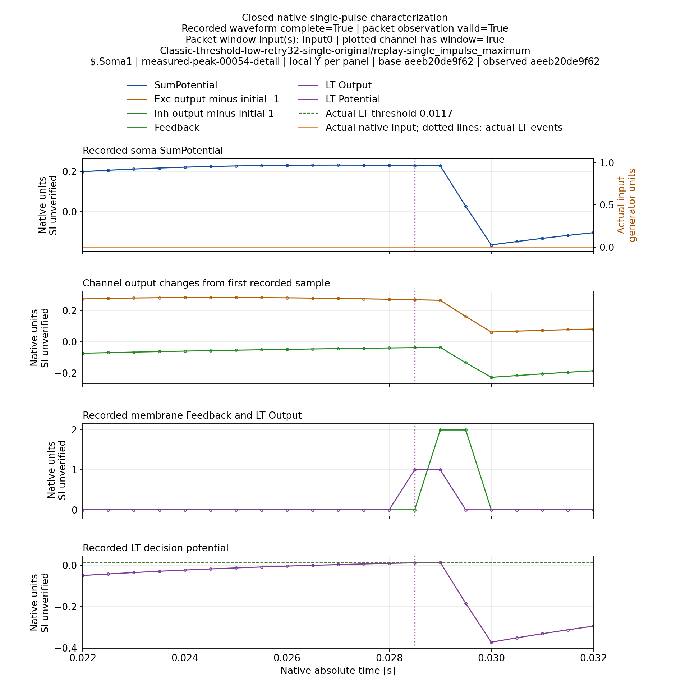
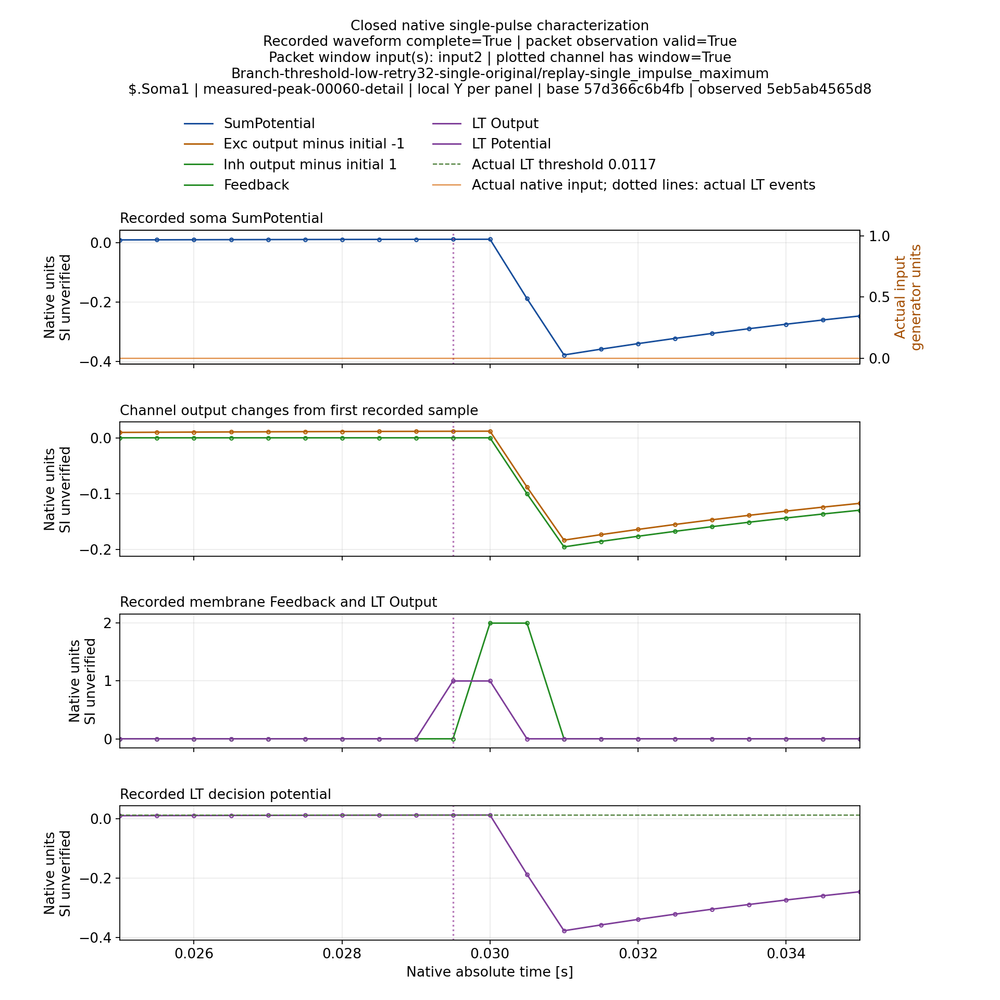
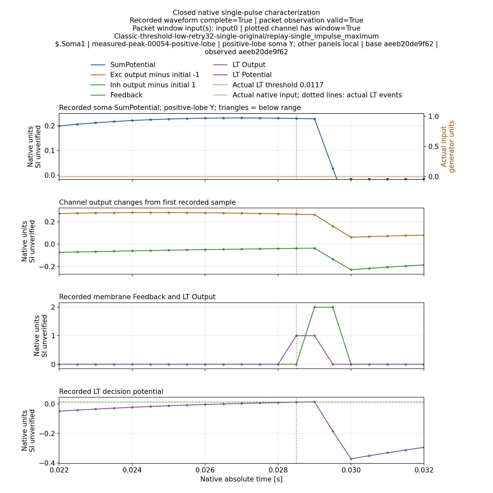
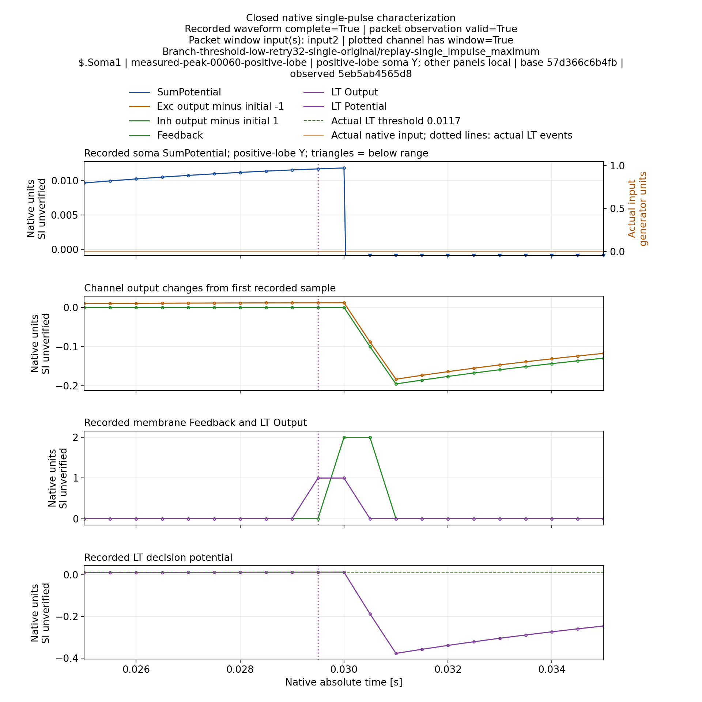

# Console replay многопикового одиночного отклика

Адресная normal-проверка новой диагностической политики принята на Elder.
Это закрывает Console replay одиночной пробы, а не назначение волн в Train
штатной пачкой и не классификацию.

## Неудачная первая попытка сохранена

A1: tool `89b3842d34290bdb5d3ebaf91f05304cd2e82681`, compiled Root
`62997ad1e7cb7869012d11da82b5a48b529ac1e7`, PulseLib
`24f9767ace1f498d5dc048a70fc303789adac757`.
Пять design tests прошли. Classic с прежней IsolatedWindow точно воспроизвёл
архивный отклик; следующий Console process завершился с кодом2 и
`invalid_native_configuration_selection`. До Branch выполнение не дошло.

Причина: диагностический SingleImpulseMaximum попадал в конфигурацию idle
владельца обучения. Native training configuration обоснованно запрещает эту
политику. Исправление `9f9de91f1b0e4c5e2841a57d5f0bb2b0d20595c5` сохраняет
IsolatedWindow в idle-конфигурации, а schema5 применяет только к фактическому
transient single-pulse запросу. Допуски и запрет диагностического сертификата
обучения не ослаблены.

Evidence A1 `924ae007b517f73722540e39f72cdd22e058cf10`:
231 members,1209856 compressed bytes. [Независимая сверка](SingleMaximumConsoleReplayA1Verification.json).
Отрицательная попытка не переименована в успешную.

## Сборка и успешный повтор

Собран Console Root `038a66413b7a41e75bf3826eda365db1c78c364b`, PulseLib
`217dc53c4b1cc010ad6938852a91ee6d2df09e3c`; Core соответствует6c520fb.
Сборка и CLI admission receipt: `07bd874f9561e7f027864317c644af0e6347a96f`,
27 members,67008 compressed bytes. Проверены498 Root и265 Pulse source hashes.
Четыре прежних runtime сохранены; сборка выполнялась последовательно.

Повтор A2 использовал тот же tool89b3842, те же исходные модели и параметры.
Все четыре задания Classic/Branch × IsolatedWindow/SingleImpulseMaximum
зафиксированы до запуска. Пять design tests и все четыре Console операции
прошли. Для каждой топологии прежняя политика сначала точно воспроизвела
архивную waveform. Затем между политиками точно совпали stimulus и soma
samples, relative clocks с объявленным roundoff-допуском; base/effective
model revisions совпали. Изменена только интерпретация наблюдения.

| Одиночная проба | Старая политика | Новый максимум | Амплитуда, native units |
|---|---|---|---|
| Classic, physical input0 | ambiguous,3 локальных пика | 0.027s, delay0.017s | 0.23209749260986 |
| Branch, physical input2 | ambiguous,2 локальных пика | 0.030s, delay0.020s | 0.011859327741041703 |

Частота2000Гц; threshold0.0117 сохранён. Это реальные многопиковые отклики
с обратным влиянием LTZone; новая политика не подавляет feedback и не
выбирает первый максимум после первого спада. Оба окна содержат3601 samples.
Применён первый source impulse к выбранному физическому входу: Branch input2
не означает предъявление третьего импульса исходной пачки.

Evidence A2 `e7b73e1fdc6c5d626604eb0e841adfb95d00ea70`:
459 members,2128700 compressed bytes, SHA256
`93dd6eeec908be54da0f05a510852c1949ac5f5e71ca5a7e35bfc40bcc221ce6`.
[Независимая сверка](SingleMaximumConsoleReplayA2Verification.json) проверила
все members,383 tool hashes,424 artifact bindings четырёх run manifests и
совпадение runtime с отдельным build receipt. Локально выполнялась только
проверка Git/archive/hash metadata; численные сравнения выполнены на Elder.

216 файлов извлечённого исходного кэша не продублированы. Их точные bindings
ссылаются на существующий primary archive commit
`fea18ada6b6446ac422fb728d119ec06bc257ae5` в bundle.external_source_cache.
Все новые run inputs, модели, primary observations и channel diagnostics
сохранены. Whole-group closure и released lease проверены после выполнения;
metadata/capacity очереди и immutable runtime не изменялись.

## Что остаётся открытым

- Новая размерная матрица N1/4/6 и ASan Console replay требуют отдельной
  проверки; [physical ASan38/readers25](SingleImpulseMaximumPhysicalASan.ru.md) уже принят.
- Максимум закреплённого импульса при наложении волн в штатной пачке Train.
- Остальная обязательная матрица, итоговые эксперименты классификации и merge
  законченного этапа в develop.

SingleImpulseMaximum остаётся diagnostic_only/training_eligible=false.
Ни сертификат Exact, ни положительный результат классификации этими пробами
не получены. Общий план и цель остаются незавершёнными.

## Временные графики и визуальная проверка

На M40 построены154 views для всех четырёх сом Classic и39 для сомы Branch.
Полный воспроизводимый кэш:
`/media/user/Data/TimeLearnerRefactor/ReportsCache/single-maximum-visual-m40-a1`.
Это193 views/583 files без SHA256SUMS, не193 независимых эксперимента.
Источник — неизменяемый primary A2; все459 archive members сверены перед
построением.24 cached native file bindings совпали с исходным Git bundle.

Compact evidence `9e1fe0ea4a5e6bc3d2d8f163833972c14a1fd46c` содержит20
сжатых metadata/log members (54024 bytes), manifests и только четыре PNG,
всего1063398 bytes изображений. Полные SVG/PDF/PNG остаются кэшем на M40.
[Сверка](SingleMaximumTemporalReportsVerification.json) и
[визуальное заключение](SingleMaximumTemporalReportsVisualQA.json).

Четыре выбранных1920×1920 изображения просмотрены: подписи читаемы, легенда
не перекрывает заголовки, actual input и LT events показаны, detail сохраняет
фактические samples. Overview всего окна служит контекстом: короткий ответ
на нём сжат по времени. Detail показывает максимум и feedback-падение, но
большой отрицательный выброс сжимает положительную часть по Y, особенно у
Branch. Для сопоставления положительных вершин нужно дополнительное
увеличение; визуальная научная приёмка всего набора пока не объявляется.

### Дополнение: положительные вершины теперь доступны для просмотра

Ограничение масштаба выбранных detail-графиков устранено дополнительным
`positive-lobe` видом. Полное исходное отрицательное отклонение остаётся в
парном `detail`; в увеличении явно написано, что отрицательные значения
за пределами Y, а их реальные timestamps обозначены треугольниками у нижней
границы. Нули и вершины взяты относительно объявленного soma baseline,
без предположения о нулевом rest-state и без изменения primary samples.
Остальные три панели сохраняют прежний локальный масштаб.

Renderer Root `93df0ca389a16c50a7f3106ee1a175e91ed70c7a` добавляет такой вид
к отрицательно-положительным local peak деталям при штатном полном render.
Адресно на M40 прошли три проверки реальных Classic/Branch primary:
сохранность данных, видимость реального максимума, точные timestamps явно
обрезанных отсчётов, full-range отрицательное отклонение и размеры/читаемость
рисунка. Два новых full-range views имеют те же domains и metadata, что и
предыдущие detail. Полная повторная отрисовка193 views не выполнялась.

Evidence `9e127579528761b3a872998529135ff0ebca5f93`:
14 compressed metadata/log members,26512 bytes; только два дополнительных
PNG (596634 bytes). [Независимая сверка384 tool hashes и артефактов](PositiveLobeTemporalReportsVerification.json),
[просмотр обоих изображений](PositiveLobeTemporalReportsVisualQA.json).
Кэш: `/media/user/Data/TimeLearnerRefactor/ReportsCache/positive-lobe-report-m40-a1`.
Это приёмка выбранных научных иллюстраций одиночного измерения, не проверка
всего визуального набора и не доказательство обучения или классификации.
Пунктир на графиках обозначает LT events, а не выбранный peak.

## Отдельная ASan-проверка Console

Зарегистрирован [M40 job](SingleMaximumConsoleASanJobs.json): тот же production
replay проверяет4 actual operations и5 design controls на compiled RootE91 /
Pulse217. Source data commitfea18 сохранён. Runtime от принятой dimension ASan
группы не пересобирается и не меняется; её whole-group closure/release проверены
до новых read leases. На данном снимке новый Console job подтверждён живым
kernel cgroup; ASan/replay verdict ещё не принят. Наличие libasan в ldd и
compiler flags само по себе не подменяет actual loaded-file proof четырёх
процессов. Train, classification, whole-burst assignment и leak check не входят
в эту адресную проверку. Normal A1/A2 receipts не переоцениваются.

### ASan Console: принятая проверка

Задание завершено:4 native Console operations и5 design tests, evidence
`c843acedc2c84804808c054ed6f746815abe64f2`. Все4 production manifests прошли
аудит. Classic/Branch повторили архивные traces и A/B точно; physics/revisions
не изменились. Whole group closed, lease released,13 runtime bindings неизменны.

[Независимая сверка](SingleMaximumConsoleASanVerification.json):459 primary
members,2155572 compressed bytes, SHA256
`b340af2ff69504d3ffae78cb0ddd65d6137f976cdcf0970b60b7b67fa166a220`,384 tool
hashes,424 bindings четырёх manifests,216 source-cache duplicates связаны с уже
опубликованным первичным архивом через commit/member/bytes/hash. Compile flags,
compiler/source closure и build flags сверены с ASan dimension build receipt.
В каждом фактическом process map найдена libasan и exact executable record.

Нули ASan_loaded_maps_verified в первоначальном terminal — константа producer,
который не выполняет эту аттестацию; отдельный collector и независимая сверка
выполнили её и подтвердили true. Terminal сохранён без исправления задним числом.
Requested detect_leaks=0, live options readback отсутствует; leak check не заявлен.
Локально проверялись только metadata/hash/schema. Train, classification,
full-burst assignment и полная матрица профилей этим не закрываются.
