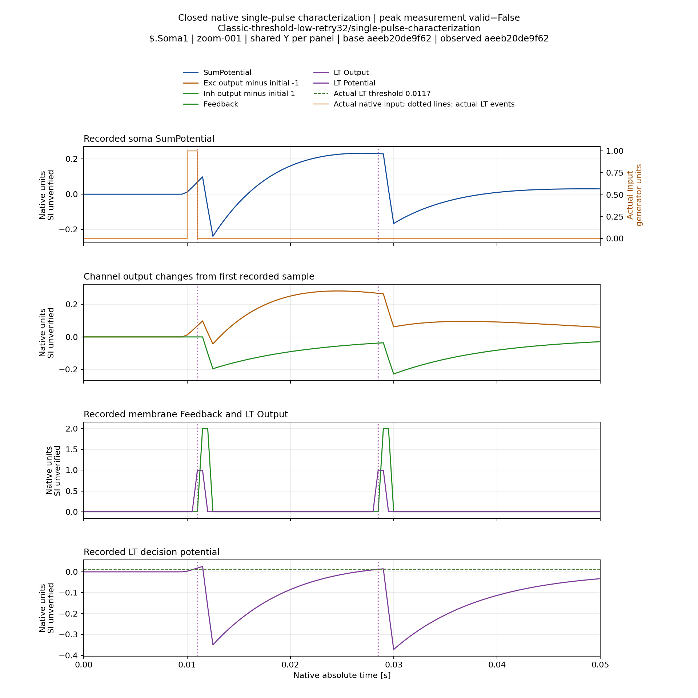
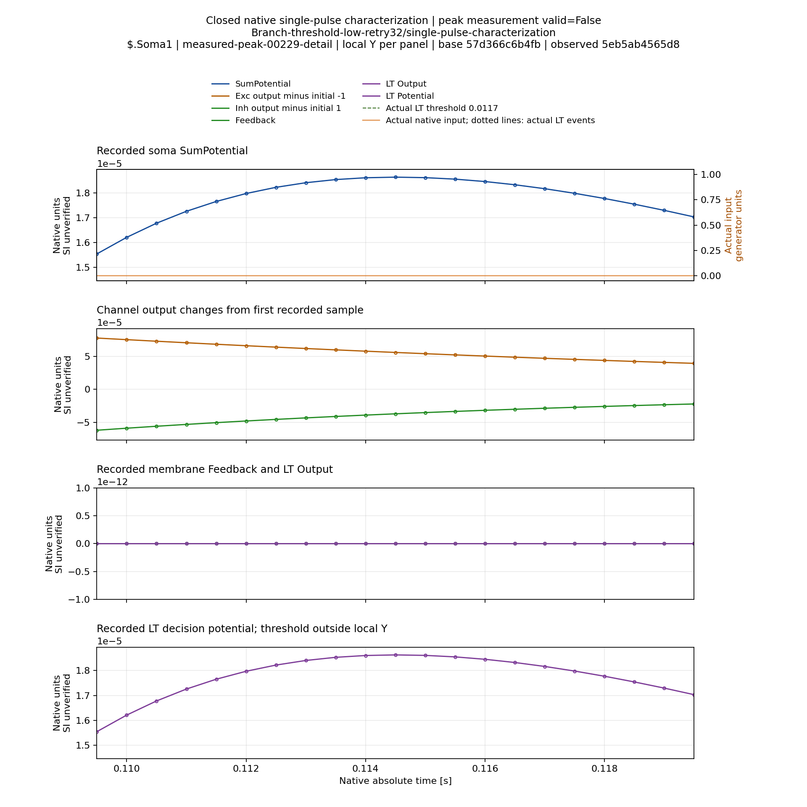

# Одноимпульсная характеристика неоднозначного отклика — 07.11.2026

**В двух фактических stock-моделях один входной импульс даёт несколько
положительных максимумов сомы.** Это наблюдение о работе измерителя и модели,
не успешное обучение и не оценка классификации.

## Условия и доказательства

[Приёмка](SinglePulseCharacterizationConsoleVerification.json): compiled
root5d0b80afeefbc5daa57d3ca5f550a5e654f07969 / Pulse302124bb3e8aaa412bc7ddacad8560cf427ac94b,
M40, четыре реальные Console пробы и42 Python tests без skips. Все472 members
primary и781 source hashes сверены с Git. Группа процессов закрыта, lease released;
предыдущие runtime не изменились. Primary commit
`bc1aa051ae46717e9a1e098e7872083aae28e290`, путь
`Reports/StructTrain/TimeLearner/s07-single-pulse-console-normal-m40-a1`.

Использованы точные Classic/Branch low/Retry stopped-state candidates,
совпадающие с первым invalid probe исходного Train. Это четыре физических
входа,2000Гц, исходный NSPNeuronGen, порог0.0117, без дополнительной LTMembrane.
Полная физическая модель, индивидуальные параметры, target, controller history
и порог перенесены штатным import и остаются неизменными. Classic записывает
все четыре сомы; Branch сохраняет solo physical selector2 и одну сому.
Selector2 в этой диагностике не означает pulse2: предъявляется pulse0.

Для каждой топологии выполнены исходная пачка и отдельное одноимпульсное
предъявление. Единственный фактический onset —0.01с; окно1.8с завершено,
3601 sample. Полная пачка повторила исходный Train; первые180 samples до
второго burst onset0.09с совпали с single-pulse по входу и всем сомам точно,
по относительному clock — с прежним roundoff. После0.09с предъявления различны.
Времена ниже отсчитываются от начала пробы; единицы потенциала — native,
соответствие SI отдельно не установлено.

## Измеренный отклик

| Модель/сома | Времена положительных максимумов, с | Амплитуды относительно native baseline | Реальные LT events, с |
|---|---|---|---|
|Classic Soma1|0.0115;0.027;0.0485|0.09811046173472382;0.23209749260986;0.03053042118556093|0.011;0.0285|
|Classic Soma2/3/4, каждая|0.0115|0.0017465044222303439|Общие события LT выше|
|Branch Soma1, physical input2|0.03;0.1145|0.011859327741041703;0.000018627355698463965|0.0295|

Минимальная амплитуда1e-6 сохранена. Задержки относительно единственного
входа: Classic0.0015/0.017/0.0385с; Branch0.02/0.1045с. Слабый второй
максимум Branch обнаружен уже после0.09с, когда второй импульс штатной пачки
отсутствует. Поэтому прежняя проверка только префикса до второго onset видела
у Branch один максимум и не описывала весь одноимпульсный отклик.

В обоих выбранных каналах полный isolated-window peak неоднозначен. Волны
полны и конечны; diagnostic waveform quality не превращается в training
certificate. LT timestamps записаны непосредственно компонентом, не выведены
из формы soma CSV. Feedback/Exc/Inh записаны тем же read-only observer.

## Что это меняет в алгоритмической постановке

Строгое соответствие «все положительные локальные максимумы = число входных
импульсов» не является общим свойством этих моделей. Простое увеличение
межимпульсного интервала само по себе не устраняет несколько максимумов
одного отклика. Это не доказывает заранее итог эксперимента с увеличенным ITI:
состояния каналов, перекрытие и спайковая обратная связь нелинейно зависят
от полного протокола.

Требуется определить измеряемый response feature и подтвердить его в штатной
пачке. Нельзя исправлять этот результат выбором крупнейших четырёх максимумов,
повышением minimum amplitude, изменением CapturedPerInput или молчаливым
подавлением LT. Одиночная характеристика помогает исследовать назначение
волн; она не подменяет Train/final verification.

Пока не выполнено контролируемое вмешательство в обратную связь/физику,
не приписываем все дополнительные максимумы одному конкретному механизму.
Совпадение с LT/Feedback и wiring в коде — основание гипотезы, не её полная
причинная проверка. Новые временные графики этого отдельного режима построены; избранные
рисунки проверены вручную, как указано ниже. Исторические августовские4/8–6/8 сохраняют прежнюю силу.

## Исправление подготовки заданий

На baseline rootb5cfae4 два обычных builder controls прошли, но явные
channel_diagnostics=False/True для обеих топологий дали четыре
worker_digest_mismatch. Причина — повторное включение старого корневого
sha256 в подписываемое тело. Исправление убирает только старый root hash
перед подписью; вложенные source hashes сохранены. Положительные toggle и
single-pulse controls входят в прошедшие42 tests. Negative controls теперь
используют правильную переподпись и проверяют действующий фактор.

ASan нового SDK, второй сервер, полный fault/profile scope, исправление
burst assignment, legacy/V2 A/B и независимая научная матрица остаются открытыми.

## Временные графики

[Проверка отчёта](SinglePulseCharacterizationVisualVerification.json): пять сом,
193 views,583 cache files/63197440B на M40. В Git сохранены19 metadata members,
сжатый архив metadata и четыре выбранных PNG общим размером925370B.
Полный cache находится в
`/media/user/Data/TimeLearnerRefactor/ReportsCache/single-pulse-joint-normal-a1`.

Каждая сома имеет полный обзор, непрерывные50мс окна с общим Y по панели и
отдельные детали максимумов с локальным Y и всеми native samples.
На общем Y слабый Branch максимум практически неразличим; для его анализа
обязательна локальная деталь. Её высоту на странице нельзя сравнивать с
высотой Classic на другом масштабе. [QA](SinglePulseCharacterizationSelectedVisualQA.json)
охватывает четыре выбранных рисунка, не весь cache.

Classic: один вход и два LT events в первом50мс окне:

Branch: разрешённый слабый второй максимум около0.1145с. В этом окне входов
и новых LT events нет; показаны все отсчёты и локальный масштаб:

