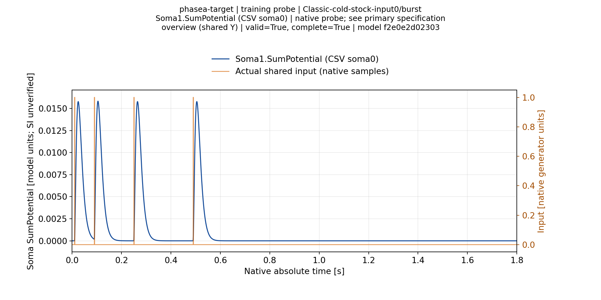
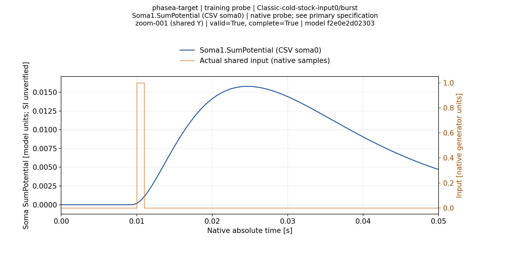

# Временные графики исходных stock N4 откликов — 11.11.2026

Построен полный временной комплект для8 fresh assigned-input проб Elder, независимо восстановленных из компактного Git-архива на M40. Это один target-паттерн из четырёх импульсов, четыре изолированных входа каждой топологии; не матрица классификации всех target/foil patterns и не результат завершённого обучения.

Все записанные сомы включены: Classic4пробы×4сомы и Branch4пробы×1сома,20пар. Полный кэш содержит960PNG,960SVG и960PDF: общий обзор0–1.8s, все последовательные50ms увеличенные участки и дополнительные явно отмеченные local-detail шкалы. PNG1920×960; native tick на основных zoom занимает14.208px, без прореживания samples. Шкала Y общая по соответствующей соме внутри топологии. Оранжевая линия — реальные входные samples, синяя — native soma SumPotential; SI единицы не подтверждены. Spike recording отключён, поэтому отсутствие маркеров не доказывает измеренное молчание.

Production reader заново проверил342/342archive members,8 primary JSON/CSV наблюдений, stock graph/assigned peaks и отрицательный контроль с повреждённым CSV. После восстановления8 redundant glog aliases проверены/опущены;334 original regular files сохранены. Проверки960PNG dimensions, полного набора SHA256 для всех форматов и общих шкал прошли. Вторая проверка использовала уже готовый неизменяемый кэш: [actual receipt](ValidationPlans/M40StockCold4CacheVerification-20261111/actual-result.json). Первый rendering job сохранил FAIL из-за list/tuple comparison в тесте; исходные данные и построенные изображения не переписаны. [Исходный отказ](ValidationPlans/M40StockCold4CrossRestoreReports-20261111/initial-report-verification-failure.jsonl).

В обратную сторону Elder независимо восстановил M40 archive и прошёл такой же data/corruption audit: [receipt](ValidationPlans/ElderStockCold4CrossRestore-20261111/actual-result.json). Это проверяет данные, не создаёт новую process authority и не является независимым случайным обучением.

## Выбранные виды для чтения

Все8 сохранённых PNG открыты и просмотрены вручную; полный кэш не имеет ручной визуальной приёмки. Обзоры показывают4 раздельные реакции. На zoom видно положение вершины относительно закреплённого импульса; для input0 пик0.0245s после onset0.01s, для input2 —0.2645s после onset0.25s.

| Топология/вход | Обзор | Увеличение |
|---|---|---|
|Classic input0|[overview](Figures/StockCold4-20261111/figures/Classic-cold-stock-input0/soma-001/overview.png)|[zoom-001](Figures/StockCold4-20261111/figures/Classic-cold-stock-input0/soma-001/zoom-001.png)|
|Classic input2|[overview](Figures/StockCold4-20261111/figures/Classic-cold-stock-input2/soma-001/overview.png)|[zoom-006](Figures/StockCold4-20261111/figures/Classic-cold-stock-input2/soma-001/zoom-006.png)|
|Branch input0|[overview](Figures/StockCold4-20261111/figures/Branch-cold-stock-input0/soma-001/overview.png)|[zoom-001](Figures/StockCold4-20261111/figures/Branch-cold-stock-input0/soma-001/zoom-001.png)|
|Branch input2|[overview](Figures/StockCold4-20261111/figures/Branch-cold-stock-input2/soma-001/overview.png)|[zoom-006](Figures/StockCold4-20261111/figures/Branch-cold-stock-input2/soma-001/zoom-006.png)|

Пример Classic, закреплённый импульс0:

[Hashes и scope ручной проверки](ValidationPlans/M40StockCold4CacheVerification-20261111/selected-visual-review.json). Полный восстанавливаемый кэш: `/media/user/Data/TimeLearnerRefactor/readbacks/s11-stock-cold4-cross-reader-m40-a1/worker/tmp/stock-cold-reports`. В Git хранятся lossless primary,8 selected PNG и manifests, не960полных графических видов. Воспроизведение выполняет `stock_cold_primary.render_result`, после `audit_result`; оригинальные primary находятся в `Reports/StructTrain/TimeLearner/StockCold4-20261111/{Elder,M40}`.

Дальнейшие cold Train имеют отдельные [отрицательные/незавершённые исходы](StockCold7MeasuredPilotOutcome-20261111.ru.md); эти начальные графики не подтверждают их сходимость. Матрица классификационных отчётов всех паттернов остаётся открытой.
