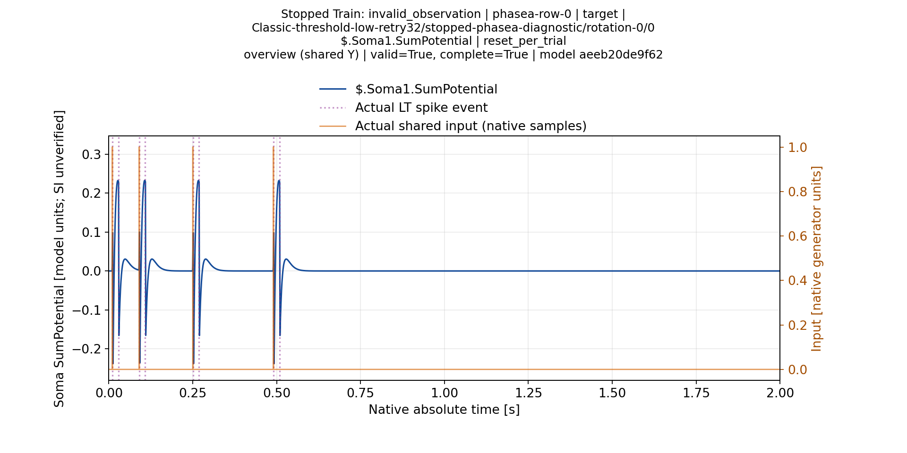
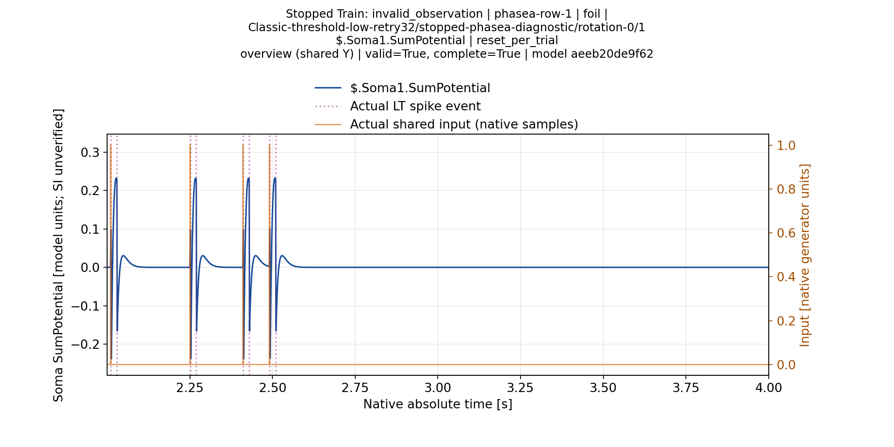
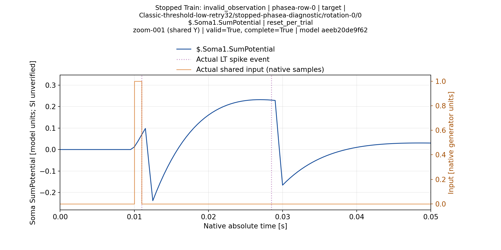
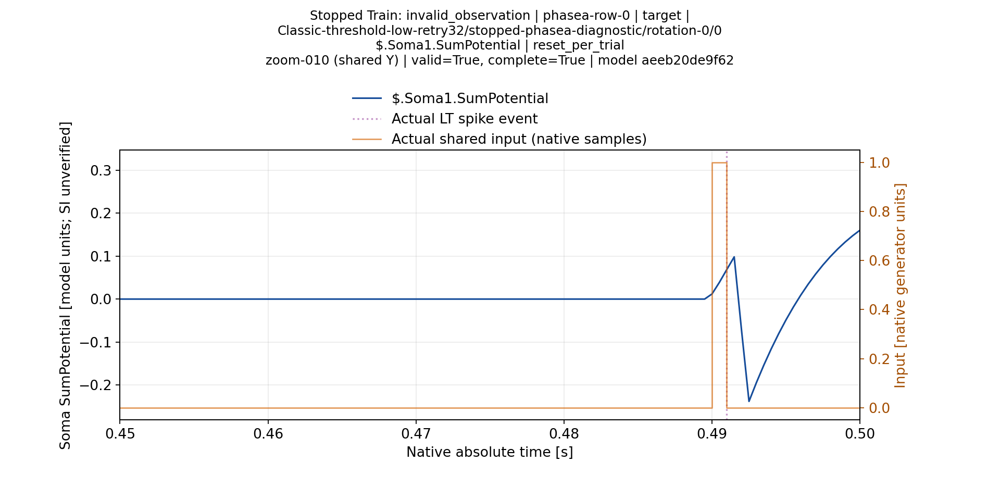

# Штатная модель: retry/advance и два порога, 06.11.2026

**Во всех восьми условиях обучение остановилось InvalidObservation без
сертификата. Ни одна диагностическая оценка не показала селективной
классификации.** Это отрицательный результат объявленного bounded протокола,
а не доказательство физической невозможности задачи.

## Условия и происхождение

Штатный NSPNeuronGen, без дополнительной LTMembrane; Classic/Branch, четыре
входа,2000Гц, N1, CapturedPerInput, опорный входN−1, ISI
[0.01,0.08,0.16,0.24]. Амплитудный допуск1e-5, relative0, SyncTolerance0.02.
C-trim/PostTune/калибровка выключены. Никаких произвольных XML overlays.

Восемь jobs фиксированы до первого native вызова: топология × threshold0.0117/100
× RetrySameCandidate/AdvanceUnassignedBurst. Обе политики имеют одинаковый
allowance32, bounds и остальные budgets. Advance меняет только явно объявленный
recovery mode; равенство прочих факторов проверено. Старые результаты с
allowance0 не выдаются за этот парный контроль. Все восемь cold preflight
подтвердили ожидаемый effective graph.

Compiled root84d6d97501a62b0a689b1170ec4f0fb53e558a48,
Pulse416e07c71b80e7e7a37cd213f8d0b6f7efb768fb. Train tool root
e83dc9c669d6fdc01b8d89e3a2cc5edd305ced4e, evaluation tool root
5d0ac867ac9786b5b6b846eec1cd5b2aae8a62c1. Один immutable runtime использован
для всех условий. Каждая фактическая stopped модель передана через native
полный diagnostic import; шаблонный Test не подставлялся.

## Измеренные диагностические ответы

Каждая строка — все8 паттернов исторической PhaseA матрицы, новая оценка
reset-per-trial, полное2с окно, target в одной позиции, inherited fixed threshold.
Это не исторический scheduler/ITI и не independent evaluation. Все64 окна
завершены; модель до и после frozen probes совпала.

| Топология | Threshold | Политика | Train | TP | FP | FN | TN |
|---|---:|---|---|---:|---:|---:|---:|
|Classic|0.0117|retry|InvalidObservation|1|7|0|0|
|Classic|0.0117|advance|InvalidObservation|1|7|0|0|
|Classic|100|retry|InvalidObservation|0|0|1|7|
|Classic|100|advance|InvalidObservation|0|0|1|7|
|Branch|0.0117|retry|InvalidObservation|1|7|0|0|
|Branch|0.0117|advance|InvalidObservation|1|7|0|0|
|Branch|100|retry|InvalidObservation|0|0|1|7|
|Branch|100|advance|InvalidObservation|0|0|1|7|

При низком пороге отвечают target и все foils. При100 модель молчит; значение
7/8 accuracy здесь выражает семь true-negative молчаний и один пропущенный
target, а не успешную детекцию. Порог100 был задан для обучения, не подбирался
как recognition threshold. Эти два значения не являются threshold sweep и не
доказывают NonSeparable для всей возможной сетки.

## Что проверено алгоритмически

Advance реально выполнял переходы к новым кандидатам, сохранял typed recovery
journal и оставлял исходные missing/ambiguous пробы невалидными. Для первых
завершённых advance случаев записаны33 события, последнее invalid_budget_stop:
32 разрешённых восстановления и следующее наблюдение, завершившее попытку.
Наличие33 отказов не означает33 разрешённых повторов сверх allowance32.
Финальный сертификат не был создан, текущая геометрия не объявлена feasible.

Само продвижение кандидатов не устранило неоднозначность измерения в этих
условиях. Различный путь поиска не дал различий в pooled spike counts внутри
пары. Это не доказывает равенство waveforms, выученной геометрии или алгоритмов.
Нельзя заключить, что достаточно просто увеличить budget, либо что никакое
обучение в исходной физике невозможно. Для дальнейшего изменения алгоритма
нужен анализ измеренных окон, причин missing/ambiguous и покрытия кандидатов.

## Доступные первичные данные и ограничения отчёта

[Train verification](StockRecoveryNativeVerification.json):8 Train/8 preflight,
16 run manifests,3455 retained primary files,27953456 compressed bytes;
evidence da57d3cb10826843790b193e93cdcb380fa7f0fc.

[Evaluation verification](StockRecoveryEvaluationVerification.json):64 trials,
6564 retained primary files,60567368 compressed bytes;
evidence8ca095726d811a6797bbd82671987635f9b7da53. Включены фактические модели,
CSV/наблюдения, stimulus timestamps, конфигурации, метрики и process/runtime
records. Каждый архив и source hash сверены. Только доказанные duplicate glog
aliases исключены из отдельных canonical copies; original archives не изменены.

Первый render остановился на отсутствующем matplotlib. Render-only retry идёт
в существующем plot-venv, отдельный cache M40 Data, без новых расчётов модели.
Планируются все160 trial/soma pairs с наложенными импульсами и100-tick zooms.
Пока не закончены render и visual QA, этот документ является читаемым численным
отчётом с доступными primary, но **не окончательным визуальным отчётом**.

Ни эти восемь остановок, ни диагностические responses не отменяют визуально
подтверждённые августовские4/8–6/8 при их исходном протоколе. Перестановки,
увеличенный ITI, независимая оценка, legacy/V2 сравнение и вся физическая/режимная
матрица остаются открытыми. СерияD не возобновлялась. Цель полного рефакторинга
не завершена;8/8 не является условием его успеха.

## Первые проверенные временные графики

[Реестр visual QA](StockRecoverySelectedVisualQA.json): просмотрены4 исходных PNG
первой Classic-low-retry модели, Soma1. Все подписи читаемы, реальный вход
наложен на график, overview содержит полное2с окно. Zoom50мс даёт минимум
14.208 pixels на native tick, без downsampling. Единицы сомы помечены как
model units/SI unverified. На просмотренных target/foil видно повторение ответа
вслед за отдельными импульсами; это наблюдение согласуется с диагностическим FP7,
но не устанавливает причину и не распространяется автоматически на другие сомы.

Последнее zoom-окно заканчивается во время ответа: продолжение находится
в соседних окнах и overview. Эти четыре PNG не заменяют160 trial/soma pairs,
весь eight-model render или полную визуальную приёмку.

[Проверенный аудит покрытия поиска](SearchCoverageReview.ru.md) уточняет предел
отрицательного результата. Classic-low advance исследовал лишь две geometry
groups, Classic-high — пять; Branch-low — пять, Branch-high —31. Во всех случаях
измеренные кандидаты относятся только к первому обучаемому входу. Поэтому
никакого полного перебора L1..100/Rs или недостижимости цели этими остановками
не доказано. Изменение очередности domains остаётся отдельным проверяемым
алгоритмическим подэтапом; исходные результаты не переписываются.
