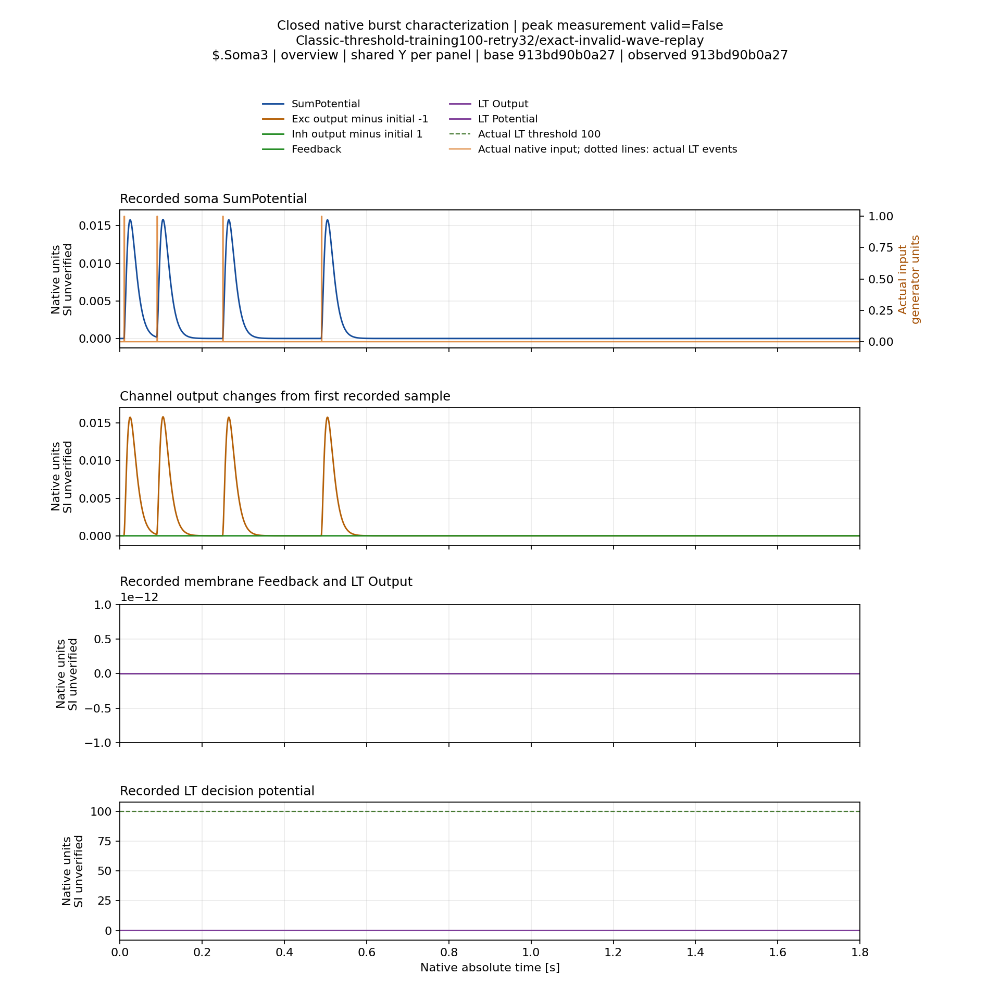
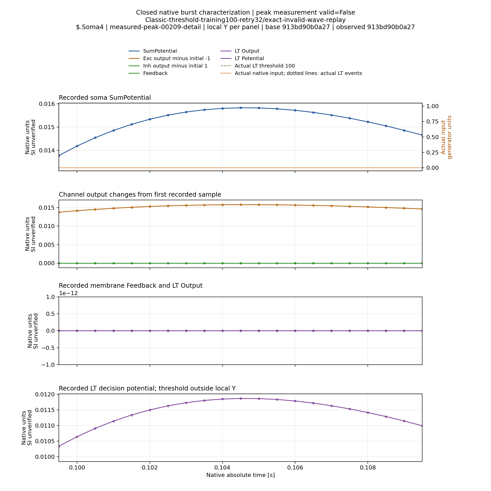

# Наложение откликов и выбор закреплённого пика — 07.11.2026

На сохранённых high-threshold состояниях форма штатной пачки очень близка к
сумме сдвинутых одиночных откликов. Для Classic/Soma1 максимальная разность
составила `8.959954678200432e-8`, для Branch/Soma1 — `1.6889238607653567e-7`
native units. Предсказанная сумма также имеет три локальных максимума при
четырёх импульсах. Это количественная проверка гипотезы наложения для двух
конкретных состояний, не доказательство линейности всей физики.

Одновременно подтверждено: **максимум всей пачки нельзя подставлять вместо
максимума закреплённого импульса в Train**. У Classic/Soma4 глобальный максимум
в `0.1045 с`, тогда как закреплённый pulse3 предъявлен в `0.49 с`.
Предшествующий пик причинно не может быть откликом этого ещё не поданного
импульса. Для Test общий максимум остаётся характеристикой всего паттерна;
реальные spikes и late responses оцениваются отдельно.

## Условия и метод

Повторно анализировались четыре уже выполненные native пробы: burst и single
для Classic и Branch из [high-threshold отчёта](HighThresholdSinglePulseScientificReport-2026-11-07.ru.md).
Порог100, исходная stock-физика, reset, структура и параметры не менялись.
Новых Train, Test, native calculations, threshold/gain/ISI/ITI изменений нет.
Графы initial-state у каждой пары одинаковы, effective routing/model revisions
сверены, полные trace прошли штатные readers и run-manifest audit.

Все записи имеют3601 samples на1.8с при2000Гц. Actual onsets —0.01,0.09,0.25,
0.49с. Использованы сдвиги0/160/480/960 native ticks. Из одиночного отклика
вычтен объявленный native baseline, затем сложены его четыре сдвинутые копии.
Для отрицательных индексов берётся baseline. Интерполяции, подбора задержки,
масштаба амплитуды или формы не было. Сумма сдвинутых одиночных входных сигналов
побитово совпала с actual burst stimulus. Clock allowance относится только к
binary64 арифметике; SyncTolerance и amplitude tolerance не менялись.

| Сома | Наибольший burst peak, с / амплитуда | Максимальный абсолютный остаток | Остаток / наибольшая абсолютная измеренная амплитуда |
|---|---|---:|---:|
|Classic Soma1|0.573 /0.004504819155902173|8.959954678200432e-8|1.9889710037441083e-5|
|Classic Soma2/3/4, каждая|0.1045 /0.015828572406203167|5.719986625463136e-7|3.613709738738973e-5|
|Branch Soma1|0.223 /0.006103650024966156|1.6889238607653567e-7|2.7670719223039358e-5|

У Classic/Soma1 измеренные и предсказанные времена максимумов одинаковы:
0.573/0.733/1.005с. У Branch/Soma1 —0.223/0.3965/0.637с. У остальных трёх
Classic somas видны четыре раздельных максимума. Максимум isolated pulse0
Classic/Soma1 находится в0.5275с, Branch/Soma1 —0.157с. Время максимума пачки
отличается: нельзя безусловно отождествлять эти response features.

## Почему это пока не разрешение на декомпозицию Train

`NPSynapseBio` и `NPExcChannelBio` — storage-образы `NPulseSynapse` и
`NPulseChannel`, а не отдельные C++ реализации. Проверены
`Core/NPulseLibrary.cpp`, `NPulseSynapse.cpp::ACalculate2` и
`NPulseChannel.cpp::ACalculate2` в PulseLib
`bedf249738d992961674b9c3bdfe9db88a11fcee` (Core совпадает с compiled1f97).

У синапса коэффициент изменения PreOutput различается при наличии импульса
и при его отсутствии. Даже без PSI это не основание объявить произвольную
последовательность суммой независимых импульсных характеристик. Канал вычисляет
`Ti=C/(G+1/R)` и `sum_u=1+G*R`, затем обновляет output через
`(channel_input-output*sum_u)/(Ti*frequency)`. Поэтому G влияет не только на
возбуждение, но и на динамику; присутствуют условный выбор R и feedback.
У других storage-профилей могут отличаться все эти условия.

Малый наблюдённый остаток не доказывает единственность разложения на вклады
конкретных импульсов. Шаблон pulse0, сдвинутый ко времени pulse3, сам по себе
не является измерением pulse3 в полном burst. Поэтому этот анализ не выдаёт
TrainingCertificate, не изменяет references, не переоценивает старые
InvalidObservation в Exact и не заменяет обучение одиночной пробой.

Для исправления этапа7 нужно отдельно обосновать и проверить способ
идентификации закреплённого отклика, затем выбирать его наибольший максимум
после закрытия окна. Число локальных максимумов — диагностический признак,
а не универсальное доказательство наличия/отсутствия всех вкладов.
Критерий полного waveform residual полезен для проверки гипотезы, но его
нельзя молча превратить в новый критерий сходимости вместо CapturedPerInput.

## Визуальный counterexample: Classic Soma4

Ниже reused native figures из уже проверенного полного temporal cache.
Видны четыре фактических входа и четыре быстрых отклика. По данным CSV
наибольший — второй, около0.1045с. Закреплённому pulse3 соответствует
предъявление0.49с; после него наблюдается локальный максимум около0.5045с.
Это запись дополнительной сомы того же frozen probe, не новый Train input3.
Header `peak measurement valid=False` относится к исходному training packet;
его нельзя читать как отдельный отказ измерения Soma4.

Оба1920×1920 PNG просмотрены отдельно. Overview показывает полный протокол;
10мс detail позволяет различить каждый timestep без downsampling. Порог100
явно обозначен вне local Y-range detail. Потенциал LTZone — отдельный сигнал,
не потенциал одной Soma4. Полный cache вручную заново не просматривался.
При первичной выборке было неверно прочитано имя каталога soma-003 как zero-based
индекс Soma4. До приёмки выборка исправлена на фактический soma-004 отдельным
commit; прежний commit и запись исправления сохранены. Численный анализ не
менялся.

## Проверка и публикация

Production analysis: root`9ab6784d7bca3ca2873225be742a1b68727c6215`,
`Scripts/StructTrain/TimeLearner/superposition_diagnostic.py`. На M40 прошли
четыре arithmetic/refusal tests без skips; затем разобраны обе реальные пары
и все пять записанных soma channels. Group closed, lease released.

Primary commit`cb0982122952ebd13c8a53089db418d4d1b339b9`; исправленная выборка
рисунков`97f7282f852c9da1785a13733247f499d646a95b`.
[Compact bundle](../../../Reports/StructTrain/TimeLearner/s07-superposition-diagnostic-m40-a1/bundle.json):
13 members,207492 compressed bytes, SHA256
`3705c1ab7658c9be64cf690d1653962e6d8a13e52b9c806cd03cfe0642eaf994`.
Он включает полные comparison CSV observed/predicted/residual для всех сом,
analysis, tests, worker и source bindings. В source Git дополнительно только
два выбранных PNG,466597 bytes; новых полных наборов рисунков не создавалось.

[Независимая проверка](SuperpositionDiagnosticVerification.json) сверила все13
members,379 tool hashes и12 input bindings с опубликованными native primary
commits. Оба PNG совпали с исходными render checksums из commit8bc32a4.
[Visual QA](SuperpositionDiagnosticVisualQA.json). Локальные операции — только
Git/archive/hash/PNG metadata и просмотр; научный расчёт выполнен на M40.
Новый native SDK, второй host, вся physics/N0/N1 матрица и итоговая
классификация этим подэтапом не проверялись.
