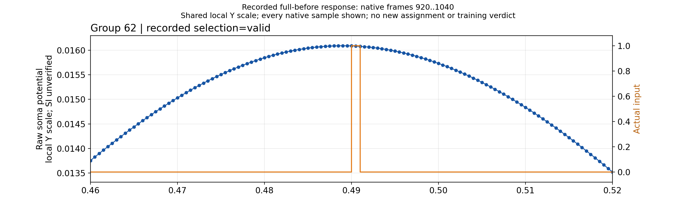
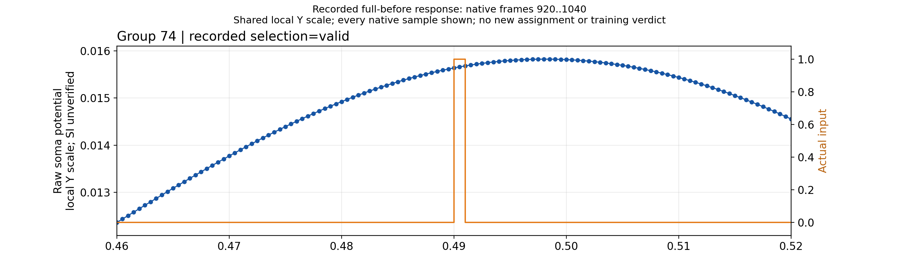

# Два крупных вида назначенного пика приняты

M40: production1/1 PASS, outer completed238.27467993972823с, группа процессов закрыта. Оба PNG2800×800 просмотрены:121 native sample, frames920..1040,0.46..0.52с от начала собственной пробы, без downsampling; minimum8px/tick. Y local отдельно для before и after: сравнивать числовые оси. Надпись full-before означает пробу до omission внутри каждой группы, а не старую версию алгоритма.

Before group62: maximum frame978, raw0.01608944232254117; after group74: frame996, raw0.01582675976754666. Group binding проверен к лучшему фактически измеренному timing-ready кандидату каждой модели; production audit проверяет package7/summary и полный CSV. Новых Train/Probe/Test, изменения принадлежности пика либо допуска нет. Оба исхода budget_exhausted,0 jointly-ready, certificate=null.

[Before manifest](completed/worker/tmp/N0-geometry-before-peak-focus/manifest.json), [after manifest](completed/worker/tmp/N0-geometry-after-peak-focus/manifest.json), [unit](completed/worker/validation/result.json), [integrity](integrity.json). Literal producer 7e2aa70d75a9f5f515f1513a3f3e8be21a260780, pack SHA256 cc8f39ac59e86819f3ee0f581eaa536a6840a17fc4c956a09e10cefd54f432fc. Полные omission controls — в [научном отчёте](../../N0GeometryPhysicalScientificReport-20261114.ru.md); single full-before не заменяет их.
