# Реакции остановленных stock-моделей на восемь паттернов

Это диагностический отчёт по четырём сохранённым моделям с незавершённым Train (`invalid_observation`). Сертификата обучения нет. Калибровки и нового обучения не выполняли; проверка не является независимым Test обученного классификатора.

Физика: stock `NSPNeuronGen` с четырьмя входами, **без LTMembrane**. В каждом случае восемь полных двухсекундных проб с `reset_per_trial`: target в позиции0 и семь foil. Матрица временных векторов историческая, но весь августовский протокол и состояние не воспроизводились; его4/8–6/8 этим опытом не отменяются.

| Модель | Фиксированный порог | TP | FP | FN | TN |
|---|---:|---:|---:|---:|---:|
| Classic-threshold-low | 0.0117 | 1 | 7 | 0 | 0 |
| Classic-threshold-training100 | 100.0 | 0 | 0 | 1 | 7 |
| Branch-threshold-low | 0.0117 | 1 | 7 | 0 | 0 |
| Branch-threshold-training100 | 100.0 | 0 | 0 | 1 | 7 |

Низкий порог даёт ответы на все восемь паттернов, включая семь ложных. При пороге100 выходных событий нет и target пропущен. Семь корректных молчаний на foil не означают успешное распознавание. Это наблюдение именно этих остановленных моделей; оно не доказывает общую несостоятельность алгоритма или физической модели.

## Как читать графики

Синяя линия — фактический `Soma.SumPotential`, оранжевая — реально предъявленные входные импульсы с собственной правой шкалой. Фиолетовый пунктир — реальные события LTZone; надпись **LT spike event не обозначает LTMembrane**. Единицы потенциала оставлены модельными: перевод в SI пока не подтверждён. Время — абсолютные часы модели; разные пробы не наложены друг на друга.

Размер1920×960. Overview охватывает всё окно; увеличенные участки показывают100 native ticks (не менее14.208 горизонтальных пикселей на tick). Частота данных не уменьшена. Shared Y одинаков внутри соответствующего отчёта модели, local detail явно меняет масштаб амплитуды. Деталь Classic-training100 около1e-11 показывает малый хвост, а не большой ответ; сопоставляйте её с общим видом. В zoom, не содержащем импульса, вход закономерно остаётся нулевым.

## Выбранные изображения

В Git сохранены20 просмотренных PNG: все восемь Classic-low soma1 обзоров, target/foil для остальных трёх случаев, четыре peak zoom и две local-Y детали. Полные графики всех32 проб и80 trial-soma pairs находятся в воспроизводимом кэше M40. Полный кэш вручную не просматривался.

### Classic-threshold-low-row0-soma1-overview

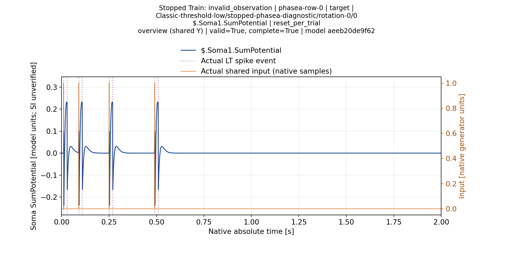

### Classic-threshold-low-row1-soma1-overview

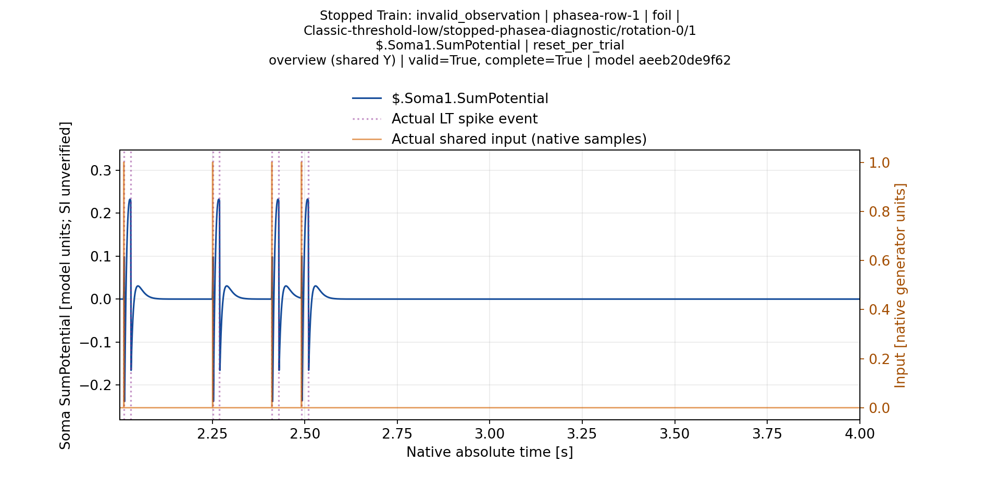

### Classic-threshold-low-row2-soma1-overview

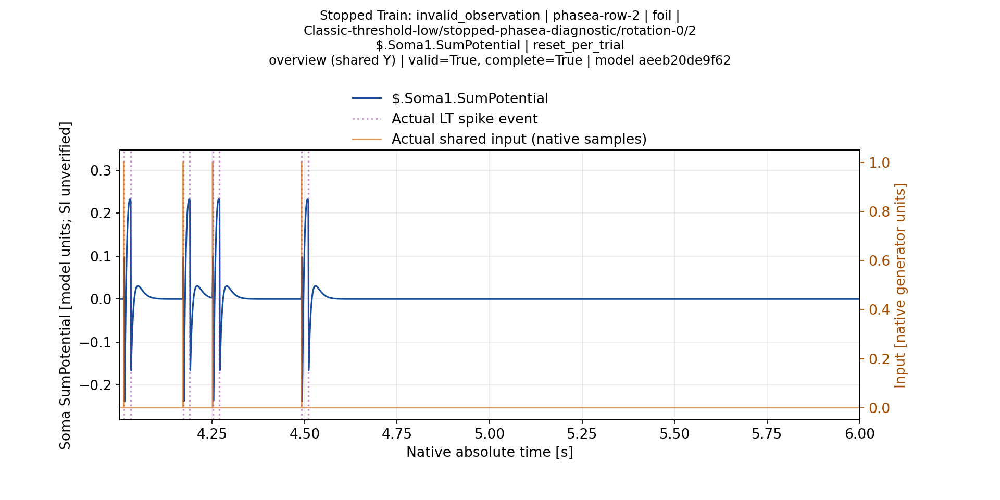

### Classic-threshold-low-row3-soma1-overview

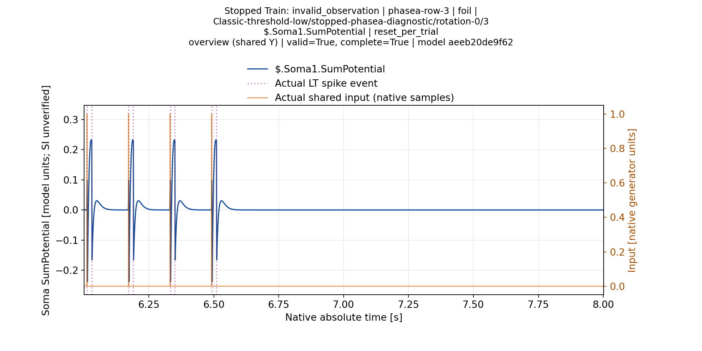

### Classic-threshold-low-row4-soma1-overview

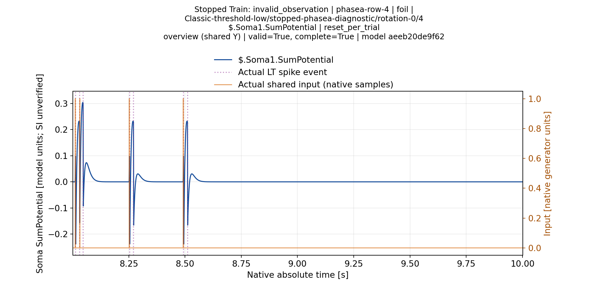

### Classic-threshold-low-row5-soma1-overview

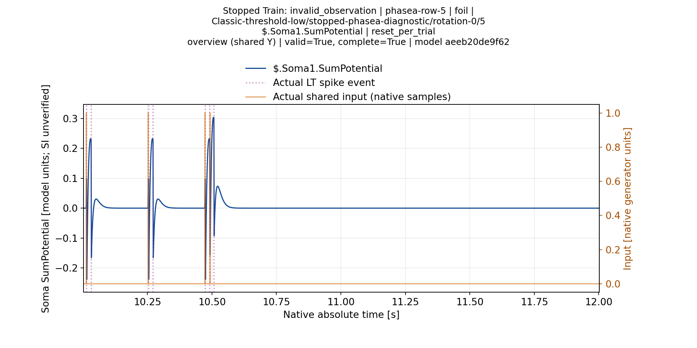

### Classic-threshold-low-row6-soma1-overview

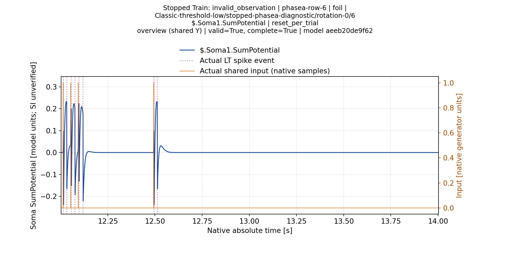

### Classic-threshold-low-row7-soma1-overview

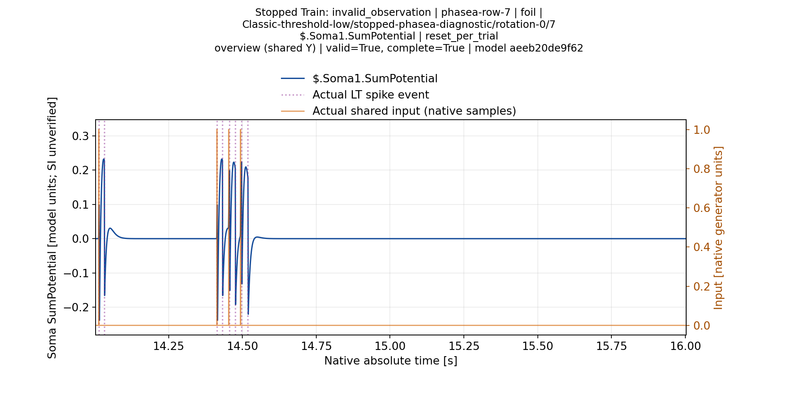

### Classic-threshold-low-target-peak-zoom

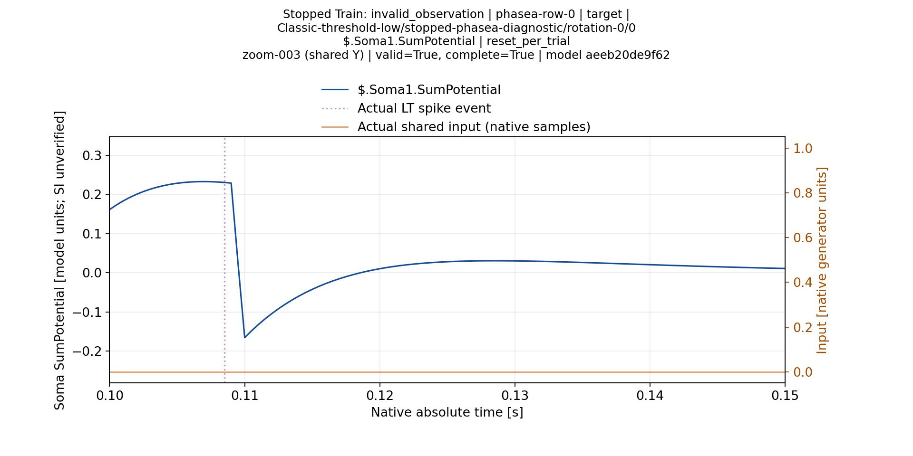

### Classic-threshold-training100-row0-soma1-overview

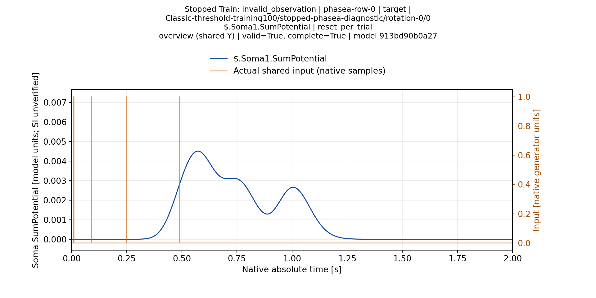

### Classic-threshold-training100-row1-soma1-overview

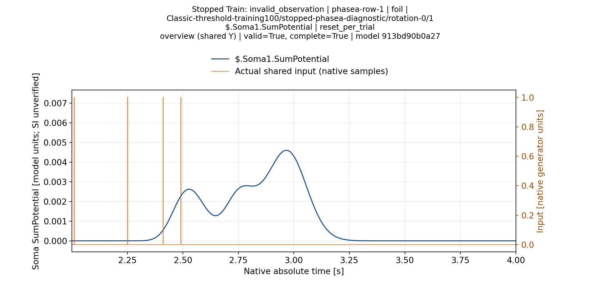

### Classic-threshold-training100-target-peak-zoom

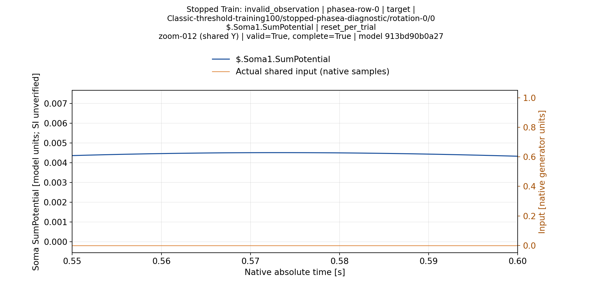

### Classic-threshold-training100-target-local-detail

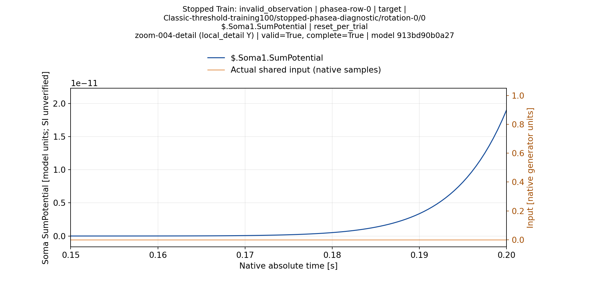

### Branch-threshold-low-row0-soma1-overview

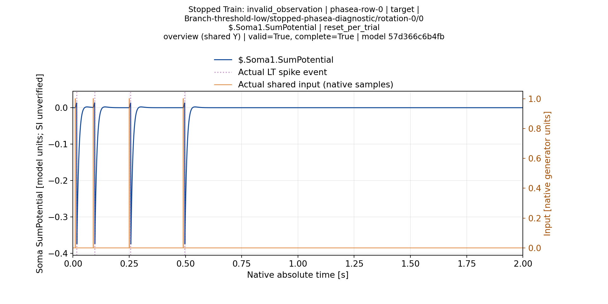

### Branch-threshold-low-row1-soma1-overview

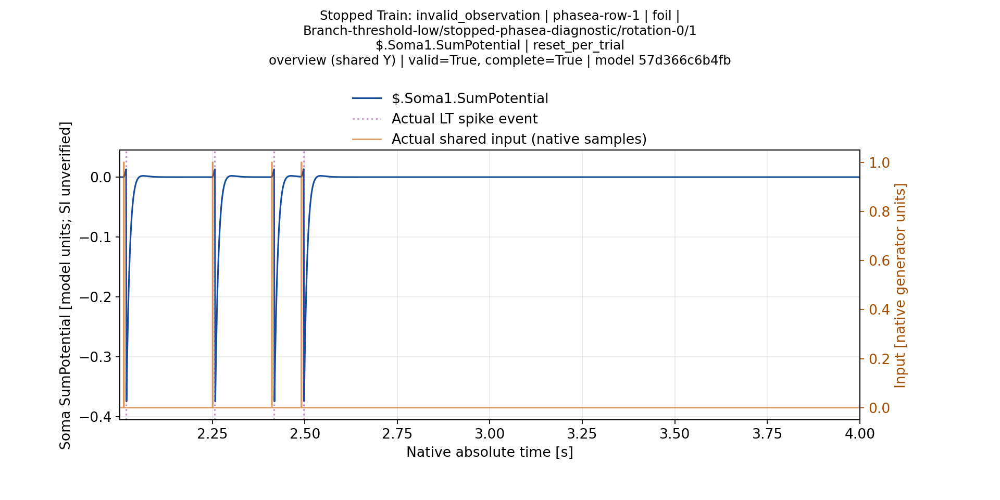

### Branch-threshold-low-target-peak-zoom

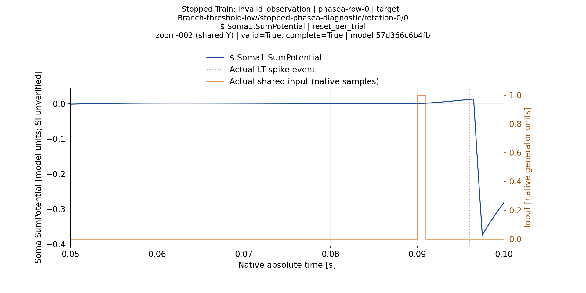

### Branch-threshold-low-target-local-detail

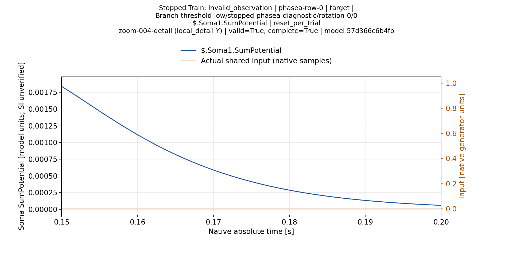

### Branch-threshold-training100-row0-soma1-overview

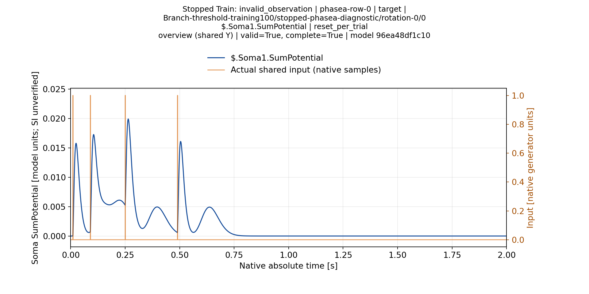

### Branch-threshold-training100-row1-soma1-overview

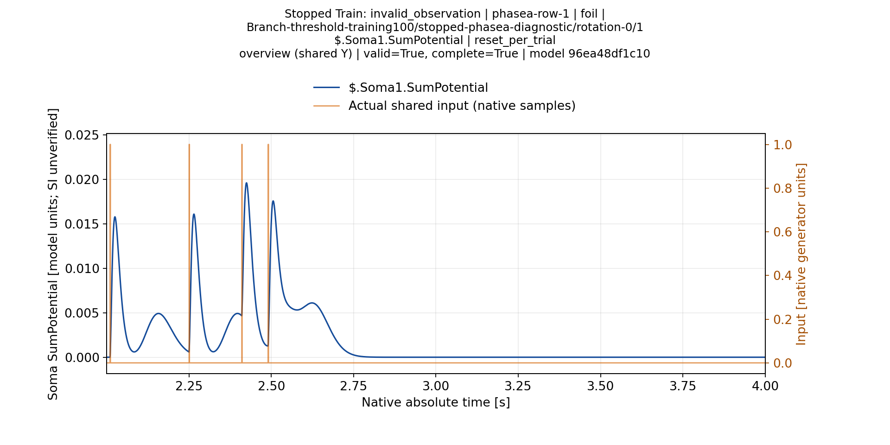

### Branch-threshold-training100-target-peak-zoom

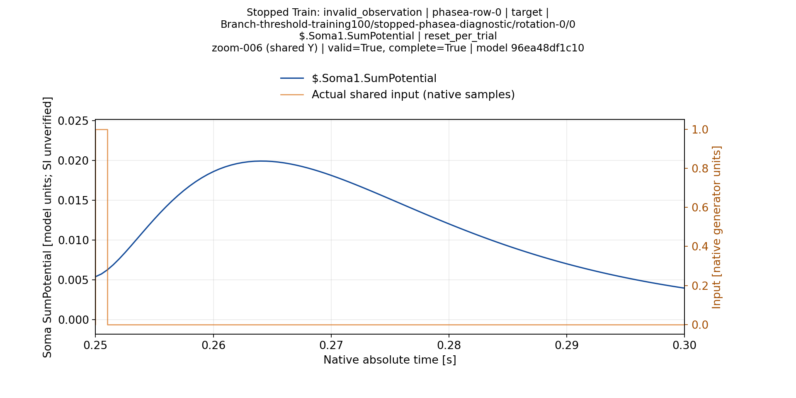

## Воспроизведение и доказательства

Renderer root `43b2fbf7bae735d028f73690eeb5f2c245fbe4ef`; primary proof `c8381cfc3ecbf446ae1f59175c794ef547dcc93d`; report proof `d262170b3c5665ecce3fd55c9e9277fcf204b7f3`. Все2684 исходных файла на M40 сравнены с Git побайтно. Шесть plotting controls и три production report readers прошли. Верифицированы40 metadata members,414 source hashes, все20 PNG и inventories всех4450 trial-soma views; ещё30 PNG относятся к series views.

Кэш: `/media/user/Data/TimeLearnerRefactor/readbacks/s11-stock-stopped-phasea-visual-a4/full-report-cache` (14728 файлов). Полные PNG/SVG/PDF в Git не дублируются. Первичные данные и модели доступны в сжатом архиве `Reports/StructTrain/TimeLearner/s11-stock-stopped-phasea-normal-a3/primary.tar.xz` указанного data commit. После проверенной распаковки полная генерация выполняется штатной командой:

```
python -m Scripts.StructTrain.TimeLearner stock-stopped-evaluation report PRIMARY_DIRECTORY/evaluation --output NEW_M40_CACHE_DIRECTORY
```

[Независимая проверка](../../../../Docs/StructTrain/TimeLearner/StockStoppedTemporalReportVerification.json) · [Визуальная приёмка выбранных20](../../../../Docs/StructTrain/TimeLearner/StockStoppedTemporalSelectedVisualQA.json).
